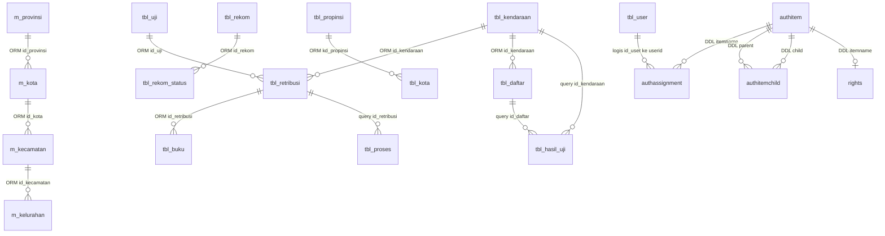

# Database Architecture dan ERD

> Tanggal analisis: 14 Oktober 2026. Metode: pemeriksaan statis repository; bukan hasil pengujian terhadap database/server produksi. **Terbukti** berarti ada implementasi di kode; **inferensi** berarti disimpulkan dari pemakaian; **rekomendasi** berarti perubahan yang belum diimplementasikan. Contoh data bersifat sintetis. Nilai kredensial sengaja tidak disalin.

Dokumen terkait: [PRD](PRD.md) · [Arsitektur](TECH_SPEC.md) · [Database](DATABASE_SCHEMA.md) · [Kontrak endpoint](API_CONTRACT.md) · [UI/UX](UI_UX_GUIDELINES.md).

**Daftar isi**

- [1. Sumber kebenaran dan tingkat kepastian](#1-sumber-kebenaran-dan-tingkat-kepastian)
- [2. Domain data](#2-domain-data)
- [3. ERD logis](#3-erd-logis)
- [4. DDL yang benar-benar disertakan](#4-ddl-yang-benar-benar-disertakan)
- [5. View, stored function, dan dependensi tersembunyi](#5-view-stored-function-dan-dependensi-tersembunyi)
- [6. Indexing dan kinerja](#6-indexing-dan-kinerja)
- [7. Prosedur melengkapi schema aktual (read-only)](#7-prosedur-melengkapi-schema-aktual-read-only)
- [8. Katalog model dan kamus atribut](#8-katalog-model-dan-kamus-atribut)
- [9. Dependensi query di luar mapping ORM](#9-dependensi-query-di-luar-mapping-orm)

## 1. Sumber kebenaran dan tingkat kepastian

Database aktif adalah **PostgreSQL `db_pkb`**, berdasarkan `protected/config/database.php`. Konfigurasi `dbcoba` menunjuk `db_pkb_coba`. File `database_mysql.php` tidak diaktifkan. Nama file `schema.mysql.sql`/`schema.sqlite.sql` pada `protected/data` berasal dari scaffold Yii: hanya mendefinisikan `tbl_user(id, username, password, email)` dan akun contoh. Model operasional `TblUser` memakai `id_user`, `otoritas`, flag stasiun dan kolom lainnya; skema contoh tersebut **tidak cocok** dengan aplikasi aktif.

| Bukti | Yang dapat dinyatakan | Yang tidak dapat dinyatakan |
|---|---|---|
| SQL CREATE TABLE | Tipe SQL, PK/FK/index pada file tersebut | Bahwa skema sudah dipasang pada server aktif |
| `tableName`, `primaryKey`, `relations` | Mapping ORM dan kunci yang dideklarasikan model | Constraint fisik DB atau integritas seluruh data |
| PHPDoc `@property` | Nama atribut dan tipe PHP yang didokumentasikan | Tipe SQL, precision, nullable, default aktual |
| `rules()` | Validasi ActiveRecord pada skenario terkait | Validasi query raw yang melewati model |
| Raw query/controller | Objek/kolom yang dirujuk dan hubungan logis | Definisi lengkap view, fungsi, trigger dan semua indeks |

Lampiran memuat seluruh mapping model yang tersedia, termasuk view dan model form. **Tipe SQL yang tidak tersedia dinyatakan belum terverifikasi**, tidak direka dari nama atau tipe PHP. PHPDoc dapat tertinggal; atribut dalam rules/labels dapat memperluas inventaris, tetapi tidak menggantikan introspeksi DB.

## 2. Domain data

| Kelompok | Objek utama | Fungsi |
|---|---|---|
| Kendaraan | `tbl_kendaraan`, `tbl_riwayat`, `tbl_jns_kend`, merek/tipe/karoseri | Identitas, pemilik, spesifikasi, histori |
| Pendaftaran | `tbl_retribusi`, `tbl_daftar`, `tbl_proses`, `tbl_uji` | Administrasi uji, kedatangan dan petugas tiap tahap |
| Hasil pemeriksaan | `tbl_hasil_uji`, `tbl_temp_*`, `tbl_kelulusan`, `tbl_list_kelulusan`, `tbl_indikator` | Nilai, status proses/lulus, detail temuan |
| Buku/rekomendasi | `tbl_buku`, `tbl_req_bukuuji`, `tbl_rekom`, `tbl_rekom_status`, `tbl_ttd` | Penerbitan, nomor seri, persetujuan |
| Pendapatan | `tbl_lap_pad`, `v_lap_pad`, `tbl_biaya` | Rekap dan komponen biaya; rumus DB tidak tersedia |
| Referensi wilayah | `m_provinsi`, `m_kota`, `m_kecamatan`, `m_kelurahan`, keluarga `tbl_*` wilayah | Beberapa generasi master wilayah |
| Referensi Kemenhub | `master_data*`, `master_variandata` | Jenis, merek, varian, bahan bakar, wilayah, pegawai |
| Akun/hak/menu | `tbl_user`, `authitem`, `authitemchild`, `authassignment`, `rights`, `tbl_menu`, `YiiSession` | Login, permission, menu dinamis, sesi |
| Survei | `tbl_ikm`, `tbl_ikm_question` | Jawaban layanan dan pertanyaan |
| Integrasi/alternatif | `outbox`, `coba`, `datapengujian`, `fotomentah`, `penguji`, dan lainnya | Verifikasi pemakaian tiap jalur sebelum migrasi/penghapusan |

Objek berawalan `v_` diperlakukan sebagai view berdasarkan konvensi model/pemakaian; jenis fisiknya tetap perlu dikonfirmasi. `VValidasi` dan `VValidasi_1` memetakan objek yang sama, demikian pula dua file `VKementrianKbwu` dan model rekomendasi alternatif. Jangan menjumlah model sebagai jumlah tabel unik.

## 3. ERD logis



Cardinality menggambarkan relasi ORM/logis. Tanpa unique constraint/DDL domain, jangan menyimpulkan satu pendaftaran pasti hanya memiliki satu hasil atau satu rekomendasi hanya satu status. Relasi user–role adalah many-to-many melalui assignment; FK `authassignment.userid → tbl_user.id_user` tidak dinyatakan dalam DDL Rights yang tersedia.

### 3.1 Relasi yang memerlukan audit

- `TblRetribusi.typekendaraan_rel` memakai `BELONGS_TO TblType` dengan foreign-key attribute `id_kendaraan`, bukan nama tipe yang lazim. Itu isi kode; target PK aktual harus dicek sebelum perbaikan.
- `VVerifikasi.retribusi_rel` memakai `id_kendaraan` untuk `BELONGS_TO TblRetribusi`, sedangkan model retribusi mendeklarasikan PK `id_retribusi`. Ini berpotensi menghasilkan relasi yang salah.
- `Authassignment.itemname0` menunjuk class `Authitem`; file class model dengan nama tersebut tidak ditemukan dalam model aplikasi. Rights memakai mekanisme auth manager terpisah.
- `User/Profile` pada modul nonaktif mempunyai hubungan profil tersendiri dan menggunakan tabel plural `tbl_users`, bukan `tbl_user` operasional.

## 4. DDL yang benar-benar disertakan

### 4.1 Scaffold akun, bukan skema produksi

| Kolom `protected/data/schema.mysql.sql:tbl_user` | Tipe | Constraint |
|---|---|---|
| `id` | INTEGER | PK, NOT NULL, AUTO_INCREMENT |
| `username` | VARCHAR(128) | NOT NULL |
| `password` | VARCHAR(128) | NOT NULL |
| `email` | VARCHAR(128) | NOT NULL |

Varian SQLite memakai AUTOINCREMENT. Keduanya memasukkan 21 akun contoh dengan password teks biasa. Jangan memakainya sebagai seed produksi atau menganggap skema tersebut cocok dengan `TblUser`.

### 4.2 Rights

Sumber `protected/modules/rights/data/schema.sql` dan `schema1.sql` (isi sama). Identifier tidak di-quote; casing fisik mengikuti DB yang menjalankannya. Konfigurasi aplikasi memakai lowercase.

| Tabel | Kolom dan tipe SQL | Kunci |
|---|---|---|
| `AuthItem` | `name varchar(64) NOT NULL`, `type integer NOT NULL`, `description text`, `bizrule text`, `data text` | PK name |
| `AuthItemChild` | `parent varchar(64) NOT NULL`, `child varchar(64) NOT NULL` | PK (parent,child); keduanya FK AuthItem(name), cascade update/delete |
| `AuthAssignment` | `itemname varchar(64) NOT NULL`, `userid varchar(64) NOT NULL`, `bizrule text`, `data text` | PK (itemname,userid); FK itemname, cascade update/delete |
| `Rights` | `itemname varchar(64) NOT NULL`, `type integer NOT NULL`, `weight integer NOT NULL` | PK/FK itemname, cascade update/delete |

`schema2.sql` adalah dump Oracle legacy dengan schema `APOTEK`, tipe VARCHAR2/NVARCHAR2/NUMBER, seed dan constraint tersendiri. Itu artefak historis, bukan bukti aplikasi PKB memakai Oracle. Jangan import semua varian berurutan; file memuat DROP TABLE.

### 4.3 Sesi framework

`CDbHttpSession` memakai `YiiSession`: `id CHAR(32) PRIMARY KEY`, `expire integer`, dan `data BYTEA` untuk driver PostgreSQL menurut schema builder Yii (`yii/framework/web/CDbHttpSession.php::createSessionTable`). Kode memilih BYTEA secara eksplisit ketika driver bernama pgsql. Konfigurasi mengaktifkan auto-create; penamaan/casing tabel aktual perlu diverifikasi. Sesi merupakan data sementara yang berbeda dari akun/role.

### 4.4 Modul IKM

Sumber MySQL `protected/modules/ikm/tbl_ikm.sql` dan `tbl_ikm_question.sql`; MyISAM/latin1 pada dump, sehingga tidak merepresentasikan engine produksi PostgreSQL.

| Tabel | Kolom | Tipe SQL | Constraint |
|---|---|---|---|
| tbl_ikm | id_ikm | int(11) | PK, auto increment, NOT NULL |
| tbl_ikm | tgl_ikm | date | NOT NULL |
| tbl_ikm | no_kendaraan | varchar(20) | NOT NULL |
| tbl_ikm | jawaban, jawaban1, jawaban2, jawaban3 | masing-masing varchar(20) | NOT NULL |
| tbl_ikm_question | question_id | int(11) | PK, auto increment, NOT NULL |
| tbl_ikm_question | question | text | NOT NULL |
| tbl_ikm_question | question_status | int(11) | NOT NULL, default 1 |

Tidak ada FK jawaban→pertanyaan pada dump; pilihan tersimpan dalam string dan tiga kolom jawaban. Kode pertanyaan dinamis tetapi penyimpanan mematok tiga jawaban; penambahan pertanyaan perlu perubahan schema/kontrak.

### 4.5 Paket Yii User yang tidak aktif

Sumber SQL dan migrasi berada di `protected/modules/user`. SQL MySQL mendefinisikan tabel berikut; ini **berbeda** dari akun aktif.

| Tabel | Kolom SQL |
|---|---|
| tbl_users | id int(11) PK AUTO_INCREMENT; username varchar(20); password/email/activkey varchar(128); create_at TIMESTAMP default CURRENT_TIMESTAMP; lastvisit TIMESTAMP default zero timestamp; superuser/status int(1) default 0 |
| tbl_profiles | user_id int(11) PK AUTO_INCREMENT; lastname/firstname varchar(50) default empty |
| tbl_profiles_fields | id int(10) PK AUTO_INCREMENT; varname varchar(50); title varchar(255); field_type varchar(50); field_size/field_size_min varchar(15) default 0; required int(1); match/range/error_message/default/widget varchar(255); other_validator/widgetparams varchar(5000); position int(3); visible int(1) |

Semua kolom pada SQL MySQL tersebut NOT NULL; default string kosong/angka 0 mengikuti DDL. `tbl_users` memiliki UNIQUE username/email dan indeks status/superuser. `tbl_profiles.user_id` FK ke users.id ON DELETE CASCADE. `tbl_profiles_fields` memiliki indeks gabungan `(varname,widget,visible)`.

Migrasi `m110805_153437_installYiiUser` memakai cabang MySQL dan SQLite/default serta atribut `createtime`/`lastvisit` integer, `first_name`/`last_name`, dan tipe field metadata yang berbeda dari dump. `m110810_162301_userTimestampFix` mengganti `createtime`/`lastvisit` menjadi `create_at`/`lastvisit_at`; dump memakai nama `lastvisit` sehingga masih berbeda dengan hasil migrasi. Konfigurasi console tidak mendaftarkan modul user, sementara migrasi mensyaratkannya. Kedua migrasi ini bukan migrasi schema domain PKB. Jangan menyatukan semua bentuk schema tanpa memilih baseline yang benar.

## 5. View, stored function, dan dependensi tersembunyi

Banyak logika bisnis berada pada fungsi DB: pendaftaran, pembuatan hasil, perubahan nilai CIS, cetak dan riwayat. String argumen memakai delimiter `~` atau koma; nilai dengan delimiter/quote berpotensi mengubah pemaknaan. Definisi CREATE FUNCTION/VIEW domain tidak tersedia dalam SQL proyek. Karena itu rumus retribusi, side effect, locking, trigger, dan atomicity fungsi tidak dapat dipastikan.

Daftar fungsi/objek query tambahan hasil ekstraksi disertakan setelah katalog model. SQL di PHP dapat dinamis; inventaris bukan pengganti `pg_dump --schema-only` dari database yang benar.

## 6. Indexing dan kinerja

**Terbukti dari file:** PK/constraint Rights, indeks akun Yii User nonaktif, dan PK dump IKM/scaffold. **Belum diketahui:** semua indeks tabel operasional PostgreSQL, statistik, ukuran data, execution plan, dan materialisasi view.

| Pola query yang terlihat | Rekomendasi kandidat, bukan indeks existing |
|---|---|
| Lookup kendaraan `id_kendaraan`, riwayat/histori terurut | Verifikasi PK; pertimbangkan indeks gabungan kendaraan + timestamp/ID hasil sesuai predicate |
| Retribusi `id_kendaraan`, `tgl_uji`, `id_uji` | Evaluasi composite index dan unique constraint jika aturan bisnis menyatakan kombinasi unik |
| Antrean `tgl_uji`, datang, lulus, jenis kendaraan | Evaluasi indeks tanggal dengan kolom selektivitas yang benar; hindari indeks boolean tunggal tanpa bukti |
| `replace(lower(no_uji),' ','') LIKE '%...%'` | B-tree biasa umumnya tidak membantu substring awal wildcard; evaluasi normalisasi dan strategi pencarian PostgreSQL yang sesuai pada staging |
| Agregat PAD per tahun/bulan/hari | Agregasi sekali dengan GROUP BY; kaji view dan indeks pada tabel dasar |
| Grid menerima page/rows/sort/order | Batasi page size, whitelist sorting, hindari query detail per row (N+1) |
| Foto base64 di hasil/kendaraan | Hindari SELECT seluruh atribut untuk daftar; pisahkan pengambilan gambar dari metadata |
| Sesion `expire` untuk cleanup | Verifikasi volume/indeks expiry dan jadwal cleanup sebelum menambah indeks |

`api/retribusiPerBulan` menjalankan agregasi berulang per bulan; `retribusiPerHari` berulang per hari dan memakai `< jumlahHari`, sehingga hari terakhir tidak termasuk. Respons harian juga menyaring weekend tetapi total dihitung sebelum filter, sehingga total dan item dapat berbeda. Ini masalah correctness selain performa.

Uji query dengan EXPLAIN dan dataset staging representatif. Hindari EXPLAIN ANALYZE terhadap perintah mutasi pada produksi. Tambahkan indeks setelah mengukur read/write tradeoff dan duplicate-data checks.

## 7. Prosedur melengkapi schema aktual (read-only)

Jalankan melalui akun pembaca metadata pada database yang telah dikonfirmasi, lalu bandingkan hasil dengan katalog. Contoh query berikut tidak dijalankan dalam analisis ini.

```sql
SELECT table_schema, table_name, column_name, data_type, udt_name,
       character_maximum_length, numeric_precision, numeric_scale,
       is_nullable, column_default
FROM information_schema.columns
WHERE table_schema NOT IN ('pg_catalog', 'information_schema')
ORDER BY table_schema, table_name, ordinal_position;

SELECT n.nspname AS schema_name, c.relname AS table_name,
       con.conname, con.contype, pg_get_constraintdef(con.oid) AS definition
FROM pg_constraint con
JOIN pg_class c ON c.oid = con.conrelid
JOIN pg_namespace n ON n.oid = c.relnamespace
WHERE n.nspname NOT IN ('pg_catalog', 'information_schema');

SELECT schemaname, tablename, indexname, indexdef
FROM pg_indexes
WHERE schemaname NOT IN ('pg_catalog', 'information_schema');

SELECT schemaname, viewname, definition FROM pg_views
WHERE schemaname NOT IN ('pg_catalog', 'information_schema');
```

Untuk baseline migrasi, ekspor schema-only memakai tooling PostgreSQL yang kompatibel tanpa menaruh password di command line; inventaris pula materialized view, trigger, function/procedure, sequence dan extension. Review hasil agar tidak memasukkan secret pada definisi fungsi. Baru setelah snapshot konsisten, buat migrasi incremental dan dokumentasikan PK/FK/index fisik.

## 8. Katalog model dan kamus atribut

Bagian berikut dihasilkan dari semua file model aplikasi/paket yang ada. Tipe pada tabel adalah **tipe PHPDoc**, bukan tipe SQL. Untuk seluruh tabel bisnis tanpa DDL, tipe SQL, nullability, default, precision, PK fisik dan FK fisik berstatus **belum terverifikasi**. `primaryKey()` hanya dicantumkan bila model menentukannya; nama atribut `id_*` saja tidak dianggap bukti PK. Rule `safe` hanya mengizinkan mass assignment dalam skenario tertentu, bukan validasi keamanan. Model yang hanya mewarisi model lain dapat tidak mendeklarasikan kolom sendiri. PHPDoc bertipe class/array relasi (contoh `Authitem`, `MKota[]`) adalah properti relasional, bukan kolom fisik. Kolom validasi merupakan ringkasan aturan; kondisi scenario, cabang dinamis, regex, default, dan validator custom lengkap harus dilihat pada `rules()` sumber.

### Indeks model

| Model / form | Objek database atau jenis |
|---|---|
| [Authassignment](#model-1) | authassignment |
| [Coba](#model-2) | coba |
| [ContactForm](#model-3) | Form/turunan; tanpa mapping sendiri |
| [Datapengujian](#model-4) | datapengujian |
| [Direktur](#model-5) | direktur |
| [Fotomentah](#model-6) | fotomentah |
| [Kepaladinas](#model-7) | kepaladinas |
| [Kodewilayah](#model-8) | kodewilayah |
| [LoginForm](#model-9) | Form/turunan; tanpa mapping sendiri |
| [MKecamatan](#model-10) | m_kecamatan |
| [MKelurahan](#model-11) | m_kelurahan |
| [MKota](#model-12) | m_kota |
| [MProvinsi](#model-13) | m_provinsi |
| [Outbox](#model-14) | outbox |
| [Penguji](#model-15) | penguji |
| [TblBiaya](#model-16) | tbl_biaya |
| [TblBkMasuk](#model-17) | tbl_bk_masuk |
| [TblBuku](#model-18) | tbl_buku |
| [TblDaftar](#model-19) | tbl_daftar |
| [TblDesa](#model-20) | tbl_desa |
| [TblHasilUji](#model-21) | tbl_hasil_uji |
| [TblIndikator](#model-22) | tbl_indikator |
| [TblJadwalUjiTaksi](#model-23) | tbl_jadwal_uji_taksi |
| [TblJnsKend](#model-24) | tbl_jns_kend |
| [TblKarBahan](#model-25) | tbl_kar_bahan |
| [TblKarJenis](#model-26) | tbl_kar_jenis |
| [TblKecamatan](#model-27) | tbl_kecamatan |
| [TblKelasJalan](#model-28) | tbl_kelas_jalan |
| [TblKelulusan](#model-29) | tbl_kelulusan |
| [TblKendaraan](#model-30) | tbl_kendaraan |
| [TblKepalaDinas](#model-31) | tbl_kepala_dinas |
| [TblKonfigurasiSumbu](#model-32) | tbl_konfigurasi_sumbu |
| [TblKota](#model-33) | tbl_kota |
| [TblLapPad](#model-34) | tbl_lap_pad |
| [TblListKelulusan](#model-35) | tbl_list_kelulusan |
| [TblMenu](#model-36) | tbl_menu |
| [TblMerk](#model-37) | tbl_merk |
| [TblNamaPenguji](#model-38) | tbl_nama_penguji |
| [TblNmKaroseri](#model-39) | tbl_nm_karoseri |
| [TblNmKomersil](#model-40) | tbl_nm_komersil |
| [TblPersyaratan](#model-41) | tbl_persyaratan |
| [TblPersyaratanCategory](#model-42) | tbl_persyaratan_category |
| [TblPosition](#model-43) | tbl_position |
| [TblPropinsi](#model-44) | tbl_propinsi |
| [TblProses](#model-45) | tbl_proses |
| [TblRekom](#model-46) | tbl_rekom |
| [TblRekomStatus](#model-47) | tbl_rekom_status |
| [TblRekomWiyung](#model-48) | tbl_rekom |
| [TblReqBukuuji](#model-49) | tbl_req_bukuuji |
| [TblRetribusi](#model-50) | tbl_retribusi |
| [TblRetribusiTemp](#model-51) | tbl_retribusi_temp |
| [TblRiwayat](#model-52) | tbl_riwayat |
| [TblSertifikasi](#model-53) | tbl_sertifikasi |
| [TblTempBrake](#model-54) | tbl_temp_brake |
| [TblTempEmisi](#model-55) | tbl_temp_emisi |
| [TblTempHeadlight](#model-56) | tbl_temp_headlight |
| [TblTempKelulusan](#model-57) | tbl_temp_kelulusan |
| [TblTempPitlift](#model-58) | tbl_temp_pitlift |
| [TblTempTl](#model-59) | tbl_temp_tl |
| [TblTtd](#model-60) | tbl_ttd |
| [TblType](#model-61) | tbl_type |
| [TblUji](#model-62) | tbl_uji |
| [TblUser](#model-63) | tbl_user |
| [VKementrianKbwu](#model-64) | v_kementrian_kbwu |
| [MasterArea](#model-65) | master_dataarea |
| [MasterBahanBakar](#model-66) | master_datafuel |
| [MasterEmployee](#model-67) | master_dataemployee |
| [MasterInsuance](#model-68) | master_dataissuance |
| [MasterKelasJalan](#model-69) | master_dataklsjln |
| [MasterMerk](#model-70) | master_databrand |
| [MasterMerkTipe](#model-71) | master_datavariantype |
| [MasterMerkTipeSub](#model-72) | master_variandata |
| [MasterVehicleType](#model-73) | master_datavehicletype |
| [MasterVehicleTypeSub](#model-74) | master_datasubvehicle |
| [VCisBrake](#model-75) | v_cis_brake |
| [VCisBrakeGandengan](#model-76) | v_cis_brake_gandengan |
| [VCisEmisi](#model-77) | v_cis_emisi |
| [VCisLampu](#model-78) | v_cis_lampu |
| [VCisPitlift](#model-79) | v_cis_pitlift |
| [VCisPrauji](#model-80) | v_cis_prauji |
| [VCisPraujiAll](#model-81) | v_cis_prauji_all |
| [VCisPraujiGandengan](#model-82) | v_cis_prauji_gandengan |
| [VDaftar](#model-83) | v_daftar |
| [VDatang](#model-84) | v_datang |
| [VDetBuku](#model-85) | v_det_buku |
| [VDetailTl](#model-86) | v_detail_tl |
| [VGantibuku](#model-87) | v_gantibuku |
| [VKementrianBaru](#model-88) | v_kementrian_baru |
| [VKementrianBerkala12000](#model-89) | v_kementrian_berkala_12000 |
| [VKementrianBerkala3500](#model-90) | v_kementrian_berkala_3500 |
| [VKementrianBerkala35016000](#model-91) | v_kementrian_berkala_3501_6000 |
| [VKementrianBerkala60019000](#model-92) | v_kementrian_berkala_6001_9000 |
| [VKementrianBerkala900112000](#model-93) | v_kementrian_berkala_9001_12000 |
| [VKementrianBerkalaLtl](#model-94) | v_kementrian_berkala_ltl |
| [VKementrianKbwu](#model-95) | v_kementrian_kbwu |
| [VKendaraan](#model-96) | v_kendaraan |
| [VLapKendUji](#model-97) | v_lap_kend_uji |
| [VLapPad](#model-98) | v_lap_pad |
| [VMatiUji](#model-99) | v_mati_uji |
| [VNotLulus](#model-100) | v_not_lulus |
| [VPad3](#model-101) | v_pad_3 |
| [VPad5](#model-102) | v_pad_5 |
| [VPersyaratan](#model-103) | v_persyaratan |
| [VPrintHasil](#model-104) | v_print_hasil |
| [VPrintHasilNow](#model-105) | v_print_hasil_now |
| [VRekom](#model-106) | v_rekom |
| [VRetribusiAll](#model-107) | v_retribusi_all |
| [VRiwayat](#model-108) | v_riwayat |
| [VRiwayatHasil](#model-109) | v_riwayat_hasil |
| [VStatusProses](#model-110) | v_status_proses |
| [VStatusProsesNow](#model-111) | v_status_proses_now |
| [VTl](#model-112) | v_tl |
| [VUjiMekanis](#model-113) | v_uji_mekanis |
| [VUjiMekanisAll](#model-114) | v_uji_mekanis_all |
| [VValidasi](#model-115) | v_validasi |
| [VValidasi_1](#model-116) | v_validasi |
| [VVerifikasi](#model-117) | v_verifikasi |
| [TblIkm](#model-118) | tbl_ikm |
| [TblIkmQuestion](#model-119) | tbl_ikm_question |
| [AssignmentForm](#model-120) | Form/turunan; tanpa mapping sendiri |
| [AuthChildForm](#model-121) | Form/turunan; tanpa mapping sendiri |
| [AuthItemForm](#model-122) | Form/turunan; tanpa mapping sendiri |
| [GenerateForm](#model-123) | Form/turunan; tanpa mapping sendiri |
| [Profile](#model-124) | Mapping dinamis modul user |
| [ProfileField](#model-125) | Mapping dinamis modul user |
| [RegistrationForm](#model-126) | Form/turunan; tanpa mapping sendiri |
| [User](#model-127) | Mapping dinamis modul user |
| [UserChangePassword](#model-128) | Form/turunan; tanpa mapping sendiri |
| [UserLogin](#model-129) | Form/turunan; tanpa mapping sendiri |
| [UserRecoveryForm](#model-130) | Form/turunan; tanpa mapping sendiri |

<a id="model-1"></a>

### Authassignment

Sumber: [protected/models/Authassignment.php](protected/models/Authassignment.php).

Mapping: `return 'authassignment';` 

PK deklarasi ORM: **tidak dioverride; bergantung metadata DB**. Koneksi: `default db (kecuali diwarisi superclass)`.

| Atribut | Tipe PHPDoc (bukan SQL) | Label / validasi model |
|---|---|---|
| `itemname` | string | Itemname; required; length max=64 |
| `userid` | integer | Userid; required; numerical integerOnly |
| `bizrule` | string | Bizrule; safe |
| `data` | string | Data; safe |
| `itemname0` | Authitem |  |

Relasi ORM eksplisit:

```php
return array(
			'itemname0' => array(self::BELONGS_TO, 'Authitem', 'itemname'),
		);
```

<a id="model-2"></a>

### Coba

Sumber: [protected/models/Coba.php](protected/models/Coba.php).

Mapping: `return 'coba';` 

PK deklarasi ORM: **tidak dioverride; bergantung metadata DB**. Koneksi: `return 'db_sms';`.

| Atribut | Tipe PHPDoc (bukan SQL) | Label / validasi model |
|---|---|---|
| `id` | Tidak dideklarasikan | Updated In Db; required; numerical integerOnly |
| `nama` | Tidak dideklarasikan | Insert Into Db; required; length max=100 |

Tidak ada relasi ORM eksplisit yang terdeteksi pada model ini; relasi query manual tetap mungkin ada.

<a id="model-3"></a>

### ContactForm

Sumber: [protected/models/ContactForm.php](protected/models/ContactForm.php).

Tidak mendeklarasikan `tableName()` sendiri; superclass `CFormModel`. Model form/turunan ini bukan bukti tabel baru.

PK deklarasi ORM: **tidak dioverride; bergantung metadata DB**. Koneksi: `default db (kecuali diwarisi superclass)`.

| Atribut | Tipe PHPDoc (bukan SQL) | Label / validasi model |
|---|---|---|
| `verifyCode` | Tidak dideklarasikan | Verification Code; captcha |
| `name` | Tidak dideklarasikan | required |
| `email` | Tidak dideklarasikan | required; email |
| `subject` | Tidak dideklarasikan | required |
| `body` | Tidak dideklarasikan | required |

Tidak ada relasi ORM eksplisit yang terdeteksi pada model ini; relasi query manual tetap mungkin ada.

<a id="model-4"></a>

### Datapengujian

Sumber: [protected/models/Datapengujian.php](protected/models/Datapengujian.php).

Mapping: `return 'datapengujian';` 

PK deklarasi ORM: **tidak dioverride; bergantung metadata DB**. Koneksi: `default db (kecuali diwarisi superclass)`.

| Atribut | Tipe PHPDoc (bukan SQL) | Label / validasi model |
|---|---|---|
| `idx` | integer | Idx |
| `statuspenerbitan` | string | Statuspenerbitan; required; length max=1 |
| `nouji` | string | Nouji; required |
| `nama` | string | Nama; required |
| `alamat` | string | Alamat; required |
| `noidentitaspemilik` | string | Noidentitaspemilik; safe |
| `nosertifikatreg` | string | Nosertifikatreg; required |
| `tglsertifikatreg` | string | Tglsertifikatreg; required; length max=8 |
| `noregistrasikendaraan` | string | Noregistrasikendaraan; required |
| `norangka` | string | Norangka; required |
| `nomesin` | string | Nomesin; required |
| `merek` | string | Merek; required |
| `tipe` | string | Tipe; required |
| `jenis` | string | Jenis; required |
| `thpembuatan` | string | Thpembuatan; required |
| `bahanbakar` | string | Bahanbakar; required |
| `isisilinder` | string | Isisilinder; required |
| `dayamotorpenggerak` | string | Dayamotorpenggerak; required |
| `jbb` | string | Jbb; required |
| `jbkb` | string | Jbkb; required |
| `jbi` | string | Jbi; required |
| `jbki` | string | Jbki; required |
| `mst` | string | Mst; required |
| `beratkosong` | string | Beratkosong; required |
| `konfigurasisumburoda` | string | Konfigurasisumburoda; required |
| `ukuranban` | string | Ukuranban; required |
| `panjangkendaraan` | string | Panjangkendaraan; required |
| `lebarkendaraan` | string | Lebarkendaraan; required |
| `tinggikendaraan` | string | Tinggikendaraan; required |
| `panjangbakatautangki` | string | Panjangbakatautangki; required |
| `lebarbakatautangki` | string | Lebarbakatautangki; required |
| `tinggibakatautangki` | string | Tinggibakatautangki; required |
| `julurdepan` | string | Julurdepan; required |
| `julurbelakang` | string | Julurbelakang; required |
| `jaraksumbu1_2` | string | Jaraksumbu1 2; required |
| `jaraksumbu2_3` | string | Jaraksumbu2 3; safe |
| `jaraksumbu3_4` | string | Jaraksumbu3 4; safe |
| `dayaangkutorang` | string | Dayaangkutorang; required |
| `dayaangkutbarang` | string | Dayaangkutbarang; required |
| `kelasjalanterendah` | string | Kelasjalanterendah; required |
| `fotodepansmall` | string | Fotodepansmall; safe |
| `fotobelakangsmall` | string | Fotobelakangsmall; safe |
| `fotokanansmall` | string | Fotokanansmall; safe |
| `fotokirismall` | string | Fotokirismall; safe |
| `idpetugasuji` | integer | Idpetugasuji; numerical integerOnly |
| `idkepaladinas` | integer | Idkepaladinas; numerical integerOnly |
| `iddirektur` | integer | Iddirektur; numerical integerOnly |
| `kodewilayah` | string | Kodewilayah; required; length max=5 |
| `kodewilayahasal` | string | Kodewilayahasal; required; length max=5 |
| `huv_nomordankondisirangka` | string | Huv Nomordankondisirangka; length max=1 |
| `huv_nomordantipemotorpenggerak` | string | Huv Nomordantipemotorpenggerak; length max=1 |
| `huv_kondisitangkicorongdanpipabahanbakar` | string | Huv Kondisitangkicorongdanpipabahanbakar; length max=1 |
| `huv_kondisiconverterkit` | string | Huv Kondisiconverterkit; length max=1 |
| `huv_kondisidanposisipipapembuangan` | string | Huv Kondisidanposisipipapembuangan; length max=1 |
| `huv_ukurandankondisiban` | string | Huv Ukurandankondisiban; length max=1 |
| `huv_kondisisistemsuspensi` | string | Huv Kondisisistemsuspensi; length max=1 |
| `huv_kondisisistemremutama` | string | Huv Kondisisistemremutama; length max=1 |
| `huv_kondisipenutuplampudanalatpantulcahaya` | string | Huv Kondisipenutuplampudanalatpantulcahaya; length max=1 |
| `huv_kondisipanelinstrumentdashboard` | string | Huv Kondisipanelinstrumentdashboard; length max=1 |
| `huv_kondisikacaspion` | string | Huv Kondisikacaspion; length max=1 |
| `huv_kondisispakbor` | string | Huv Kondisispakbor; length max=1 |
| `huv_bentukbumper` | string | Huv Bentukbumper; length max=1 |
| `huv_keberadaandankondisiperlengkapan` | string | Huv Keberadaandankondisiperlengkapan; length max=1 |
| `huv_rancanganteknis` | string | Huv Rancanganteknis; length max=1 |
| `huv_keberadaandankondisifasilitastanggapdaruratuntukmobilbus` | string | Huv Keberadaandankondisifasilitastanggapdaruratuntukmobilbus; length max=1 |
| `huv_kondisibadankacaengseltempatdudukmbarangbakmuatantertutup` | string | Huv Kondisibadankacaengseltempatdudukmbarangbakmuatantertutup; length max=1 |
| `hum_kondisipenerusdaya` | string | Hum Kondisipenerusdaya; length max=1 |
| `hum_sudutbebaskemudi` | string | Hum Sudutbebaskemudi; length max=1 |
| `hum_kondisiremparkir` | string | Hum Kondisiremparkir; length max=1 |
| `hum_fungsilampudanalatpantulcahaya` | string | Hum Fungsilampudanalatpantulcahaya; length max=1 |
| `hum_fungsipenghapuskaca` | string | Hum Fungsipenghapuskaca; length max=1 |
| `hum_tingkatkegelapankaca` | string | Hum Tingkatkegelapankaca; length max=1 |
| `hum_fungsiklakson` | string | Hum Fungsiklakson; length max=1 |
| `hum_kondisidanfungsisabukkeselamatan` | string | Hum Kondisidanfungsisabukkeselamatan; length max=1 |
| `hum_ukurankendaraan` | string | Hum Ukurankendaraan; length max=1 |
| `hum_ukurantempatdudukdanbagiandalamkendaraanuntukmobilbus` | string | Hum Ukurantempatdudukdanbagiandalamkendaraanuntukmobilbus; length max=1 |
| `alatuji_emisiasapbahanbakarsolar` | string | Alatuji Emisiasapbahanbakarsolar; safe |
| `alatuji_emisicobahanbakarbensin` | string | Alatuji Emisicobahanbakarbensin; safe |
| `alatuji_emisihcbahanbakarbensin` | string | Alatuji Emisihcbahanbakarbensin; safe |
| `alatuji_remutamatotalgayapengereman` | string | Alatuji Remutamatotalgayapengereman; safe |
| `alatuji_remutamaselisihgayapengeremanrodakirikanan1` | string | Alatuji Remutamaselisihgayapengeremanrodakirikanan1; safe |
| `alatuji_remutamaselisihgayapengeremanrodakirikanan2` | string | Alatuji Remutamaselisihgayapengeremanrodakirikanan2; safe |
| `alatuji_remutamaselisihgayapengeremanrodakirikanan3` | string | Alatuji Remutamaselisihgayapengeremanrodakirikanan3; safe |
| `alatuji_remutamaselisihgayapengeremanrodakirikanan4` | string | Alatuji Remutamaselisihgayapengeremanrodakirikanan4; safe |
| `alatuji_remparkirtangan` | string | Alatuji Remparkirtangan; safe |
| `alatuji_remparkirkaki` | string | Alatuji Remparkirkaki; safe |
| `alatuji_kincuprodadepan` | string | Alatuji Kincuprodadepan; safe |
| `alatuji_tingkatkebisingan` | string | Alatuji Tingkatkebisingan; safe |
| `alatuji_lampuutamakekuatanpancarlampukanan` | string | Alatuji Lampuutamakekuatanpancarlampukanan; safe |
| `alatuji_lampuutamakekuatanpancarlampukiri` | string | Alatuji Lampuutamakekuatanpancarlampukiri; safe |
| `alatuji_lampuutamapenyimpanganlampukanan` | string | Alatuji Lampuutamapenyimpanganlampukanan; safe |
| `alatuji_lampuutamapenyimpanganlampukiri` | string | Alatuji Lampuutamapenyimpanganlampukiri; safe |
| `alatuji_penunjukkecepatan` | string | Alatuji Penunjukkecepatan; safe |
| `alatuji_kedalamanalurban` | string | Alatuji Kedalamanalurban; safe |
| `qrcodeurl` | string | Qrcodeurl; length max=32 |
| `qrnoujipm133` | string | Qrnoujipm133; safe |
| `masaberlakuuji` | string | Masaberlakuuji; length max=8 |
| `tgluji` | string | Tgluji; required; length max=8 |
| `statuslulusuji` | boolean | Statuslulusuji; safe |
| `uid` | string | Uid; safe |
| `nokendalikartu` | string | Nokendalikartu; safe |
| `datetimepersochip` | string | Datetimepersochip; length max=14 |
| `datetimepersovisual` | string | Datetimepersovisual; length max=14 |
| `datetimecetaksertifikat` | string | Datetimecetaksertifikat; length max=14 |
| `datetimeupload` | string | Datetimeupload; length max=14 |
| `vcode` | string | Vcode; length max=32 |

Tidak ada relasi ORM eksplisit yang terdeteksi pada model ini; relasi query manual tetap mungkin ada.

<a id="model-5"></a>

### Direktur

Sumber: [protected/models/Direktur.php](protected/models/Direktur.php).

Mapping: `return 'direktur';` 

PK deklarasi ORM: **tidak dioverride; bergantung metadata DB**. Koneksi: `default db (kecuali diwarisi superclass)`.

| Atribut | Tipe PHPDoc (bukan SQL) | Label / validasi model |
|---|---|---|
| `idx` | string | Idx; required |
| `nama` | string | Nama; required; length max=50 |
| `nip` | string | Nip; required; length max=25 |
| `pangkat` | string | Pangkat; required |
| `tandatangan` | string | Tandatangan; safe |
| `tandatangan2` | string | Tandatangan2; safe |
| `tandatangan3` | string | Tandatangan3; safe |
| `kodewilayah` | string | Kodewilayah; required |
| `flag_tandatangan_aktif` | string | Flag Tandatangan Aktif; length max=1 |
| `flag_aktif` | boolean | Flag Aktif; safe |
| `verifikasi` | string | Verifikasi; required |

Tidak ada relasi ORM eksplisit yang terdeteksi pada model ini; relasi query manual tetap mungkin ada.

<a id="model-6"></a>

### Fotomentah

Sumber: [protected/models/Fotomentah.php](protected/models/Fotomentah.php).

Mapping: `return 'fotomentah';` 

PK deklarasi ORM: **tidak dioverride; bergantung metadata DB**. Koneksi: `default db (kecuali diwarisi superclass)`.

| Atribut | Tipe PHPDoc (bukan SQL) | Label / validasi model |
|---|---|---|
| `idx` | integer | Idx |
| `nouji` | string | Nouji; safe |
| `fotodepanmentah` | string | Fotodepanmentah; safe |
| `fotobelakangmentah` | string | Fotobelakangmentah; safe |
| `fotokananmentah` | string | Fotokananmentah; safe |
| `fotokirimentah` | string | Fotokirimentah; safe |
| `statuskompres` | integer | Statuskompres; numerical integerOnly |

Tidak ada relasi ORM eksplisit yang terdeteksi pada model ini; relasi query manual tetap mungkin ada.

<a id="model-7"></a>

### Kepaladinas

Sumber: [protected/models/Kepaladinas.php](protected/models/Kepaladinas.php).

Mapping: `return 'kepaladinas';` 

PK deklarasi ORM: **tidak dioverride; bergantung metadata DB**. Koneksi: `default db (kecuali diwarisi superclass)`.

| Atribut | Tipe PHPDoc (bukan SQL) | Label / validasi model |
|---|---|---|
| `idx` | string | Idx; required |
| `nama` | string | Nama; required; length max=50 |
| `nip` | string | Nip; required; length max=25 |
| `pangkat` | string | Pangkat; required |
| `tandatangan` | string | Tandatangan; safe |
| `tandatangan2` | string | Tandatangan2; safe |
| `tandatangan3` | string | Tandatangan3; safe |
| `kodewilayah` | string | Kodewilayah; required |
| `flag_tandatangan_aktif` | string | Flag Tandatangan Aktif; length max=1 |
| `flag_aktif` | boolean | Flag Aktif; safe |
| `verifikasi` | string | Verifikasi; required |

Tidak ada relasi ORM eksplisit yang terdeteksi pada model ini; relasi query manual tetap mungkin ada.

<a id="model-8"></a>

### Kodewilayah

Sumber: [protected/models/Kodewilayah.php](protected/models/Kodewilayah.php).

Mapping: `return 'kodewilayah';` 

PK deklarasi ORM: **tidak dioverride; bergantung metadata DB**. Koneksi: `default db (kecuali diwarisi superclass)`.

| Atribut | Tipe PHPDoc (bukan SQL) | Label / validasi model |
|---|---|---|
| `idx` | string | Idx; required |
| `kodewilayah` | string | Kodewilayah; required |
| `namawilayah` | string | Namawilayah; required; length max=50 |
| `email` | string | Email; required |
| `no_hp` | string | No Hp; required |
| `nama` | string | Nama; required |

Tidak ada relasi ORM eksplisit yang terdeteksi pada model ini; relasi query manual tetap mungkin ada.

<a id="model-9"></a>

### LoginForm

Sumber: [protected/models/LoginForm.php](protected/models/LoginForm.php).

Tidak mendeklarasikan `tableName()` sendiri; superclass `CFormModel`. Model form/turunan ini bukan bukti tabel baru.

PK deklarasi ORM: **tidak dioverride; bergantung metadata DB**. Koneksi: `default db (kecuali diwarisi superclass)`.

| Atribut | Tipe PHPDoc (bukan SQL) | Label / validasi model |
|---|---|---|
| `rememberMe` | Tidak dideklarasikan | Remember me next time; boolean |
| `username` | Tidak dideklarasikan | required |
| `password` | Tidak dideklarasikan | required; authenticate |

Tidak ada relasi ORM eksplisit yang terdeteksi pada model ini; relasi query manual tetap mungkin ada.

<a id="model-10"></a>

### MKecamatan

Sumber: [protected/models/MKecamatan.php](protected/models/MKecamatan.php).

Mapping: `return 'm_kecamatan';` 

PK deklarasi ORM: **tidak dioverride; bergantung metadata DB**. Koneksi: `default db (kecuali diwarisi superclass)`.

| Atribut | Tipe PHPDoc (bukan SQL) | Label / validasi model |
|---|---|---|
| `id_kecamatan` | string | Id Kecamatan; required; length max=7 |
| `id_kota` | string | Id Kota; required; length max=4 |
| `nama` | string | Nama; required; length max=255 |
| `created_at` | string | Created At; safe |
| `updated_at` | string | Updated At; safe |
| `idKota` | MKota |  |
| `mKelurahans` | MKelurahan[] |  |

Relasi ORM eksplisit:

```php
return array(
			'idKota' => array(self::BELONGS_TO, 'MKota', 'id_kota'),
			'mKelurahans' => array(self::HAS_MANY, 'MKelurahan', 'id_kecamatan'),
		);
```

<a id="model-11"></a>

### MKelurahan

Sumber: [protected/models/MKelurahan.php](protected/models/MKelurahan.php).

Mapping: `return 'm_kelurahan';` 

PK deklarasi ORM: **tidak dioverride; bergantung metadata DB**. Koneksi: `default db (kecuali diwarisi superclass)`.

| Atribut | Tipe PHPDoc (bukan SQL) | Label / validasi model |
|---|---|---|
| `id_kelurahan` | string | Id Kelurahan; required; length max=10 |
| `id_kecamatan` | string | Id Kecamatan; required; length max=7 |
| `nama` | string | Nama; required; length max=255 |
| `created_at` | string | Created At; safe |
| `updated_at` | string | Updated At; safe |
| `idKecamatan` | MKecamatan |  |

Relasi ORM eksplisit:

```php
return array(
			'idKecamatan' => array(self::BELONGS_TO, 'MKecamatan', 'id_kecamatan'),
		);
```

<a id="model-12"></a>

### MKota

Sumber: [protected/models/MKota.php](protected/models/MKota.php).

Mapping: `return 'm_kota';` 

PK deklarasi ORM: **tidak dioverride; bergantung metadata DB**. Koneksi: `default db (kecuali diwarisi superclass)`.

| Atribut | Tipe PHPDoc (bukan SQL) | Label / validasi model |
|---|---|---|
| `id_kota` | string | Id Kota; required; length max=4 |
| `id_provinsi` | string | Id Provinsi; required; length max=2 |
| `nama` | string | Nama; required; length max=255 |
| `created_at` | string | Created At; safe |
| `updated_at` | string | Updated At; safe |
| `idProvinsi` | MProvinsi |  |
| `mKecamatans` | MKecamatan[] |  |

Relasi ORM eksplisit:

```php
return array(
			'idProvinsi' => array(self::BELONGS_TO, 'MProvinsi', 'id_provinsi'),
			'mKecamatans' => array(self::HAS_MANY, 'MKecamatan', 'id_kota'),
		);
```

<a id="model-13"></a>

### MProvinsi

Sumber: [protected/models/MProvinsi.php](protected/models/MProvinsi.php).

Mapping: `return 'm_provinsi';` 

PK deklarasi ORM: **tidak dioverride; bergantung metadata DB**. Koneksi: `default db (kecuali diwarisi superclass)`.

| Atribut | Tipe PHPDoc (bukan SQL) | Label / validasi model |
|---|---|---|
| `id_provinsi` | string | Id Provinsi; required; length max=2 |
| `nama` | string | Nama; required; length max=255 |
| `created_at` | string | Created At; safe |
| `updated_at` | string | Updated At; safe |
| `mKotas` | MKota[] |  |

Relasi ORM eksplisit:

```php
return array(
			'mKotas' => array(self::HAS_MANY, 'MKota', 'id_provinsi'),
		);
```

<a id="model-14"></a>

### Outbox

Sumber: [protected/models/Outbox.php](protected/models/Outbox.php).

Mapping: `return 'outbox';` 

PK deklarasi ORM: **tidak dioverride; bergantung metadata DB**. Koneksi: `return 'db_sms';`.

| Atribut | Tipe PHPDoc (bukan SQL) | Label / validasi model |
|---|---|---|
| `UpdatedInDB` | string | Updated In Db; required |
| `InsertIntoDB` | string | Insert Into Db; required |
| `SendingDateTime` | string | Sending Date Time; required |
| `SendBefore` | string | Send Before; safe |
| `SendAfter` | string | Send After; safe |
| `Text` | string | Text; safe |
| `DestinationNumber` | string | Destination Number; length max=20 |
| `Coding` | string | Coding; length max=255 |
| `UDH` | string | Udh; safe |
| `Class` | integer | Class; numerical integerOnly |
| `TextDecoded` | string | Text Decoded; safe |
| `ID` | integer | ID |
| `MultiPart` | boolean | Multi Part; safe |
| `RelativeValidity` | integer | Relative Validity; numerical integerOnly |
| `SenderID` | string | Sender; length max=255 |
| `SendingTimeOut` | string | Sending Time Out; required |
| `DeliveryReport` | string | Delivery Report; length max=10 |
| `CreatorID` | string | Creator; required |

Tidak ada relasi ORM eksplisit yang terdeteksi pada model ini; relasi query manual tetap mungkin ada.

<a id="model-15"></a>

### Penguji

Sumber: [protected/models/Penguji.php](protected/models/Penguji.php).

Mapping: `return 'penguji';` 

PK deklarasi ORM: **tidak dioverride; bergantung metadata DB**. Koneksi: `default db (kecuali diwarisi superclass)`.

| Atribut | Tipe PHPDoc (bukan SQL) | Label / validasi model |
|---|---|---|
| `idx` | string | Idx; required |
| `nama` | string | Nama; required; length max=50 |
| `nrp` | string | Nrp; required; length max=25 |
| `pangkat` | string | Pangkat; required |
| `tandatangan` | string | Tandatangan; safe |
| `tandatangan2` | string | Tandatangan2; safe |
| `tandatangan3` | string | Tandatangan3; safe |
| `kodewilayah` | string | Kodewilayah; required |
| `flag_tandatangan_aktif` | string | Flag Tandatangan Aktif; length max=1 |
| `flag_aktif` | boolean | Flag Aktif; safe |
| `verifikasi` | string | Verifikasi; required |

Tidak ada relasi ORM eksplisit yang terdeteksi pada model ini; relasi query manual tetap mungkin ada.

<a id="model-16"></a>

### TblBiaya

Sumber: [protected/models/TblBiaya.php](protected/models/TblBiaya.php).

Mapping: `return 'tbl_biaya';` 

PK deklarasi ORM: **tidak dioverride; bergantung metadata DB**. Koneksi: `default db (kecuali diwarisi superclass)`.

| Atribut | Tipe PHPDoc (bukan SQL) | Label / validasi model |
|---|---|---|
| `id_biaya` | integer | Id Biaya |
| `b_pertama` | double | B Pertama; numerical |
| `b_penetapan_lulus_uji` | double | B Penetapan Lulus Uji; numerical |
| `b_plat_uji` | double | B Plat Uji; numerical |
| `b_tnd_samping` | double | B Tnd Samping; numerical |
| `b_buku` | double | B Buku; numerical |
| `b_mutasi_keluar` | double | B Mutasi Keluar; numerical |
| `b_numpang_uji` | double | B Numpang Uji; numerical |
| `b_ubah_sifat_fungsi` | double | B Ubah Sifat Fungsi; numerical |
| `b_ubah_bentuk` | double | B Ubah Bentuk; numerical |
| `b_admin` | double | B Admin; numerical |
| `b_tlt_uji` | double | B Tlt Uji; numerical |
| `b_tlt_daftar` | double | B Tlt Daftar; numerical |

Tidak ada relasi ORM eksplisit yang terdeteksi pada model ini; relasi query manual tetap mungkin ada.

<a id="model-17"></a>

### TblBkMasuk

Sumber: [protected/models/TblBkMasuk.php](protected/models/TblBkMasuk.php).

Mapping: `return 'tbl_bk_masuk';` 

PK deklarasi ORM: **tidak dioverride; bergantung metadata DB**. Koneksi: `default db (kecuali diwarisi superclass)`.

| Atribut | Tipe PHPDoc (bukan SQL) | Label / validasi model |
|---|---|---|
| `id_bk_masuk` | string | Id Bk Masuk |
| `bk_masuk` | string | Bk Masuk; length max=30 |

Tidak ada relasi ORM eksplisit yang terdeteksi pada model ini; relasi query manual tetap mungkin ada.

<a id="model-18"></a>

### TblBuku

Sumber: [protected/models/TblBuku.php](protected/models/TblBuku.php).

Mapping: `return 'tbl_buku';` 

PK deklarasi ORM: `return array('id_buku');`. Koneksi: `default db (kecuali diwarisi superclass)`.

| Atribut | Tipe PHPDoc (bukan SQL) | Label / validasi model |
|---|---|---|
| `keterangan` | string | Keterangan; length max=50 |
| `petugas` | string | Petugas; length max=50 |
| `id_retribusi` | string | Id Retribusi; safe |
| `no_seri` | string | No Seri; length max=30 |
| `cetak` | boolean | Cetak; safe |
| `tgl_cetak` | string | Tgl Cetak; safe |
| `id_buku` | string | Id Buku |

Relasi ORM eksplisit:

```php
return array(
            'retribusi_rel' => array(self::BELONGS_TO, 'TblRetribusi', 'id_retribusi')
        );
```

<a id="model-19"></a>

### TblDaftar

Sumber: [protected/models/TblDaftar.php](protected/models/TblDaftar.php).

Mapping: `return 'tbl_daftar';` 

PK deklarasi ORM: `return array('id_daftar');`. Koneksi: `default db (kecuali diwarisi superclass)`.

| Atribut | Tipe PHPDoc (bukan SQL) | Label / validasi model |
|---|---|---|
| `tgl_uji` | string | Tgl Uji; safe |
| `no_berkas` | string | No Berkas; safe |
| `id_daftar` | string | Id Daftar |
| `id_kendaraan` | string | Id Kendaraan; safe |
| `datang` | boolean | Datang; safe |
| `daftar_ulang` | boolean | Daftar Ulang; safe |
| `id_retribusi` | string | Id Retribusi; safe |
| `lulus` | boolean | Lulus; safe |
| `ktp` | boolean | Ktp; safe |
| `fcstnk` | boolean | Fcstnk; safe |
| `dom_usaha` | boolean | Dom Usaha; safe |
| `fcbukuji` | boolean | Fcbukuji; safe |
| `fctrayek` | boolean | Fctrayek; safe |
| `id_uji` | string | Id Uji; safe |
| `id_jns` | integer | Id Jns; numerical integerOnly |
| `numerator_buku` | string | Numerator Buku; length max=30 |
| `no_antrian` | integer | No Antrian; numerical integerOnly |
| `gesekan` | boolean | Gesekan; safe |
| `no_antrian1` | string | No Antrian1; length max=30 |
| `stts_daftar` | string | Stts Daftar; length max=30 |

Relasi ORM eksplisit:

```php
return array(
            'kendaraan_rel' => array(self::BELONGS_TO, 'TblKendaraan', 'id_kendaraan')
        );
```

<a id="model-20"></a>

### TblDesa

Sumber: [protected/models/TblDesa.php](protected/models/TblDesa.php).

Mapping: `return 'tbl_desa';` 

PK deklarasi ORM: **tidak dioverride; bergantung metadata DB**. Koneksi: `default db (kecuali diwarisi superclass)`.

| Atribut | Tipe PHPDoc (bukan SQL) | Label / validasi model |
|---|---|---|
| `id_nm_desa` | string | Id Nm Desa |
| `nm_desa` | string | Nm Desa; safe |
| `id_kecamatan` | integer | Id Kecamatan; numerical integerOnly |

Tidak ada relasi ORM eksplisit yang terdeteksi pada model ini; relasi query manual tetap mungkin ada.

<a id="model-21"></a>

### TblHasilUji

Sumber: [protected/models/TblHasilUji.php](protected/models/TblHasilUji.php).

Mapping: `return 'tbl_hasil_uji';` 

PK deklarasi ORM: `return 'id_hasil_uji';`. Koneksi: `default db (kecuali diwarisi superclass)`.

| Atribut | Tipe PHPDoc (bukan SQL) | Label / validasi model |
|---|---|---|
| `id_hasil_uji` | string | Id Hasil Uji |
| `id_daftar` | string | Id Daftar; safe |
| `ktlamp_kanan` | double | Ktlamp Kanan; numerical |
| `dev_kanan` | double | Dev Kanan; numerical |
| `dev_kiri` | double | Dev Kiri; numerical |
| `grem_sb1` | double | Grem Sb1; numerical |
| `grem_sb2` | double | Grem Sb2; numerical |
| `grem_sb3` | double | Grem Sb3; numerical |
| `grem_sb4` | double | Grem Sb4; numerical |
| `selrem_sb1` | double | Selrem Sb1; numerical |
| `selrem_sb2` | double | Selrem Sb2; numerical |
| `selgaya1` | double | Selgaya1; numerical |
| `selgaya2` | double | Selgaya2; numerical |
| `ems_diesel` | double | Ems Diesel; numerical |
| `ems_mesin_co` | double | Ems Mesin Co; numerical |
| `ems_mesin_hc` | double | Ems Mesin Hc; numerical |
| `ktlamp_kiri` | double | Ktlamp Kiri; numerical |
| `nm_penguji` | string | Nm Penguji; length max=50 |
| `no_antrian` | integer | No Antrian; numerical integerOnly |
| `jdatang` | string | Jdatang; safe |
| `jselesai` | string | Jselesai; safe |
| `penyerahan` | boolean | Penyerahan; safe |
| `no_surat` | string | No Surat; length max=30 |
| `keterangan` | string | Keterangan; length max=1000 |
| `prauji` | boolean | Prauji; safe |
| `cetak` | boolean | Cetak; safe |
| `no_ujikend` | boolean | No Ujikend; safe |
| `no_casmesin` | boolean | No Casmesin; safe |
| `lp_arah` | boolean | Lp Arah; safe |
| `lp_rem` | boolean | Lp Rem; safe |
| `lp_mundur` | boolean | Lp Mundur; safe |
| `lp_posisi` | boolean | Lp Posisi; safe |
| `konbody` | boolean | Konbody; safe |
| `prisaikolong` | boolean | Prisaikolong; safe |
| `ubansb1` | boolean | Ubansb1; safe |
| `ubansb2` | boolean | Ubansb2; safe |
| `alurban` | boolean | Alurban; safe |
| `kuatroda` | boolean | Kuatroda; safe |
| `uupanjang` | boolean | Uupanjang; safe |
| `uulebar` | boolean | Uulebar; safe |
| `uutinggi` | boolean | Uutinggi; safe |
| `uufoh` | boolean | Uufoh; safe |
| `uuroh` | boolean | Uuroh; safe |
| `jssb12` | boolean | Jssb12; safe |
| `dpanjang` | boolean | Dpanjang; safe |
| `dlebar` | boolean | Dlebar; safe |
| `dtinggi` | boolean | Dtinggi; safe |
| `klipkcdepan` | boolean | Klipkcdepan; safe |
| `kcspion` | boolean | Kcspion; safe |
| `dongkrak` | boolean | Dongkrak; safe |
| `peralatan` | boolean | Peralatan; safe |
| `serep` | boolean | Serep; safe |
| `tndsgtg` | boolean | Tndsgtg; safe |
| `sabuk` | boolean | Sabuk; safe |
| `ujimekanis` | boolean | Ujimekanis; safe |
| `siskem` | boolean | Siskem; safe |
| `sissus` | boolean | Sissus; safe |
| `salrem` | boolean | Salrem; safe |
| `sisdaya` | boolean | Sisdaya; safe |
| `msntranmisi` | boolean | Msntranmisi; safe |
| `tangki` | boolean | Tangki; safe |
| `salgasbuang` | boolean | Salgasbuang; safe |
| `klakson` | boolean | Klakson; safe |
| `spedmeter` | boolean | Spedmeter; safe |
| `kincuproda` | boolean | Kincuproda; safe |
| `selrem_sb3` | double | Selrem Sb3; numerical |
| `selrem_sb4` | double | Selrem Sb4; numerical |
| `id_kendaraan` | string | Id Kendaraan; safe |
| `alat` | integer | Alat; numerical integerOnly |
| `lulus_prauji` | boolean | Lulus Prauji; safe |
| `lulus_ujimekanis` | boolean | Lulus Ujimekanis; safe |
| `nrp` | string | Nrp; length max=30 |
| `jabatan` | string | Jabatan; length max=30 |
| `no_antrian1` | string | No Antrian1; length max=30 |
| `stts_ant` | boolean | Stts Ant; safe |
| `id_uji` | integer | Id Uji; numerical integerOnly |
| `smoke` | boolean | Smoke; safe |
| `lulus_smoke` | boolean | Lulus Smoke; safe |
| `pitlift` | boolean | Pitlift; safe |
| `lulus_pitlift` | boolean | Lulus Pitlift; safe |
| `lampu` | boolean | Lampu; safe |
| `lulus_lampu` | boolean | Lulus Lampu; safe |
| `break` | boolean | Break; safe |
| `lulus_break` | boolean | Lulus Break; safe |
| `uji_ulang` | boolean | Uji Ulang; safe |
| `selgaya3` | double | Selgaya3; numerical |
| `selgaya4` | double | Selgaya4; numerical |
| `jproses` | string | Jproses; safe |
| `img_depan` | string | Img Depan; safe |
| `img_belakang` | string | Img Belakang; safe |
| `posisi` | string | Posisi; length max=10 |
| `no_tl` | double | No Tl; numerical |
| `no_tldim` | double | No Tldim; numerical |
| `catatan` | string | Catatan; safe |
| `img_kiri` | string | Img Kiri; safe |
| `img_kanan` | string | Img Kanan; safe |

Tidak ada relasi ORM eksplisit yang terdeteksi pada model ini; relasi query manual tetap mungkin ada.

<a id="model-22"></a>

### TblIndikator

Sumber: [protected/models/TblIndikator.php](protected/models/TblIndikator.php).

Mapping: `return 'tbl_indikator';` 

PK deklarasi ORM: **tidak dioverride; bergantung metadata DB**. Koneksi: `default db (kecuali diwarisi superclass)`.

| Atribut | Tipe PHPDoc (bukan SQL) | Label / validasi model |
|---|---|---|
| `target` | string | Target; length max=30 |
| `tahun` | integer | Tahun; numerical integerOnly |
| `bulan` | integer | Bulan; numerical integerOnly |
| `hr_kerja` | integer | Hr Kerja; numerical integerOnly |
| `retribusi` | string | Retribusi; length max=30 |
| `buku` | string | Buku; length max=30 |
| `denda` | string | Denda; length max=30 |

Tidak ada relasi ORM eksplisit yang terdeteksi pada model ini; relasi query manual tetap mungkin ada.

<a id="model-23"></a>

### TblJadwalUjiTaksi

Sumber: [protected/models/TblJadwalUjiTaksi.php](protected/models/TblJadwalUjiTaksi.php).

Mapping: `return 'tbl_jadwal_uji_taksi';` 

PK deklarasi ORM: **tidak dioverride; bergantung metadata DB**. Koneksi: `default db (kecuali diwarisi superclass)`.

| Atribut | Tipe PHPDoc (bukan SQL) | Label / validasi model |
|---|---|---|
| `schedule_id` | integer | Schedule |
| `schedule_date` | string | Schedule Date; safe |
| `taxi` | string | Taxi; length max=50 |
| `taxi_address` | string | Taxi Address; length max=50 |
| `jumlah` | integer | Jumlah; numerical integerOnly |
| `employee_id` | string | Employee; length max=50 |

Tidak ada relasi ORM eksplisit yang terdeteksi pada model ini; relasi query manual tetap mungkin ada.

<a id="model-24"></a>

### TblJnsKend

Sumber: [protected/models/TblJnsKend.php](protected/models/TblJnsKend.php).

Mapping: `return 'tbl_jns_kend';` 

PK deklarasi ORM: **tidak dioverride; bergantung metadata DB**. Koneksi: `default db (kecuali diwarisi superclass)`.

| Atribut | Tipe PHPDoc (bukan SQL) | Label / validasi model |
|---|---|---|
| `id_jns_kend` | string | Id Jns Kend |
| `jns_kend` | string | Jns Kend; length max=40 |

Tidak ada relasi ORM eksplisit yang terdeteksi pada model ini; relasi query manual tetap mungkin ada.

<a id="model-25"></a>

### TblKarBahan

Sumber: [protected/models/TblKarBahan.php](protected/models/TblKarBahan.php).

Mapping: `return 'tbl_kar_bahan';` 

PK deklarasi ORM: **tidak dioverride; bergantung metadata DB**. Koneksi: `default db (kecuali diwarisi superclass)`.

| Atribut | Tipe PHPDoc (bukan SQL) | Label / validasi model |
|---|---|---|
| `id_kar_bahan` | integer | Id Kar Bahan |
| `kar_bahan` | string | Kar Bahan; safe |

Tidak ada relasi ORM eksplisit yang terdeteksi pada model ini; relasi query manual tetap mungkin ada.

<a id="model-26"></a>

### TblKarJenis

Sumber: [protected/models/TblKarJenis.php](protected/models/TblKarJenis.php).

Mapping: `return 'tbl_kar_jenis';` 

PK deklarasi ORM: **tidak dioverride; bergantung metadata DB**. Koneksi: `default db (kecuali diwarisi superclass)`.

| Atribut | Tipe PHPDoc (bukan SQL) | Label / validasi model |
|---|---|---|
| `id_kar_jenis` | integer | Id Kar Jenis |
| `kar_jenis` | string | Kar Jenis; safe |

Tidak ada relasi ORM eksplisit yang terdeteksi pada model ini; relasi query manual tetap mungkin ada.

<a id="model-27"></a>

### TblKecamatan

Sumber: [protected/models/TblKecamatan.php](protected/models/TblKecamatan.php).

Mapping: `return 'tbl_kecamatan';` 

PK deklarasi ORM: **tidak dioverride; bergantung metadata DB**. Koneksi: `default db (kecuali diwarisi superclass)`.

| Atribut | Tipe PHPDoc (bukan SQL) | Label / validasi model |
|---|---|---|
| `id_kecamatan` | integer | Id Kecamatan |
| `nm_kecamatan` | string | Nm Kecamatan; length max=100 |

Tidak ada relasi ORM eksplisit yang terdeteksi pada model ini; relasi query manual tetap mungkin ada.

<a id="model-28"></a>

### TblKelasJalan

Sumber: [protected/models/TblKelasJalan.php](protected/models/TblKelasJalan.php).

Mapping: `return 'tbl_kelas_jalan';` 

PK deklarasi ORM: **tidak dioverride; bergantung metadata DB**. Koneksi: `default db (kecuali diwarisi superclass)`.

| Atribut | Tipe PHPDoc (bukan SQL) | Label / validasi model |
|---|---|---|
| `id_kelas_jalan` | integer | Id Kelas Jalan |
| `kelas_jalan` | string | Kelas Jalan; length max=20 |

Tidak ada relasi ORM eksplisit yang terdeteksi pada model ini; relasi query manual tetap mungkin ada.

<a id="model-29"></a>

### TblKelulusan

Sumber: [protected/models/TblKelulusan.php](protected/models/TblKelulusan.php).

Mapping: `return 'tbl_kelulusan';` 

PK deklarasi ORM: **tidak dioverride; bergantung metadata DB**. Koneksi: `default db (kecuali diwarisi superclass)`.

| Atribut | Tipe PHPDoc (bukan SQL) | Label / validasi model |
|---|---|---|
| `id_kelulusan` | string | Id Kelulusan |
| `kelulusan` | string | Kelulusan; length max=1000 |
| `kd_lulus` | string | Kd Lulus; length max=30 |
| `stts_kirim` | string | Stts Kirim; length max=20 |

Tidak ada relasi ORM eksplisit yang terdeteksi pada model ini; relasi query manual tetap mungkin ada.

<a id="model-30"></a>

### TblKendaraan

Sumber: [protected/models/TblKendaraan.php](protected/models/TblKendaraan.php).

Mapping: `return 'tbl_kendaraan';` 

PK deklarasi ORM: `return array('id_kendaraan');`. Koneksi: `default db (kecuali diwarisi superclass)`.

| Atribut | Tipe PHPDoc (bukan SQL) | Label / validasi model |
|---|---|---|
| `no_uji` | string | No Uji; required; length max=30 |
| `merk` | string | Merk; safe |
| `tipe` | string | Tipe; safe |
| `tahun` | string | Tahun; safe |
| `jenis` | string | Jenis; safe |
| `awal_pakai` | string | Awal Pakai; safe |
| `no_chasis` | string | No Chasis; safe |
| `no_mesin` | string | No Mesin; safe |
| `nama_pemilik` | string | Nama Pemilik; safe |
| `identitas` | string | Identitas; safe |
| `no_identitas` | string | No Identitas; safe |
| `alamat` | string | Alamat; safe |
| `no_kendaraan` | string | No Kendaraan; safe |
| `created` | string | Created; safe |
| `createdby` | string | Createdby; safe |
| `id_kendaraan` | string | Id Kendaraan |
| `id_jns_kend` | string | Id Jns Kend; safe |
| `umum` | boolean | Umum; safe |
| `kd_pemilik` | string | Kd Pemilik; safe |
| `tgl_mati_uji` | string | Tgl Mati Uji; safe |
| `cetak` | boolean | Cetak; safe |
| `tmp_lahir` | string | Tmp Lahir; safe |
| `tgl_lahir` | string | Tgl Lahir; safe |
| `kelamin` | string | Kelamin; safe |
| `rt` | string | Rt; safe |
| `rw` | string | Rw; safe |
| `kelurahan` | string | Kelurahan; safe |
| `kecamatan` | string | Kecamatan; safe |
| `kota` | string | Kota; safe |
| `propinsi` | string | Propinsi; safe |
| `pengimport` | string | Pengimport; safe |
| `keterangan` | string | Keterangan; safe |
| `sifat` | string | Sifat; safe |
| `stts_masuk` | string | Stts Masuk; length max=20 |
| `jns_ukuran` | string | Jns Ukuran; length max=20 |
| `no_faktur_jual` | string | No Faktur Jual; length max=300 |
| `no_telp` | string | No Telp; length max=20 |

Tidak ada relasi ORM eksplisit yang terdeteksi pada model ini; relasi query manual tetap mungkin ada.

<a id="model-31"></a>

### TblKepalaDinas

Sumber: [protected/models/TblKepalaDinas.php](protected/models/TblKepalaDinas.php).

Mapping: `return 'tbl_kepala_dinas';` 

PK deklarasi ORM: **tidak dioverride; bergantung metadata DB**. Koneksi: `default db (kecuali diwarisi superclass)`.

| Atribut | Tipe PHPDoc (bukan SQL) | Label / validasi model |
|---|---|---|
| `id_kepala_dinas` | integer | Id Kepala Dinas |
| `nama` | string | Nama; length max=50 |
| `pangkat` | string | Pangkat; length max=50 |
| `nip` | string | Nip; length max=50 |
| `status` | integer | Status; numerical integerOnly |

Tidak ada relasi ORM eksplisit yang terdeteksi pada model ini; relasi query manual tetap mungkin ada.

<a id="model-32"></a>

### TblKonfigurasiSumbu

Sumber: [protected/models/TblKonfigurasiSumbu.php](protected/models/TblKonfigurasiSumbu.php).

Mapping: `return 'tbl_konfigurasi_sumbu';` 

PK deklarasi ORM: **tidak dioverride; bergantung metadata DB**. Koneksi: `default db (kecuali diwarisi superclass)`.

| Atribut | Tipe PHPDoc (bukan SQL) | Label / validasi model |
|---|---|---|
| `id_knfigurasi_sumbu` | integer |  |
| `konfigurasi_sumbu` | string | Konfigurasi Sumbu; length max=20 |
| `id_konfigurasi_sumbu` | Tidak dideklarasikan | Id Knfigurasi Sumbu |

Tidak ada relasi ORM eksplisit yang terdeteksi pada model ini; relasi query manual tetap mungkin ada.

<a id="model-33"></a>

### TblKota

Sumber: [protected/models/TblKota.php](protected/models/TblKota.php).

Mapping: `return 'tbl_kota';` 

PK deklarasi ORM: `return array('kd_kota');`. Koneksi: `default db (kecuali diwarisi superclass)`.

| Atribut | Tipe PHPDoc (bukan SQL) | Label / validasi model |
|---|---|---|
| `id_kota` | string | Id Kota |
| `kd_kota` | string | Kd Kota; length max=20 |
| `nama_kota` | string |  |
| `kd_propinsi` | string | Kd Propinsi; length max=30 |
| `nm_kota` | Tidak dideklarasikan | Nama Kota; length max=200 |

Relasi ORM eksplisit:

```php
return array(
            'propinsi_rel' => array(self::BELONGS_TO, 'TblPropinsi', 'kd_propinsi')
        );
```

<a id="model-34"></a>

### TblLapPad

Sumber: [protected/models/TblLapPad.php](protected/models/TblLapPad.php).

Mapping: `return 'tbl_lap_pad';` 

PK deklarasi ORM: **tidak dioverride; bergantung metadata DB**. Koneksi: `default db (kecuali diwarisi superclass)`.

| Atribut | Tipe PHPDoc (bukan SQL) | Label / validasi model |
|---|---|---|
| `tgl_pad` | string | Tgl Pad; safe |
| `b_daftar` | string | B Daftar; length max=30 |
| `b_buku` | string | B Buku; length max=30 |
| `b_denda` | string | B Denda; length max=30 |
| `jum_kend` | integer | Jum Kend; numerical integerOnly |
| `no_sts` | integer | No Sts; numerical integerOnly |
| `stts_kirim` | string | Stts Kirim; length max=30 |

Tidak ada relasi ORM eksplisit yang terdeteksi pada model ini; relasi query manual tetap mungkin ada.

<a id="model-35"></a>

### TblListKelulusan

Sumber: [protected/models/TblListKelulusan.php](protected/models/TblListKelulusan.php).

Mapping: `return 'tbl_list_kelulusan';` 

PK deklarasi ORM: **tidak dioverride; bergantung metadata DB**. Koneksi: `default db (kecuali diwarisi superclass)`.

| Atribut | Tipe PHPDoc (bukan SQL) | Label / validasi model |
|---|---|---|
| `id_hasil_uji` | string | Id Hasil Uji; safe |
| `kd_lulus` | string | Kd Lulus; length max=30 |
| `kelulusan` | string | Kelulusan; length max=1000 |
| `id_list_lulus` | string | Id List Lulus |
| `input_tl` | string | Input Tl; length max=30 |
| `stts_kirim` | string | Stts Kirim; length max=20 |

Tidak ada relasi ORM eksplisit yang terdeteksi pada model ini; relasi query manual tetap mungkin ada.

<a id="model-36"></a>

### TblMenu

Sumber: [protected/models/TblMenu.php](protected/models/TblMenu.php).

Mapping: `return 'tbl_menu';` 

PK deklarasi ORM: **tidak dioverride; bergantung metadata DB**. Koneksi: `default db (kecuali diwarisi superclass)`.

| Atribut | Tipe PHPDoc (bukan SQL) | Label / validasi model |
|---|---|---|
| `menu_id` | integer | Menu |
| `menu_label` | string | Menu Label; length max=100 |
| `menu_link` | string | Menu Link; length max=100 |
| `condition` | string | Condition; length max=100 |
| `parent_id` | integer | Parent; numerical integerOnly |
| `menu_status` | integer | Menu Status; numerical integerOnly |
| `menu_icon` | string | Menu Icon; length max=100 |
| `menu_parameter` | string | Menu Parameter; length max=20 |
| `menu_sort` | integer | Menu Sort; numerical integerOnly |
| `menu_condition` | string | Menu Condition; safe |

Tidak ada relasi ORM eksplisit yang terdeteksi pada model ini; relasi query manual tetap mungkin ada.

<a id="model-37"></a>

### TblMerk

Sumber: [protected/models/TblMerk.php](protected/models/TblMerk.php).

Mapping: `return 'tbl_merk';` 

PK deklarasi ORM: **tidak dioverride; bergantung metadata DB**. Koneksi: `default db (kecuali diwarisi superclass)`.

| Atribut | Tipe PHPDoc (bukan SQL) | Label / validasi model |
|---|---|---|
| `id_merk` | string | Id Merk |
| `merk` | string | Merk; length max=100 |

Tidak ada relasi ORM eksplisit yang terdeteksi pada model ini; relasi query manual tetap mungkin ada.

<a id="model-38"></a>

### TblNamaPenguji

Sumber: [protected/models/TblNamaPenguji.php](protected/models/TblNamaPenguji.php).

Mapping: `return 'tbl_nama_penguji';` 

PK deklarasi ORM: **tidak dioverride; bergantung metadata DB**. Koneksi: `default db (kecuali diwarisi superclass)`.

| Atribut | Tipe PHPDoc (bukan SQL) | Label / validasi model |
|---|---|---|
| `nama_penguji` | string | Nama Penguji; length max=120 |
| `id_nama_penguji` | string | Id Nama Penguji |
| `nrp` | string | Nrp; length max=30 |
| `jabatan` | string | Jabatan; length max=20 |
| `status_penguji` | boolean | Status Penguji; safe |

Tidak ada relasi ORM eksplisit yang terdeteksi pada model ini; relasi query manual tetap mungkin ada.

<a id="model-39"></a>

### TblNmKaroseri

Sumber: [protected/models/TblNmKaroseri.php](protected/models/TblNmKaroseri.php).

Mapping: `return 'tbl_nm_karoseri';` 

PK deklarasi ORM: **tidak dioverride; bergantung metadata DB**. Koneksi: `default db (kecuali diwarisi superclass)`.

| Atribut | Tipe PHPDoc (bukan SQL) | Label / validasi model |
|---|---|---|
| `id_nm_karoseri` | string | Id Nm Karoseri |
| `nm_karoseri` | string | Nm Karoseri; safe |

Tidak ada relasi ORM eksplisit yang terdeteksi pada model ini; relasi query manual tetap mungkin ada.

<a id="model-40"></a>

### TblNmKomersil

Sumber: [protected/models/TblNmKomersil.php](protected/models/TblNmKomersil.php).

Mapping: `return 'tbl_nm_komersil';` 

PK deklarasi ORM: **tidak dioverride; bergantung metadata DB**. Koneksi: `default db (kecuali diwarisi superclass)`.

| Atribut | Tipe PHPDoc (bukan SQL) | Label / validasi model |
|---|---|---|
| `id_nm_komersil` | string | Id Nm Komersil |
| `nm_komersil` | string | Nm Komersil; length max=100 |

Tidak ada relasi ORM eksplisit yang terdeteksi pada model ini; relasi query manual tetap mungkin ada.

<a id="model-41"></a>

### TblPersyaratan

Sumber: [protected/models/TblPersyaratan.php](protected/models/TblPersyaratan.php).

Mapping: `return 'tbl_persyaratan';` 

PK deklarasi ORM: **tidak dioverride; bergantung metadata DB**. Koneksi: `default db (kecuali diwarisi superclass)`.

| Atribut | Tipe PHPDoc (bukan SQL) | Label / validasi model |
|---|---|---|
| `persyaratan_id` | integer | Persyaratan |
| `persyaratan` | string | Persyaratan; safe |
| `id_persyaratan_category` | integer | Id Persyaratan Category; numerical integerOnly |

Tidak ada relasi ORM eksplisit yang terdeteksi pada model ini; relasi query manual tetap mungkin ada.

<a id="model-42"></a>

### TblPersyaratanCategory

Sumber: [protected/models/TblPersyaratanCategory.php](protected/models/TblPersyaratanCategory.php).

Mapping: `return 'tbl_persyaratan_category';` 

PK deklarasi ORM: **tidak dioverride; bergantung metadata DB**. Koneksi: `default db (kecuali diwarisi superclass)`.

| Atribut | Tipe PHPDoc (bukan SQL) | Label / validasi model |
|---|---|---|
| `id_persyaratan_category` | integer | Id Persyaratan Category |
| `persyaratan_category` | string | Persyaratan Category; safe |

Tidak ada relasi ORM eksplisit yang terdeteksi pada model ini; relasi query manual tetap mungkin ada.

<a id="model-43"></a>

### TblPosition

Sumber: [protected/models/TblPosition.php](protected/models/TblPosition.php).

Mapping: `return 'tbl_position';` 

PK deklarasi ORM: `return array('id_position');`. Koneksi: `default db (kecuali diwarisi superclass)`.

| Atribut | Tipe PHPDoc (bukan SQL) | Label / validasi model |
|---|---|---|
| `id_position` | integer | Id Position |
| `position_name` | string | Position Name; required; length max=100 |

Tidak ada relasi ORM eksplisit yang terdeteksi pada model ini; relasi query manual tetap mungkin ada.

<a id="model-44"></a>

### TblPropinsi

Sumber: [protected/models/TblPropinsi.php](protected/models/TblPropinsi.php).

Mapping: `return 'tbl_propinsi';` 

PK deklarasi ORM: `return array('kd_propinsi');`. Koneksi: `default db (kecuali diwarisi superclass)`.

| Atribut | Tipe PHPDoc (bukan SQL) | Label / validasi model |
|---|---|---|
| `id_propinsi` | string | Id Propinsi |
| `kd_propinsi` | string | Kd Propinsi; length max=30 |
| `nm_propinsi` | string | Nm Propinsi; length max=200 |

Tidak ada relasi ORM eksplisit yang terdeteksi pada model ini; relasi query manual tetap mungkin ada.

<a id="model-45"></a>

### TblProses

Sumber: [protected/models/TblProses.php](protected/models/TblProses.php).

Mapping: `return 'tbl_proses';` 

PK deklarasi ORM: **tidak dioverride; bergantung metadata DB**. Koneksi: `default db (kecuali diwarisi superclass)`.

| Atribut | Tipe PHPDoc (bukan SQL) | Label / validasi model |
|---|---|---|
| `id_proses` | string | Id Proses |
| `tgl_uji` | string | Tgl Uji; safe |
| `ptgs_datang` | string | Ptgs Datang; length max=30 |
| `ptgs_periksa` | string | Ptgs Periksa; length max=30 |
| `ptgs_ukur` | string | Ptgs Ukur; length max=30 |
| `id_daftar` | string | Id Daftar; safe |
| `ptgs_penyerahan` | string | Ptgs Penyerahan; length max=30 |
| `ptgs_daftar` | string | Ptgs Daftar; length max=30 |
| `ptgs_validasi` | string | Ptgs Validasi; length max=30 |
| `id_retribusi` | string | Id Retribusi; safe |
| `ptgs_print_hasil` | string | Ptgs Print Hasil; length max=30 |
| `ptgs_banding` | string | Ptgs Banding; length max=30 |
| `ptgs_stiker` | string | Ptgs Stiker; length max=30 |
| `ptgs_prauji` | string | Ptgs Prauji; length max=100 |
| `ptgs_smoke` | string | Ptgs Smoke; length max=100 |
| `ptgs_pitlift` | string | Ptgs Pitlift; length max=100 |
| `ptgs_lampu` | string | Ptgs Lampu; length max=100 |
| `ptgs_break` | string | Ptgs Break; length max=100 |
| `jam_prauji` | string | Jam Prauji; safe |
| `jam_smoke` | string | Jam Smoke; safe |
| `jam_pitlift` | string | Jam Pitlift; safe |
| `jam_lampu` | string | Jam Lampu; safe |
| `jam_break` | string | Jam Break; safe |

Tidak ada relasi ORM eksplisit yang terdeteksi pada model ini; relasi query manual tetap mungkin ada.

<a id="model-46"></a>

### TblRekom

Sumber: [protected/models/TblRekom.php](protected/models/TblRekom.php).

Mapping: `return 'tbl_rekom';` 

PK deklarasi ORM: `return 'id_rekom';`. Koneksi: `default db (kecuali diwarisi superclass)`.

| Atribut | Tipe PHPDoc (bukan SQL) | Label / validasi model |
|---|---|---|
| `id_kendaraan` | string | Id Kendaraan; safe |
| `tgl_rekom` | string | Tgl Rekom; safe |
| `pemilik_baru` | string | Pemilik Baru; length max=100 |
| `alamat_baru` | string | Alamat Baru; safe |
| `id_riwayat` | string | Id Riwayat; safe |
| `id_retribusi` | string | Id Retribusi; safe |
| `mutke` | boolean | Mutke; safe |
| `numke` | boolean | Numke; safe |
| `mutmasuk` | boolean | Mutmasuk; safe |
| `ubhsifat` | boolean | Ubhsifat; safe |
| `ubhbentuk` | boolean | Ubhbentuk; safe |
| `id_provinsi_mutke` | string | Id Provinsi Mutke; length max=2 |
| `id_kota_mutke` | string | Id Kota Mutke; length max=4 |
| `id_rekom` | string | Id Rekom |
| `nik_baru` | string | Nik Baru; length max=100 |
| `uji_pertama` | boolean | Uji Pertama; safe |
| `ket_ubah_sifat` | string | Ket Ubah Sifat; safe |
| `ket_ubah_bentuk` | string | Ket Ubah Bentuk; safe |
| `no_surat_mutke` | integer | No Surat Mutke; numerical integerOnly |
| `no_surat_numke` | integer | No Surat Numke; numerical integerOnly |
| `no_surat` | integer | No Surat; numerical integerOnly |
| `id_provinsi_mutmas` | string | Id Provinsi Mutmas; length max=2 |
| `id_kota_mutmas` | string | Id Kota Mutmas; length max=4 |
| `id_provinsi_numke` | string | Id Provinsi Numke; length max=2 |
| `id_kota_numke` | string | Id Kota Numke; length max=4 |
| `no_rekom_mutmasuk` | string | No Rekom Mutmasuk; safe |
| `tgl_rekom_mutmas` | string | Tgl Rekom Mutmas; safe |
| `area_code` | Tidak dideklarasikan | Area Code; length max=100 |

Tidak ada relasi ORM eksplisit yang terdeteksi pada model ini; relasi query manual tetap mungkin ada.

<a id="model-47"></a>

### TblRekomStatus

Sumber: [protected/models/TblRekomStatus.php](protected/models/TblRekomStatus.php).

Mapping: `return 'tbl_rekom_status';` 

PK deklarasi ORM: `return array('id_rekom_status');`. Koneksi: `default db (kecuali diwarisi superclass)`.

| Atribut | Tipe PHPDoc (bukan SQL) | Label / validasi model |
|---|---|---|
| `id_rekom_status` | string | Id Rekom Status |
| `id_rekom` | integer | Id Rekom; required; numerical integerOnly |
| `approve1` | boolean | Approve1; safe |
| `tgl_approve1` | string | Tgl Approve1; safe |
| `approve2` | boolean | Approve2; safe |
| `tgl_approve2` | string | Tgl Approve2; safe |
| `approve3` | boolean | Approve3; safe |
| `tgl_approve3` | string | Tgl Approve3; safe |

Relasi ORM eksplisit:

```php
return array(
            'rekom_rel' => array(self::BELONGS_TO, 'TblRekom', 'id_rekom')
        );
```

<a id="model-48"></a>

### TblRekomWiyung

Sumber: [protected/models/TblRekomWiyung.php](protected/models/TblRekomWiyung.php).

Mapping: `return 'tbl_rekom';` 

PK deklarasi ORM: `return array('id_rekom');`. Koneksi: `default db (kecuali diwarisi superclass)`.

| Atribut | Tipe PHPDoc (bukan SQL) | Label / validasi model |
|---|---|---|
| `id_kendaraan` | string | Id Kendaraan; safe |
| `tgl_rekom` | string | Tgl Rekom; safe |
| `pemilik_baru` | string | Pemilik Baru; length max=100 |
| `alamat_baru` | string | Alamat Baru; length max=200 |
| `keterangan` | string | Keterangan; safe |
| `id_riwayat` | string | Id Riwayat; safe |
| `id_retribusi` | string | Id Retribusi; safe |
| `mutke` | boolean | Mutke; safe |
| `numke` | boolean | Numke; safe |
| `lprusak` | boolean | Lprusak; safe |
| `ubhsifat` | boolean | Ubhsifat; safe |
| `proses` | boolean | Proses; safe |
| `nosurat` | string | Nosurat; safe |
| `tempat` | string | Tempat; safe |
| `tmp_tujuan` | string | Tmp Tujuan; safe |
| `id_rekom` | string | Id Rekom |
| `kd_kota` | string | Kd Kota; length max=30 |
| `nik_baru` | string | Nik Baru; length max=100 |
| `confirm` | string | Confirm; length max=20 |
| `disetujui` | boolean | Disetujui; safe |

Tidak ada relasi ORM eksplisit yang terdeteksi pada model ini; relasi query manual tetap mungkin ada.

<a id="model-49"></a>

### TblReqBukuuji

Sumber: [protected/models/TblReqBukuuji.php](protected/models/TblReqBukuuji.php).

Mapping: `return 'tbl_req_bukuuji';` 

PK deklarasi ORM: **tidak dioverride; bergantung metadata DB**. Koneksi: `default db (kecuali diwarisi superclass)`.

| Atribut | Tipe PHPDoc (bukan SQL) | Label / validasi model |
|---|---|---|
| `id_req` | integer | Id Req |
| `no_seri_awal` | string | No Seri Awal; length max=100 |
| `no_seri_akhir` | string | No Seri Akhir; length max=100 |
| `jumlah` | string | Jumlah; safe |
| `tgl_pengajuan` | string | Tgl Pengajuan; safe |
| `tgl_approve` | string | Tgl Approve; safe |
| `status_pengajuan` | integer | Status Pengajuan; numerical integerOnly |
| `status_approval` | integer | Status Approval; numerical integerOnly |

Tidak ada relasi ORM eksplisit yang terdeteksi pada model ini; relasi query manual tetap mungkin ada.

<a id="model-50"></a>

### TblRetribusi

Sumber: [protected/models/TblRetribusi.php](protected/models/TblRetribusi.php).

Mapping: `return 'tbl_retribusi';` 

PK deklarasi ORM: `return array('id_retribusi');`. Koneksi: `default db (kecuali diwarisi superclass)`.

| Atribut | Tipe PHPDoc (bukan SQL) | Label / validasi model |
|---|---|---|
| `id_retribusi` | string | Id Retribusi |
| `id_kendaraan` | string | Id Kendaraan; safe |
| `b_daftar` | double | B Daftar; numerical |
| `b_lulus_uji` | double | B Lulus Uji; numerical |
| `b_tnd_uji` | double | B Tnd Uji; numerical |
| `b_gnt_buku` | double | B Gnt Buku; numerical |
| `b_rsk_hilang` | double | B Rsk Hilang; numerical |
| `tgl_retribusi` | string | Tgl Retribusi; safe |
| `b_tlt_uji` | double | B Tlt Uji; numerical |
| `penerima` | string | Penerima; length max=50 |
| `numerator` | string | Numerator; safe |
| `id_bk_masuk` | string | Id Bk Masuk; safe |
| `id_uji` | string | Id Uji; safe |
| `nampeng` | string | Nampeng; length max=100 |
| `validasi` | boolean | Validasi; safe |
| `tglmati` | string | Tglmati; safe |
| `id_jns` | integer | Id Jns; numerical integerOnly |
| `stts_syarat` | string | Stts Syarat; safe |
| `no_berkas` | string | No Berkas; safe |
| `dikuasakan` | boolean | Dikuasakan; safe |
| `idnoktp` | string | Idnoktp; safe |
| `stts_kuasa` | string | Stts Kuasa; safe |
| `kepada` | string | Kepada; length max=30 |
| `tgl_uji` | string | Tgl Uji; safe |
| `lm_tlt` | integer | Lm Tlt; numerical integerOnly |
| `target` | double | Target; numerical |
| `userid` | string | Userid; length max=30 |
| `img_scan` | string | Img Scan; safe |

Relasi ORM eksplisit:

```php
return array(
            'tbluji_rel' => array(self::BELONGS_TO, 'TblUji', 'id_uji'),
            'kendaraan_rel' => array(self::BELONGS_TO, 'TblKendaraan', 'id_kendaraan'),
            'typekendaraan_rel' => array(self::BELONGS_TO, 'TblType', 'id_kendaraan')
        );
```

<a id="model-51"></a>

### TblRetribusiTemp

Sumber: [protected/models/TblRetribusiTemp.php](protected/models/TblRetribusiTemp.php).

Mapping: `return 'tbl_retribusi_temp';` 

PK deklarasi ORM: `return array('id_retribusi_temp');`. Koneksi: `default db (kecuali diwarisi superclass)`.

| Atribut | Tipe PHPDoc (bukan SQL) | Label / validasi model |
|---|---|---|
| `id_retribusi_temp` | string | Id Retribusi Temp |
| `id_kendaraan` | string | Id Kendaraan; safe |
| `tgl_uji` | string | Tgl Uji; safe |

Tidak ada relasi ORM eksplisit yang terdeteksi pada model ini; relasi query manual tetap mungkin ada.

<a id="model-52"></a>

### TblRiwayat

Sumber: [protected/models/TblRiwayat.php](protected/models/TblRiwayat.php).

Mapping: `return 'tbl_riwayat';` 

PK deklarasi ORM: **tidak dioverride; bergantung metadata DB**. Koneksi: `default db (kecuali diwarisi superclass)`.

| Atribut | Tipe PHPDoc (bukan SQL) | Label / validasi model |
|---|---|---|
| `tgl_uji` | string | Tgl Uji; safe |
| `tempat` | string | Tempat; length max=30 |
| `catatan` | string | Catatan; length max=100 |
| `nama_penguji` | string | Nama Penguji; length max=120 |
| `id_kendaraan` | string | Id Kendaraan; safe |
| `id_rekom` | string | Id Rekom; safe |
| `id_hasil_uji` | string | Id Hasil Uji; safe |
| `id_riwayat` | string | Id Riwayat |
| `nrp` | string | Nrp; length max=50 |
| `tempat_tujuan` | string | Tempat Tujuan; length max=50 |
| `cetak` | boolean | Cetak; safe |

Tidak ada relasi ORM eksplisit yang terdeteksi pada model ini; relasi query manual tetap mungkin ada.

<a id="model-53"></a>

### TblSertifikasi

Sumber: [protected/models/TblSertifikasi.php](protected/models/TblSertifikasi.php).

Mapping: `return 'tbl_sertifikasi';` 

PK deklarasi ORM: **tidak dioverride; bergantung metadata DB**. Koneksi: `default db (kecuali diwarisi superclass)`.

| Atribut | Tipe PHPDoc (bukan SQL) | Label / validasi model |
|---|---|---|
| `no_regis` | string | No Regis; length max=200 |
| `no_tipe` | string | No Tipe; length max=200 |
| `tgl_tipe` | string | Tgl Tipe; safe |
| `oleh_tipe` | string | Oleh Tipe; length max=100 |
| `id_kendaraan` | string | Id Kendaraan; safe |
| `no_rancang` | string | No Rancang; length max=200 |
| `tgl_regis` | string | Tgl Regis; safe |
| `oleh_regis` | string | Oleh Regis; length max=100 |
| `tgl_rancang` | string | Tgl Rancang; safe |
| `oleh_rancang` | string | Oleh Rancang; length max=100 |

Tidak ada relasi ORM eksplisit yang terdeteksi pada model ini; relasi query manual tetap mungkin ada.

<a id="model-54"></a>

### TblTempBrake

Sumber: [protected/models/TblTempBrake.php](protected/models/TblTempBrake.php).

Mapping: `return 'tbl_temp_brake';` 

PK deklarasi ORM: **tidak dioverride; bergantung metadata DB**. Koneksi: `default db (kecuali diwarisi superclass)`.

| Atribut | Tipe PHPDoc (bukan SQL) | Label / validasi model |
|---|---|---|
| `id_temp_brake` | string | Id Temp Brake |
| `no_uji` | string | No Uji; length max=20 |
| `no_kendaraan` | string | No Kendaraan; length max=20 |
| `cis` | string | Cis; length max=10 |
| `grem_sb1` | double | Grem Sb1; numerical |
| `grem_sb2` | double | Grem Sb2; numerical |
| `selrem_sb1` | double | Selrem Sb1; numerical |
| `selrem_sb2` | double | Selrem Sb2; numerical |
| `kelulusan` | boolean | Kelulusan; safe |
| `id_hasil_uji` | string | Id Hasil Uji; safe |

Tidak ada relasi ORM eksplisit yang terdeteksi pada model ini; relasi query manual tetap mungkin ada.

<a id="model-55"></a>

### TblTempEmisi

Sumber: [protected/models/TblTempEmisi.php](protected/models/TblTempEmisi.php).

Mapping: `return 'tbl_temp_emisi';` 

PK deklarasi ORM: **tidak dioverride; bergantung metadata DB**. Koneksi: `default db (kecuali diwarisi superclass)`.

| Atribut | Tipe PHPDoc (bukan SQL) | Label / validasi model |
|---|---|---|
| `id_temp_emisi` | string | Id Temp Emisi |
| `no_uji` | string | No Uji; length max=20 |
| `no_kendaraan` | string | No Kendaraan; length max=20 |
| `cis` | string | Cis; length max=10 |
| `diesel` | double | Diesel; numerical |
| `mesin_co` | double | Mesin Co; numerical |
| `mesin_hc` | double | Mesin Hc; numerical |
| `kelulusan` | boolean | Kelulusan; safe |
| `id_hasil_uji` | string | Id Hasil Uji; safe |

Tidak ada relasi ORM eksplisit yang terdeteksi pada model ini; relasi query manual tetap mungkin ada.

<a id="model-56"></a>

### TblTempHeadlight

Sumber: [protected/models/TblTempHeadlight.php](protected/models/TblTempHeadlight.php).

Mapping: `return 'tbl_temp_headlight';` 

PK deklarasi ORM: **tidak dioverride; bergantung metadata DB**. Koneksi: `default db (kecuali diwarisi superclass)`.

| Atribut | Tipe PHPDoc (bukan SQL) | Label / validasi model |
|---|---|---|
| `id_temp_headlight` | string | Id Temp Headlight |
| `no_uji` | string | No Uji; length max=20 |
| `no_kendaraan` | string | No Kendaraan; length max=20 |
| `cis` | string | Cis; length max=10 |
| `lamp_kt_kanan` | double | Lamp Kt Kanan; numerical |
| `lamp_kt_kiri` | double | Lamp Kt Kiri; numerical |
| `dev_kanan` | double | Dev Kanan; numerical |
| `dev_kiri` | double | Dev Kiri; numerical |
| `kelulusan` | boolean | Kelulusan; safe |
| `id_hasil_uji` | string | Id Hasil Uji; safe |

Tidak ada relasi ORM eksplisit yang terdeteksi pada model ini; relasi query manual tetap mungkin ada.

<a id="model-57"></a>

### TblTempKelulusan

Sumber: [protected/models/TblTempKelulusan.php](protected/models/TblTempKelulusan.php).

Mapping: `return 'tbl_temp_kelulusan';` 

PK deklarasi ORM: **tidak dioverride; bergantung metadata DB**. Koneksi: `default db (kecuali diwarisi superclass)`.

| Atribut | Tipe PHPDoc (bukan SQL) | Label / validasi model |
|---|---|---|
| `id_temp_kelulusan` | string | Id Temp Kelulusan |
| `id_hasil_uji` | string | Id Hasil Uji; safe |
| `cis` | string | Cis; length max=10 |
| `kelulusan` | boolean | Kelulusan; safe |
| `no_uji` | string | No Uji; length max=20 |
| `no_kendaraan` | string | No Kendaraan; length max=20 |

Tidak ada relasi ORM eksplisit yang terdeteksi pada model ini; relasi query manual tetap mungkin ada.

<a id="model-58"></a>

### TblTempPitlift

Sumber: [protected/models/TblTempPitlift.php](protected/models/TblTempPitlift.php).

Mapping: `return 'tbl_temp_pitlift';` 

PK deklarasi ORM: **tidak dioverride; bergantung metadata DB**. Koneksi: `default db (kecuali diwarisi superclass)`.

| Atribut | Tipe PHPDoc (bukan SQL) | Label / validasi model |
|---|---|---|
| `id_temp_pitlift` | string | Id Temp Pitlift |
| `no_uji` | string | No Uji; length max=20 |
| `no_kendaraan` | string | No Kendaraan; length max=20 |
| `cis` | string | Cis; length max=10 |
| `kelulusan` | boolean | Kelulusan; safe |
| `id_hasil_uji` | string | Id Hasil Uji; safe |

Tidak ada relasi ORM eksplisit yang terdeteksi pada model ini; relasi query manual tetap mungkin ada.

<a id="model-59"></a>

### TblTempTl

Sumber: [protected/models/TblTempTl.php](protected/models/TblTempTl.php).

Mapping: `return 'tbl_temp_tl';` 

PK deklarasi ORM: **tidak dioverride; bergantung metadata DB**. Koneksi: `default db (kecuali diwarisi superclass)`.

| Atribut | Tipe PHPDoc (bukan SQL) | Label / validasi model |
|---|---|---|
| `id_temp_tl` | string | Id Temp Tl |
| `id_kendaraan` | string | Id Kendaraan; safe |
| `id_hasil_uji` | string | Id Hasil Uji; safe |
| `tgl_tl` | string | Tgl Tl; safe |
| `tgl_batas_tl` | string | Tgl Batas Tl; safe |

Tidak ada relasi ORM eksplisit yang terdeteksi pada model ini; relasi query manual tetap mungkin ada.

<a id="model-60"></a>

### TblTtd

Sumber: [protected/models/TblTtd.php](protected/models/TblTtd.php).

Mapping: `return 'tbl_ttd';` 

PK deklarasi ORM: **tidak dioverride; bergantung metadata DB**. Koneksi: `default db (kecuali diwarisi superclass)`.

| Atribut | Tipe PHPDoc (bukan SQL) | Label / validasi model |
|---|---|---|
| `nama` | string | Nama; length max=50 |
| `nip` | string | Nip; length max=40 |
| `jabatan` | string | Jabatan; length max=50 |
| `title_bag` | string | Title Bag; safe |
| `id_ttd` | integer | Id Ttd; required; numerical integerOnly |
| `enable` | boolean | Enable; safe |

Tidak ada relasi ORM eksplisit yang terdeteksi pada model ini; relasi query manual tetap mungkin ada.

<a id="model-61"></a>

### TblType

Sumber: [protected/models/TblType.php](protected/models/TblType.php).

Mapping: `return 'tbl_type';` 

PK deklarasi ORM: **tidak dioverride; bergantung metadata DB**. Koneksi: `default db (kecuali diwarisi superclass)`.

| Atribut | Tipe PHPDoc (bukan SQL) | Label / validasi model |
|---|---|---|
| `warna` | string | Warna; length max=30 |
| `isi_silinder` | string | Isi Silinder; length max=30 |
| `daya_motor` | string | Daya Motor; length max=30 |
| `bahan_bakar` | string | Bahan Bakar; length max=30 |
| `ukuran_panjang` | string | Ukuran Panjang; length max=30 |
| `ukuran_lebar` | string | Ukuran Lebar; length max=30 |
| `ukuran_tinggi` | string | Ukuran Tinggi; length max=30 |
| `bagian_belakang` | string | Bagian Belakang; length max=30 |
| `bagian_depan` | string | Bagian Depan; length max=30 |
| `bagian_jterendah` | string | Bagian Jterendah; length max=30 |
| `karoseri_jenis` | string | Karoseri Jenis; length max=30 |
| `karoseri_bahan` | string | Karoseri Bahan; length max=30 |
| `karoseri_duduk` | string | Karoseri Duduk; length max=30 |
| `karoseri_berdiri` | string | Karoseri Berdiri; length max=30 |
| `jsumbu1` | string | Jsumbu1; length max=30 |
| `jsumbu2` | string | Jsumbu2; length max=30 |
| `jsumbu3` | string | Jsumbu3; length max=30 |
| `jsumbu4` | string | Jsumbu4; length max=30 |
| `bsumbu1` | string | Bsumbu1; length max=30 |
| `bsumbu2` | string | Bsumbu2; length max=30 |
| `bsumbu3` | string | Bsumbu3; length max=30 |
| `bsumbu4` | string | Bsumbu4; length max=30 |
| `bsumbu5` | string | Bsumbu5; length max=30 |
| `psumbu1` | string | Psumbu1; length max=30 |
| `psumbu2` | string | Psumbu2; length max=30 |
| `psumbu4` | string | Psumbu4; length max=30 |
| `psumbu5` | string | Psumbu5; length max=30 |
| `psumbu3` | string | Psumbu3; length max=30 |
| `dimpanjang` | string | Dimpanjang; length max=30 |
| `dimlebar` | string | Dimlebar; length max=30 |
| `dimtinggi` | string | Dimtinggi; length max=30 |
| `kemjbb` | string | Kemjbb; length max=30 |
| `kemjbkb` | string | Kemjbkb; length max=30 |
| `kemorang` | string | Kemorang; length max=30 |
| `kembarang` | string | Kembarang; length max=30 |
| `kls_jln` | string | Kls Jln; length max=30 |
| `id_kendaraan` | string | Id Kendaraan; safe |
| `nm_type` | string | Nm Type; length max=100 |
| `id_nm_komersil` | string | Id Nm Komersil; safe |
| `ukp` | string | Ukp; length max=30 |
| `ukq` | string | Ukq; length max=30 |
| `id_merk` | string | Id Merk; safe |
| `nm_komersil` | string | Nm Komersil; length max=100 |
| `ukp2` | string | Ukp2; length max=30 |
| `konsumbu` | string | Konsumbu; length max=12 |
| `mst` | string | Mst; length max=30 |
| `dydukpab1` | string | Dydukpab1; length max=30 |
| `dydukpab2` | string | Dydukpab2; length max=30 |
| `dydukpab3` | string | Dydukpab3; length max=30 |
| `dydukpab4` | string | Dydukpab4; length max=30 |
| `dydukpab5` | string | Dydukpab5; length max=30 |
| `warna_bak` | string | Warna Bak; length max=100 |
| `guna_khusus` | string | Guna Khusus; length max=100 |
| `nm_karoseri` | string | Nm Karoseri; length max=200 |

Tidak ada relasi ORM eksplisit yang terdeteksi pada model ini; relasi query manual tetap mungkin ada.

<a id="model-62"></a>

### TblUji

Sumber: [protected/models/TblUji.php](protected/models/TblUji.php).

Mapping: `return 'tbl_uji';` 

PK deklarasi ORM: `return array('id_uji');`. Koneksi: `default db (kecuali diwarisi superclass)`.

| Atribut | Tipe PHPDoc (bukan SQL) | Label / validasi model |
|---|---|---|
| `id_uji` | string | Id Uji |
| `nm_uji` | string | Nm Uji; length max=50 |
| `b_daftar` | integer | B Daftar; numerical integerOnly |
| `b_tlt_daftar` | integer | B Tlt Daftar; numerical integerOnly |
| `b_tlt_uji` | integer | B Tlt Uji; numerical integerOnly |
| `b_lulus` | integer | B Lulus; numerical integerOnly |
| `b_tnd` | integer | B Tnd; numerical integerOnly |
| `b_buku` | integer | B Buku; numerical integerOnly |
| `b_rusak` | integer | B Rusak; numerical integerOnly |

Tidak ada relasi ORM eksplisit yang terdeteksi pada model ini; relasi query manual tetap mungkin ada.

<a id="model-63"></a>

### TblUser

Sumber: [protected/models/TblUser.php](protected/models/TblUser.php).

Mapping: `return 'tbl_user';` 

PK deklarasi ORM: **tidak dioverride; bergantung metadata DB**. Koneksi: `default db (kecuali diwarisi superclass)`.

| Atribut | Tipe PHPDoc (bukan SQL) | Label / validasi model |
|---|---|---|
| `username` | string | Username; required; length max=100 |
| `password` | string | Password; length max=32 |
| `otoritas` | string | Otoritas; length max=30 |
| `id_user` | string | Id User |
| `prauji` | boolean | Prauji; safe |
| `emisi` | boolean | Emisi; safe |
| `pitlift` | boolean | Pitlift; safe |
| `headlight` | boolean | Headlight; safe |
| `brake` | boolean | Brake; safe |
| `gandengan` | boolean | Gandengan; safe |
| `posisi_cis` | string | Posisi Cis; length max=20 |
| `password_` | string | Password; length max=20 |

Tidak ada relasi ORM eksplisit yang terdeteksi pada model ini; relasi query manual tetap mungkin ada.

<a id="model-64"></a>

### VKementrianKbwu

Sumber: [protected/models/VKementrianKbwu.php](protected/models/VKementrianKbwu.php).

Mapping: `return 'v_kementrian_kbwu';` 

PK deklarasi ORM: **tidak dioverride; bergantung metadata DB**. Koneksi: `default db (kecuali diwarisi superclass)`.

| Atribut | Tipe PHPDoc (bukan SQL) | Label / validasi model |
|---|---|---|
| `id_jns` | integer | Id Jns; numerical integerOnly |
| `tahun` | double | Tahun; numerical |
| `bulan` | double | Bulan; numerical |
| `jumlah` | string | Jumlah; safe |

Tidak ada relasi ORM eksplisit yang terdeteksi pada model ini; relasi query manual tetap mungkin ada.

<a id="model-65"></a>

### MasterArea

Sumber: [protected/models/master/MasterArea.php](protected/models/master/MasterArea.php).

Mapping: `return 'master_dataarea';` 

PK deklarasi ORM: `return array('area_id');`. Koneksi: `default db (kecuali diwarisi superclass)`.

Tidak ada daftar atribut statis dari PHPDoc/rules/labels; cek superclass atau metadata dinamis.

Tidak ada relasi ORM eksplisit yang terdeteksi pada model ini; relasi query manual tetap mungkin ada.

<a id="model-66"></a>

### MasterBahanBakar

Sumber: [protected/models/master/MasterBahanBakar.php](protected/models/master/MasterBahanBakar.php).

Mapping: `return 'master_datafuel';` 

PK deklarasi ORM: `return array('fuel_id');`. Koneksi: `default db (kecuali diwarisi superclass)`.

Tidak ada daftar atribut statis dari PHPDoc/rules/labels; cek superclass atau metadata dinamis.

Tidak ada relasi ORM eksplisit yang terdeteksi pada model ini; relasi query manual tetap mungkin ada.

<a id="model-67"></a>

### MasterEmployee

Sumber: [protected/models/master/MasterEmployee.php](protected/models/master/MasterEmployee.php).

Mapping: `return 'master_dataemployee';` 

PK deklarasi ORM: `return array('user_id');`. Koneksi: `default db (kecuali diwarisi superclass)`.

Tidak ada daftar atribut statis dari PHPDoc/rules/labels; cek superclass atau metadata dinamis.

Tidak ada relasi ORM eksplisit yang terdeteksi pada model ini; relasi query manual tetap mungkin ada.

<a id="model-68"></a>

### MasterInsuance

Sumber: [protected/models/master/MasterInsuance.php](protected/models/master/MasterInsuance.php).

Mapping: `return 'master_dataissuance';` 

PK deklarasi ORM: `return array('issuance_id');`. Koneksi: `default db (kecuali diwarisi superclass)`.

Tidak ada daftar atribut statis dari PHPDoc/rules/labels; cek superclass atau metadata dinamis.

Tidak ada relasi ORM eksplisit yang terdeteksi pada model ini; relasi query manual tetap mungkin ada.

<a id="model-69"></a>

### MasterKelasJalan

Sumber: [protected/models/master/MasterKelasJalan.php](protected/models/master/MasterKelasJalan.php).

Mapping: `return 'master_dataklsjln';` 

PK deklarasi ORM: `return array('kelasjalan_id');`. Koneksi: `default db (kecuali diwarisi superclass)`.

Tidak ada daftar atribut statis dari PHPDoc/rules/labels; cek superclass atau metadata dinamis.

Tidak ada relasi ORM eksplisit yang terdeteksi pada model ini; relasi query manual tetap mungkin ada.

<a id="model-70"></a>

### MasterMerk

Sumber: [protected/models/master/MasterMerk.php](protected/models/master/MasterMerk.php).

Mapping: `return 'master_databrand';` 

PK deklarasi ORM: `return array('vehicle_brand_id');`. Koneksi: `default db (kecuali diwarisi superclass)`.

Tidak ada daftar atribut statis dari PHPDoc/rules/labels; cek superclass atau metadata dinamis.

Tidak ada relasi ORM eksplisit yang terdeteksi pada model ini; relasi query manual tetap mungkin ada.

<a id="model-71"></a>

### MasterMerkTipe

Sumber: [protected/models/master/MasterMerkTipe.php](protected/models/master/MasterMerkTipe.php).

Mapping: `return 'master_datavariantype';` 

PK deklarasi ORM: `return array('vehicle_varian_type_id');`. Koneksi: `default db (kecuali diwarisi superclass)`.

Tidak ada daftar atribut statis dari PHPDoc/rules/labels; cek superclass atau metadata dinamis.

Tidak ada relasi ORM eksplisit yang terdeteksi pada model ini; relasi query manual tetap mungkin ada.

<a id="model-72"></a>

### MasterMerkTipeSub

Sumber: [protected/models/master/MasterMerkTipeSub.php](protected/models/master/MasterMerkTipeSub.php).

Mapping: `return 'master_variandata';` 

PK deklarasi ORM: `return array('vehicle_varian_id');`. Koneksi: `default db (kecuali diwarisi superclass)`.

Tidak ada daftar atribut statis dari PHPDoc/rules/labels; cek superclass atau metadata dinamis.

Tidak ada relasi ORM eksplisit yang terdeteksi pada model ini; relasi query manual tetap mungkin ada.

<a id="model-73"></a>

### MasterVehicleType

Sumber: [protected/models/master/MasterVehicleType.php](protected/models/master/MasterVehicleType.php).

Mapping: `return 'master_datavehicletype';` 

PK deklarasi ORM: `return array('vehicle_type_id');`. Koneksi: `default db (kecuali diwarisi superclass)`.

Tidak ada daftar atribut statis dari PHPDoc/rules/labels; cek superclass atau metadata dinamis.

Tidak ada relasi ORM eksplisit yang terdeteksi pada model ini; relasi query manual tetap mungkin ada.

<a id="model-74"></a>

### MasterVehicleTypeSub

Sumber: [protected/models/master/MasterVehicleTypeSub.php](protected/models/master/MasterVehicleTypeSub.php).

Mapping: `return 'master_datasubvehicle';` 

PK deklarasi ORM: `return array('vehicle_sub_id');`. Koneksi: `default db (kecuali diwarisi superclass)`.

Tidak ada daftar atribut statis dari PHPDoc/rules/labels; cek superclass atau metadata dinamis.

Tidak ada relasi ORM eksplisit yang terdeteksi pada model ini; relasi query manual tetap mungkin ada.

<a id="model-75"></a>

### VCisBrake

Sumber: [protected/models/view/VCisBrake.php](protected/models/view/VCisBrake.php).

Mapping: `return 'v_cis_brake';` 

PK deklarasi ORM: **tidak dioverride; bergantung metadata DB**. Koneksi: `default db (kecuali diwarisi superclass)`.

| Atribut | Tipe PHPDoc (bukan SQL) | Label / validasi model |
|---|---|---|
| `no_antrian` | integer | No Antrian; numerical integerOnly |
| `id_hasil_uji` | string | Id Hasil Uji; safe |
| `id_daftar` | string | Id Daftar; safe |
| `prauji` | boolean | Prauji; safe |
| `cetak` | boolean | Cetak; safe |
| `no_kendaraan` | string | No Kendaraan; safe |
| `no_uji` | string | No Uji; length max=30 |
| `nama_pemilik` | string | Nama Pemilik; safe |
| `keterangan` | string | Keterangan; length max=1000 |
| `id_jns_kend` | string | Id Jns Kend; safe |
| `merk` | string | Merk; safe |
| `tahun` | string | Tahun; safe |
| `tipe` | string | Tipe; safe |
| `konsumbu` | string | Konsumbu; length max=12 |
| `bahan_bakar` | string | Bahan Bakar; length max=30 |
| `nm_komersil` | string | Nm Komersil; length max=100 |
| `bsumbu1` | string | Bsumbu1; length max=30 |
| `bsumbu2` | string | Bsumbu2; length max=30 |
| `bsumbu3` | string | Bsumbu3; length max=30 |
| `bsumbu4` | string | Bsumbu4; length max=30 |

Tidak ada relasi ORM eksplisit yang terdeteksi pada model ini; relasi query manual tetap mungkin ada.

<a id="model-76"></a>

### VCisBrakeGandengan

Sumber: [protected/models/view/VCisBrakeGandengan.php](protected/models/view/VCisBrakeGandengan.php).

Mapping: `return 'v_cis_brake_gandengan';` 

PK deklarasi ORM: **tidak dioverride; bergantung metadata DB**. Koneksi: `default db (kecuali diwarisi superclass)`.

| Atribut | Tipe PHPDoc (bukan SQL) | Label / validasi model |
|---|---|---|
| `no_antrian` | integer | No Antrian; numerical integerOnly |
| `id_hasil_uji` | string | Id Hasil Uji; safe |
| `id_daftar` | string | Id Daftar; safe |
| `prauji` | boolean | Prauji; safe |
| `cetak` | boolean | Cetak; safe |
| `no_kendaraan` | string | No Kendaraan; safe |
| `no_uji` | string | No Uji; length max=30 |
| `nama_pemilik` | string | Nama Pemilik; safe |
| `keterangan` | string | Keterangan; length max=1000 |
| `id_jns_kend` | string | Id Jns Kend; safe |
| `merk` | string | Merk; safe |
| `tahun` | string | Tahun; safe |
| `tipe` | string | Tipe; safe |
| `konsumbu` | string | Konsumbu; length max=12 |
| `bahan_bakar` | string | Bahan Bakar; length max=30 |
| `nm_komersil` | string | Nm Komersil; length max=100 |
| `bsumbu1` | string | Bsumbu1; length max=30 |
| `bsumbu2` | string | Bsumbu2; length max=30 |
| `bsumbu3` | string | Bsumbu3; length max=30 |
| `bsumbu4` | string | Bsumbu4; length max=30 |

Tidak ada relasi ORM eksplisit yang terdeteksi pada model ini; relasi query manual tetap mungkin ada.

<a id="model-77"></a>

### VCisEmisi

Sumber: [protected/models/view/VCisEmisi.php](protected/models/view/VCisEmisi.php).

Mapping: `return 'v_cis_emisi';` 

PK deklarasi ORM: **tidak dioverride; bergantung metadata DB**. Koneksi: `default db (kecuali diwarisi superclass)`.

| Atribut | Tipe PHPDoc (bukan SQL) | Label / validasi model |
|---|---|---|
| `no_antrian` | string | No Antrian; safe |
| `stts_no` | string | Stts No; safe |
| `id_hasil_uji` | string | Id Hasil Uji; safe |
| `id_daftar` | string | Id Daftar; safe |
| `prauji` | boolean | Prauji; safe |
| `cetak` | boolean | Cetak; safe |
| `no_kendaraan` | string | No Kendaraan; safe |
| `no_uji` | string | No Uji; length max=30 |
| `nama_pemilik` | string | Nama Pemilik; safe |
| `keterangan` | string | Keterangan; length max=1000 |
| `merk` | string | Merk; safe |
| `tahun` | string | Tahun; safe |
| `tipe` | string | Tipe; safe |
| `karoseri_jenis` | string | Karoseri Jenis; length max=30 |
| `bahan_bakar` | string | Bahan Bakar; length max=30 |
| `nm_komersil` | string | Nm Komersil; length max=100 |

Tidak ada relasi ORM eksplisit yang terdeteksi pada model ini; relasi query manual tetap mungkin ada.

<a id="model-78"></a>

### VCisLampu

Sumber: [protected/models/view/VCisLampu.php](protected/models/view/VCisLampu.php).

Mapping: `return 'v_cis_lampu';` 

PK deklarasi ORM: **tidak dioverride; bergantung metadata DB**. Koneksi: `default db (kecuali diwarisi superclass)`.

| Atribut | Tipe PHPDoc (bukan SQL) | Label / validasi model |
|---|---|---|
| `no_antrian` | string | No Antrian; safe |
| `stts_no` | string | Stts No; safe |
| `id_hasil_uji` | string | Id Hasil Uji; safe |
| `id_daftar` | string | Id Daftar; safe |
| `prauji` | boolean | Prauji; safe |
| `cetak` | boolean | Cetak; safe |
| `no_kendaraan` | string | No Kendaraan; safe |
| `no_uji` | string | No Uji; length max=30 |
| `nama_pemilik` | string | Nama Pemilik; safe |
| `keterangan` | string | Keterangan; length max=1000 |
| `merk` | string | Merk; safe |
| `tahun` | string | Tahun; safe |
| `tipe` | string | Tipe; safe |
| `karoseri_jenis` | string | Karoseri Jenis; length max=30 |
| `bahan_bakar` | string | Bahan Bakar; length max=30 |
| `nm_komersil` | string | Nm Komersil; length max=100 |

Tidak ada relasi ORM eksplisit yang terdeteksi pada model ini; relasi query manual tetap mungkin ada.

<a id="model-79"></a>

### VCisPitlift

Sumber: [protected/models/view/VCisPitlift.php](protected/models/view/VCisPitlift.php).

Mapping: `return 'v_cis_pitlift';` 

PK deklarasi ORM: **tidak dioverride; bergantung metadata DB**. Koneksi: `default db (kecuali diwarisi superclass)`.

| Atribut | Tipe PHPDoc (bukan SQL) | Label / validasi model |
|---|---|---|
| `no_antrian` | string | No Antrian; safe |
| `stts_no` | string | Stts No; safe |
| `id_hasil_uji` | string | Id Hasil Uji; safe |
| `id_daftar` | string | Id Daftar; safe |
| `prauji` | boolean | Prauji; safe |
| `cetak` | boolean | Cetak; safe |
| `no_kendaraan` | string | No Kendaraan; safe |
| `no_uji` | string | No Uji; length max=30 |
| `nama_pemilik` | string | Nama Pemilik; safe |
| `keterangan` | string | Keterangan; length max=1000 |
| `merk` | string | Merk; safe |
| `tahun` | string | Tahun; safe |
| `tipe` | string | Tipe; safe |
| `karoseri_jenis` | string | Karoseri Jenis; length max=30 |
| `bahan_bakar` | string | Bahan Bakar; length max=30 |
| `nm_komersil` | string | Nm Komersil; length max=100 |

Tidak ada relasi ORM eksplisit yang terdeteksi pada model ini; relasi query manual tetap mungkin ada.

<a id="model-80"></a>

### VCisPrauji

Sumber: [protected/models/view/VCisPrauji.php](protected/models/view/VCisPrauji.php).

Mapping: `return 'v_cis_prauji';` 

PK deklarasi ORM: **tidak dioverride; bergantung metadata DB**. Koneksi: `default db (kecuali diwarisi superclass)`.

| Atribut | Tipe PHPDoc (bukan SQL) | Label / validasi model |
|---|---|---|
| `no_antrian` | string | No Antrian; safe |
| `stts_no` | string | Stts No; safe |
| `id_kendaraan` | string | Id Kendaraan; safe |
| `id_hasil_uji` | string | Id Hasil Uji; safe |
| `id_daftar` | string | Id Daftar; safe |
| `prauji` | boolean | Prauji; safe |
| `cetak` | boolean | Cetak; safe |
| `no_kendaraan` | string | No Kendaraan; safe |
| `no_uji` | string | No Uji; length max=30 |
| `nama_pemilik` | string | Nama Pemilik; safe |
| `keterangan` | string | Keterangan; length max=1000 |
| `id_jns_kend` | string | Id Jns Kend; safe |
| `merk` | string | Merk; safe |
| `tahun` | string | Tahun; safe |
| `tipe` | string | Tipe; safe |
| `antri` | integer | Antri; numerical integerOnly |
| `karoseri_jenis` | string | Karoseri Jenis; length max=30 |
| `bahan_bakar` | string | Bahan Bakar; length max=30 |
| `nm_komersil` | string | Nm Komersil; length max=100 |
| `karoseri_bahan` | string | Karoseri Bahan; length max=30 |
| `konsumbu` | string | Konsumbu; length max=12 |
| `img1` | string | Img1; safe |
| `img2` | string | Img2; safe |

Tidak ada relasi ORM eksplisit yang terdeteksi pada model ini; relasi query manual tetap mungkin ada.

<a id="model-81"></a>

### VCisPraujiAll

Sumber: [protected/models/view/VCisPraujiAll.php](protected/models/view/VCisPraujiAll.php).

Mapping: `return 'v_cis_prauji_all';` 

PK deklarasi ORM: **tidak dioverride; bergantung metadata DB**. Koneksi: `default db (kecuali diwarisi superclass)`.

| Atribut | Tipe PHPDoc (bukan SQL) | Label / validasi model |
|---|---|---|
| `no_antrian` | integer | No Antrian; numerical integerOnly |
| `id_kendaraan` | string | Id Kendaraan; safe |
| `id_hasil_uji` | string | Id Hasil Uji; safe |
| `id_daftar` | string | Id Daftar; safe |
| `prauji` | boolean | Prauji; safe |
| `cetak` | boolean | Cetak; safe |
| `no_kendaraan` | string | No Kendaraan; safe |
| `no_uji` | string | No Uji; length max=30 |
| `nama_pemilik` | string | Nama Pemilik; safe |
| `keterangan` | string | Keterangan; length max=1000 |
| `id_jns_kend` | string | Id Jns Kend; safe |
| `merk` | string | Merk; safe |
| `tahun` | string | Tahun; safe |
| `tipe` | string | Tipe; safe |
| `antri` | integer | Antri; numerical integerOnly |
| `karoseri_jenis` | string | Karoseri Jenis; length max=30 |
| `bahan_bakar` | string | Bahan Bakar; length max=30 |
| `nm_komersil` | string | Nm Komersil; length max=100 |
| `karoseri_bahan` | string | Karoseri Bahan; length max=30 |
| `konsumbu` | string | Konsumbu; length max=12 |
| `img1` | string | Img1; safe |
| `img2` | string | Img2; safe |
| `jdatang` | string | Jdatang; safe |
| `numerator` | string | Numerator; safe |

Tidak ada relasi ORM eksplisit yang terdeteksi pada model ini; relasi query manual tetap mungkin ada.

<a id="model-82"></a>

### VCisPraujiGandengan

Sumber: [protected/models/view/VCisPraujiGandengan.php](protected/models/view/VCisPraujiGandengan.php).

Mapping: `return 'v_cis_prauji_gandengan';` 

PK deklarasi ORM: **tidak dioverride; bergantung metadata DB**. Koneksi: `default db (kecuali diwarisi superclass)`.

| Atribut | Tipe PHPDoc (bukan SQL) | Label / validasi model |
|---|---|---|
| `no_antrian` | integer | No Antrian; numerical integerOnly |
| `id_kendaraan` | string | Id Kendaraan; safe |
| `id_hasil_uji` | string | Id Hasil Uji; safe |
| `id_daftar` | string | Id Daftar; safe |
| `prauji` | boolean | Prauji; safe |
| `cetak` | boolean | Cetak; safe |
| `no_kendaraan` | string | No Kendaraan; safe |
| `no_uji` | string | No Uji; length max=30 |
| `nama_pemilik` | string | Nama Pemilik; safe |
| `keterangan` | string | Keterangan; length max=1000 |
| `id_jns_kend` | string | Id Jns Kend; safe |
| `merk` | string | Merk; safe |
| `tahun` | string | Tahun; safe |
| `tipe` | string | Tipe; safe |
| `antri` | integer | Antri; numerical integerOnly |
| `karoseri_jenis` | string | Karoseri Jenis; length max=30 |
| `bahan_bakar` | string | Bahan Bakar; length max=30 |
| `nm_komersil` | string | Nm Komersil; length max=100 |
| `karoseri_bahan` | string | Karoseri Bahan; length max=30 |
| `konsumbu` | string | Konsumbu; length max=12 |
| `img1` | string | Img1; safe |
| `img2` | string | Img2; safe |
| `jdatang` | string | Jdatang; safe |
| `numerator` | string | Numerator; safe |

Tidak ada relasi ORM eksplisit yang terdeteksi pada model ini; relasi query manual tetap mungkin ada.

<a id="model-83"></a>

### VDaftar

Sumber: [protected/models/view/VDaftar.php](protected/models/view/VDaftar.php).

Mapping: `return 'v_daftar';` 

PK deklarasi ORM: **tidak dioverride; bergantung metadata DB**. Koneksi: `default db (kecuali diwarisi superclass)`.

| Atribut | Tipe PHPDoc (bukan SQL) | Label / validasi model |
|---|---|---|
| `stts_daftar` | string | Stts Daftar; length max=30 |
| `no_berkas` | string | No Berkas; safe |
| `tgl_uji` | string | Tgl Uji; safe |
| `no_uji` | string | No Uji; length max=30 |
| `no_chasis` | string | No Chasis; safe |
| `no_mesin` | string | No Mesin; safe |
| `no_kendaraan` | string | No Kendaraan; safe |
| `nama_pemilik` | string | Nama Pemilik; safe |
| `alamat` | string | Alamat; safe |
| `id_daftar` | string | Id Daftar; safe |
| `id_uji` | string | Id Uji; safe |
| `jenis` | string | Jenis; safe |
| `nm_komersil` | string | Nm Komersil; length max=100 |
| `karoseri_jenis` | string | Karoseri Jenis; length max=30 |
| `karoseri_bahan` | string | Karoseri Bahan; length max=30 |
| `karoseri_duduk` | string | Karoseri Duduk; length max=30 |
| `nampeng` | string | Nampeng; length max=100 |
| `idnoktp` | string | Idnoktp; safe |
| `id_retribusi` | string | Id Retribusi; safe |
| `jns_kend` | string | Jns Kend; length max=40 |
| `id_jns_kend` | string | Id Jns Kend; safe |
| `nm_uji` | string | Nm Uji; length max=50 |
| `numerator` | string | Numerator; safe |
| `penerima` | string | Penerima; length max=50 |
| `cetak` | boolean | Cetak; safe |
| `status` | string | Status; safe |
| `tgl_retribusi` | string | Tgl Retribusi; safe |
| `datang` | boolean | Datang; safe |
| `lulus` | boolean | Lulus; safe |

Tidak ada relasi ORM eksplisit yang terdeteksi pada model ini; relasi query manual tetap mungkin ada.

<a id="model-84"></a>

### VDatang

Sumber: [protected/models/view/VDatang.php](protected/models/view/VDatang.php).

Mapping: `return 'v_datang';` 

PK deklarasi ORM: **tidak dioverride; bergantung metadata DB**. Koneksi: `default db (kecuali diwarisi superclass)`.

| Atribut | Tipe PHPDoc (bukan SQL) | Label / validasi model |
|---|---|---|
| `tgl_uji` | string | Tgl Uji; safe |
| `no_berkas` | string | No Berkas; safe |
| `no_uji` | string | No Uji; length max=30 |
| `nama_pemilik` | string | Nama Pemilik; safe |
| `no_kendaraan` | string | No Kendaraan; safe |
| `no_chasis` | string | No Chasis; safe |
| `no_mesin` | string | No Mesin; safe |
| `id_kendaraan` | string | Id Kendaraan; safe |
| `id_daftar` | string | Id Daftar; safe |
| `id_retribusi` | string | Id Retribusi; safe |
| `datang` | boolean | Datang; safe |
| `jns_kend` | string | Jns Kend; length max=40 |
| `nm_uji` | string | Nm Uji; length max=50 |
| `id_uji` | string | Id Uji; safe |
| `numerator` | string | Numerator; safe |

Tidak ada relasi ORM eksplisit yang terdeteksi pada model ini; relasi query manual tetap mungkin ada.

<a id="model-85"></a>

### VDetBuku

Sumber: [protected/models/view/VDetBuku.php](protected/models/view/VDetBuku.php).

Mapping: `return 'v_det_buku';` 

PK deklarasi ORM: **tidak dioverride; bergantung metadata DB**. Koneksi: `default db (kecuali diwarisi superclass)`.

| Atribut | Tipe PHPDoc (bukan SQL) | Label / validasi model |
|---|---|---|
| `tgl_uji` | string | Tgl Uji; safe |
| `berlaku` | string | Berlaku; safe |
| `tempat` | string | Tempat; length max=200 |
| `catatan` | string | Catatan; length max=100 |
| `nama_penguji` | string | Nama Penguji; length max=120 |
| `nrp` | string | Nrp; length max=30 |
| `id_kendaraan` | string | Id Kendaraan; safe |
| `ktlamp_kanan` | double | Ktlamp Kanan; numerical |
| `ktlamp_kiri` | double | Ktlamp Kiri; numerical |
| `dev_kanan` | double | Dev Kanan; numerical |
| `dev_kiri` | double | Dev Kiri; numerical |
| `selrem_sb1` | double | Selrem Sb1; numerical |
| `selrem_sb2` | double | Selrem Sb2; numerical |
| `selrem_sb3` | double | Selrem Sb3; numerical |
| `selrem_sb4` | double | Selrem Sb4; numerical |
| `beratgaya` | double | Beratgaya; numerical |
| `selgaya` | double |  |
| `selkirikanan` | double |  |
| `ems_diesel` | double | Ems Diesel; numerical |
| `ems_mesin_co` | double | Ems Mesin Co; numerical |
| `ems_mesin_hc` | double | Ems Mesin Hc; numerical |
| `selgaya1` | Tidak dideklarasikan | Selgaya 1; numerical |
| `selgaya2` | Tidak dideklarasikan | Selgaya 2; numerical |
| `selgaya3` | Tidak dideklarasikan | Selgaya 3; numerical |
| `selgaya4` | Tidak dideklarasikan | Selgaya 4; numerical |

Tidak ada relasi ORM eksplisit yang terdeteksi pada model ini; relasi query manual tetap mungkin ada.

<a id="model-86"></a>

### VDetailTl

Sumber: [protected/models/view/VDetailTl.php](protected/models/view/VDetailTl.php).

Mapping: `return 'v_detail_tl';` 

PK deklarasi ORM: **tidak dioverride; bergantung metadata DB**. Koneksi: `default db (kecuali diwarisi superclass)`.

| Atribut | Tipe PHPDoc (bukan SQL) | Label / validasi model |
|---|---|---|
| `no_uji` | string | No Uji; length max=30 |
| `merk` | string | Merk; length max=30 |
| `tipe` | string | Tipe; length max=30 |
| `nama_pemilik` | string | Nama Pemilik; length max=100 |
| `no_kendaraan` | string | No Kendaraan; length max=12 |
| `jdatang` | string | Jdatang; safe |
| `jselesai` | string | Jselesai; safe |
| `kelulusan` | string | Kelulusan; length max=1000 |

Tidak ada relasi ORM eksplisit yang terdeteksi pada model ini; relasi query manual tetap mungkin ada.

<a id="model-87"></a>

### VGantibuku

Sumber: [protected/models/view/VGantibuku.php](protected/models/view/VGantibuku.php).

Mapping: `return 'v_gantibuku';` 

PK deklarasi ORM: **tidak dioverride; bergantung metadata DB**. Koneksi: `default db (kecuali diwarisi superclass)`.

| Atribut | Tipe PHPDoc (bukan SQL) | Label / validasi model |
|---|---|---|
| `no_uji` | string | No Uji; length max=30 |
| `no_kendaraan` | string | No Kendaraan; length max=12 |
| `nama_pemilik` | string | Nama Pemilik; length max=100 |
| `tgl_retribusi` | string | Tgl Retribusi; safe |
| `no_seri` | string | No Seri; length max=30 |
| `numerator` | string | Numerator; safe |
| `id_kendaraan` | string | Id Kendaraan; safe |
| `id_retribusi` | string | Id Retribusi; safe |
| `cetak` | boolean | Cetak; safe |
| `tgl_cetak` | string | Tgl Cetak; safe |
| `jenis` | string | Jenis; length max=30 |
| `tahun` | string | Tahun; length max=30 |
| `bahan_bakar` | string | Bahan Bakar; length max=30 |
| `id_uji` | string | Id Uji; safe |
| `petugas` | string | Petugas; length max=50 |

Tidak ada relasi ORM eksplisit yang terdeteksi pada model ini; relasi query manual tetap mungkin ada.

<a id="model-88"></a>

### VKementrianBaru

Sumber: [protected/models/view/VKementrianBaru.php](protected/models/view/VKementrianBaru.php).

Mapping: `return 'v_kementrian_baru';` 

PK deklarasi ORM: **tidak dioverride; bergantung metadata DB**. Koneksi: `default db (kecuali diwarisi superclass)`.

| Atribut | Tipe PHPDoc (bukan SQL) | Label / validasi model |
|---|---|---|
| `jenis` | string | Jenis; safe |
| `merk` | string | Merk; safe |
| `tahun` | string | Tahun; safe |
| `nm_type` | string | Nm Type; length max=100 |
| `no_uji` | string | No Uji; length max=30 |
| `no_kendaraan` | string | No Kendaraan; safe |
| `no_chasis` | string | No Chasis; safe |
| `no_mesin` | string | No Mesin; safe |
| `nama_pemilik` | string | Nama Pemilik; safe |
| `alamat` | string | Alamat; safe |
| `no_regis` | string | No Regis; length max=200 |
| `tgl_uji` | string | Tgl Uji; safe |

Tidak ada relasi ORM eksplisit yang terdeteksi pada model ini; relasi query manual tetap mungkin ada.

<a id="model-89"></a>

### VKementrianBerkala12000

Sumber: [protected/models/view/VKementrianBerkala12000.php](protected/models/view/VKementrianBerkala12000.php).

Mapping: `return 'v_kementrian_berkala_12000';` 

PK deklarasi ORM: **tidak dioverride; bergantung metadata DB**. Koneksi: `default db (kecuali diwarisi superclass)`.

| Atribut | Tipe PHPDoc (bukan SQL) | Label / validasi model |
|---|---|---|
| `tgl_uji` | string | Tgl Uji; safe |
| `mp_u_1` | string | Mp U 1; safe |
| `mp_tu_1` | string | Mp Tu 1; safe |
| `mp_u_6` | string | Mp U 6; safe |
| `mp_tu_6` | string | Mp Tu 6; safe |
| `mp_u_10` | string | Mp U 10; safe |
| `mp_tu_10` | string | Mp Tu 10; safe |
| `mb_u_1` | string | Mb U 1; safe |
| `mb_tu_1` | string | Mb Tu 1; safe |
| `mb_u_6` | string | Mb U 6; safe |
| `mb_tu_6` | string | Mb Tu 6; safe |
| `mb_u_10` | string | Mb U 10; safe |
| `mb_tu_10` | string | Mb Tu 10; safe |
| `bus_u_1` | string | Bus U 1; safe |
| `bus_tu_1` | string | Bus Tu 1; safe |
| `bus_u_6` | string | Bus U 6; safe |
| `bus_tu_6` | string | Bus Tu 6; safe |
| `bus_u_10` | string | Bus U 10; safe |
| `bus_tu_10` | string | Bus Tu 10; safe |
| `mk_u_1` | string | Mk U 1; safe |
| `mk_tu_1` | string | Mk Tu 1; safe |
| `mk_u_6` | string | Mk U 6; safe |
| `mk_tu_6` | string | Mk Tu 6; safe |
| `mk_u_10` | string | Mk U 10; safe |
| `mk_tu_10` | string | Mk Tu 10; safe |
| `kg_u_1` | string | Kg U 1; safe |
| `kg_tu_1` | string | Kg Tu 1; safe |
| `kg_u_6` | string | Kg U 6; safe |
| `kg_tu_6` | string | Kg Tu 6; safe |
| `kg_u_10` | string | Kg U 10; safe |
| `kg_tu_10` | string | Kg Tu 10; safe |
| `kt_u_1` | string | Kt U 1; safe |
| `kt_tu_1` | string | Kt Tu 1; safe |
| `kt_u_6` | string | Kt U 6; safe |
| `kt_tu_6` | string | Kt Tu 6; safe |
| `kt_u_10` | string | Kt U 10; safe |
| `kt_tu_10` | string | Kt Tu 10; safe |

Tidak ada relasi ORM eksplisit yang terdeteksi pada model ini; relasi query manual tetap mungkin ada.

<a id="model-90"></a>

### VKementrianBerkala3500

Sumber: [protected/models/view/VKementrianBerkala3500.php](protected/models/view/VKementrianBerkala3500.php).

Mapping: `return 'v_kementrian_berkala_3500';` 

PK deklarasi ORM: **tidak dioverride; bergantung metadata DB**. Koneksi: `default db (kecuali diwarisi superclass)`.

| Atribut | Tipe PHPDoc (bukan SQL) | Label / validasi model |
|---|---|---|
| `tgl_uji` | string | Tgl Uji; safe |
| `mp_u_1` | string | Mp U 1; safe |
| `mp_tu_1` | string | Mp Tu 1; safe |
| `mp_u_6` | string | Mp U 6; safe |
| `mp_tu_6` | string | Mp Tu 6; safe |
| `mp_u_10` | string | Mp U 10; safe |
| `mp_tu_10` | string | Mp Tu 10; safe |
| `mb_u_1` | string | Mb U 1; safe |
| `mb_tu_1` | string | Mb Tu 1; safe |
| `mb_u_6` | string | Mb U 6; safe |
| `mb_tu_6` | string | Mb Tu 6; safe |
| `mb_u_10` | string | Mb U 10; safe |
| `mb_tu_10` | string | Mb Tu 10; safe |
| `bus_u_1` | string | Bus U 1; safe |
| `bus_tu_1` | string | Bus Tu 1; safe |
| `bus_u_6` | string | Bus U 6; safe |
| `bus_tu_6` | string | Bus Tu 6; safe |
| `bus_u_10` | string | Bus U 10; safe |
| `bus_tu_10` | string | Bus Tu 10; safe |
| `mk_u_1` | string | Mk U 1; safe |
| `mk_tu_1` | string | Mk Tu 1; safe |
| `mk_u_6` | string | Mk U 6; safe |
| `mk_tu_6` | string | Mk Tu 6; safe |
| `mk_u_10` | string | Mk U 10; safe |
| `mk_tu_10` | string | Mk Tu 10; safe |
| `kg_u_1` | string | Kg U 1; safe |
| `kg_tu_1` | string | Kg Tu 1; safe |
| `kg_u_6` | string | Kg U 6; safe |
| `kg_tu_6` | string | Kg Tu 6; safe |
| `kg_u_10` | string | Kg U 10; safe |
| `kg_tu_10` | string | Kg Tu 10; safe |
| `kt_u_1` | string | Kt U 1; safe |
| `kt_tu_1` | string | Kt Tu 1; safe |
| `kt_u_6` | string | Kt U 6; safe |
| `kt_tu_6` | string | Kt Tu 6; safe |
| `kt_u_10` | string | Kt U 10; safe |
| `kt_tu_10` | string | Kt Tu 10; safe |

Tidak ada relasi ORM eksplisit yang terdeteksi pada model ini; relasi query manual tetap mungkin ada.

<a id="model-91"></a>

### VKementrianBerkala35016000

Sumber: [protected/models/view/VKementrianBerkala35016000.php](protected/models/view/VKementrianBerkala35016000.php).

Mapping: `return 'v_kementrian_berkala_3501_6000';` 

PK deklarasi ORM: **tidak dioverride; bergantung metadata DB**. Koneksi: `default db (kecuali diwarisi superclass)`.

| Atribut | Tipe PHPDoc (bukan SQL) | Label / validasi model |
|---|---|---|
| `tgl_uji` | string | Tgl Uji; safe |
| `mp_u_1` | string | Mp U 1; safe |
| `mp_tu_1` | string | Mp Tu 1; safe |
| `mp_u_6` | string | Mp U 6; safe |
| `mp_tu_6` | string | Mp Tu 6; safe |
| `mp_u_10` | string | Mp U 10; safe |
| `mp_tu_10` | string | Mp Tu 10; safe |
| `mb_u_1` | string | Mb U 1; safe |
| `mb_tu_1` | string | Mb Tu 1; safe |
| `mb_u_6` | string | Mb U 6; safe |
| `mb_tu_6` | string | Mb Tu 6; safe |
| `mb_u_10` | string | Mb U 10; safe |
| `mb_tu_10` | string | Mb Tu 10; safe |
| `bus_u_1` | string | Bus U 1; safe |
| `bus_tu_1` | string | Bus Tu 1; safe |
| `bus_u_6` | string | Bus U 6; safe |
| `bus_tu_6` | string | Bus Tu 6; safe |
| `bus_u_10` | string | Bus U 10; safe |
| `bus_tu_10` | string | Bus Tu 10; safe |
| `mk_u_1` | string | Mk U 1; safe |
| `mk_tu_1` | string | Mk Tu 1; safe |
| `mk_u_6` | string | Mk U 6; safe |
| `mk_tu_6` | string | Mk Tu 6; safe |
| `mk_u_10` | string | Mk U 10; safe |
| `mk_tu_10` | string | Mk Tu 10; safe |
| `kg_u_1` | string | Kg U 1; safe |
| `kg_tu_1` | string | Kg Tu 1; safe |
| `kg_u_6` | string | Kg U 6; safe |
| `kg_tu_6` | string | Kg Tu 6; safe |
| `kg_u_10` | string | Kg U 10; safe |
| `kg_tu_10` | string | Kg Tu 10; safe |
| `kt_u_1` | string | Kt U 1; safe |
| `kt_tu_1` | string | Kt Tu 1; safe |
| `kt_u_6` | string | Kt U 6; safe |
| `kt_tu_6` | string | Kt Tu 6; safe |
| `kt_u_10` | string | Kt U 10; safe |
| `kt_tu_10` | string | Kt Tu 10; safe |

Tidak ada relasi ORM eksplisit yang terdeteksi pada model ini; relasi query manual tetap mungkin ada.

<a id="model-92"></a>

### VKementrianBerkala60019000

Sumber: [protected/models/view/VKementrianBerkala60019000.php](protected/models/view/VKementrianBerkala60019000.php).

Mapping: `return 'v_kementrian_berkala_6001_9000';` 

PK deklarasi ORM: **tidak dioverride; bergantung metadata DB**. Koneksi: `default db (kecuali diwarisi superclass)`.

| Atribut | Tipe PHPDoc (bukan SQL) | Label / validasi model |
|---|---|---|
| `tgl_uji` | string | Tgl Uji; safe |
| `mp_u_1` | string | Mp U 1; safe |
| `mp_tu_1` | string | Mp Tu 1; safe |
| `mp_u_6` | string | Mp U 6; safe |
| `mp_tu_6` | string | Mp Tu 6; safe |
| `mp_u_10` | string | Mp U 10; safe |
| `mp_tu_10` | string | Mp Tu 10; safe |
| `mb_u_1` | string | Mb U 1; safe |
| `mb_tu_1` | string | Mb Tu 1; safe |
| `mb_u_6` | string | Mb U 6; safe |
| `mb_tu_6` | string | Mb Tu 6; safe |
| `mb_u_10` | string | Mb U 10; safe |
| `mb_tu_10` | string | Mb Tu 10; safe |
| `bus_u_1` | string | Bus U 1; safe |
| `bus_tu_1` | string | Bus Tu 1; safe |
| `bus_u_6` | string | Bus U 6; safe |
| `bus_tu_6` | string | Bus Tu 6; safe |
| `bus_u_10` | string | Bus U 10; safe |
| `bus_tu_10` | string | Bus Tu 10; safe |
| `mk_u_1` | string | Mk U 1; safe |
| `mk_tu_1` | string | Mk Tu 1; safe |
| `mk_u_6` | string | Mk U 6; safe |
| `mk_tu_6` | string | Mk Tu 6; safe |
| `mk_u_10` | string | Mk U 10; safe |
| `mk_tu_10` | string | Mk Tu 10; safe |
| `kg_u_1` | string | Kg U 1; safe |
| `kg_tu_1` | string | Kg Tu 1; safe |
| `kg_u_6` | string | Kg U 6; safe |
| `kg_tu_6` | string | Kg Tu 6; safe |
| `kg_u_10` | string | Kg U 10; safe |
| `kg_tu_10` | string | Kg Tu 10; safe |
| `kt_u_1` | string | Kt U 1; safe |
| `kt_tu_1` | string | Kt Tu 1; safe |
| `kt_u_6` | string | Kt U 6; safe |
| `kt_tu_6` | string | Kt Tu 6; safe |
| `kt_u_10` | string | Kt U 10; safe |
| `kt_tu_10` | string | Kt Tu 10; safe |

Tidak ada relasi ORM eksplisit yang terdeteksi pada model ini; relasi query manual tetap mungkin ada.

<a id="model-93"></a>

### VKementrianBerkala900112000

Sumber: [protected/models/view/VKementrianBerkala900112000.php](protected/models/view/VKementrianBerkala900112000.php).

Mapping: `return 'v_kementrian_berkala_9001_12000';` 

PK deklarasi ORM: **tidak dioverride; bergantung metadata DB**. Koneksi: `default db (kecuali diwarisi superclass)`.

| Atribut | Tipe PHPDoc (bukan SQL) | Label / validasi model |
|---|---|---|
| `tgl_uji` | string | Tgl Uji; safe |
| `mp_u_1` | string | Mp U 1; safe |
| `mp_tu_1` | string | Mp Tu 1; safe |
| `mp_u_6` | string | Mp U 6; safe |
| `mp_tu_6` | string | Mp Tu 6; safe |
| `mp_u_10` | string | Mp U 10; safe |
| `mp_tu_10` | string | Mp Tu 10; safe |
| `mb_u_1` | string | Mb U 1; safe |
| `mb_tu_1` | string | Mb Tu 1; safe |
| `mb_u_6` | string | Mb U 6; safe |
| `mb_tu_6` | string | Mb Tu 6; safe |
| `mb_u_10` | string | Mb U 10; safe |
| `mb_tu_10` | string | Mb Tu 10; safe |
| `bus_u_1` | string | Bus U 1; safe |
| `bus_tu_1` | string | Bus Tu 1; safe |
| `bus_u_6` | string | Bus U 6; safe |
| `bus_tu_6` | string | Bus Tu 6; safe |
| `bus_u_10` | string | Bus U 10; safe |
| `bus_tu_10` | string | Bus Tu 10; safe |
| `mk_u_1` | string | Mk U 1; safe |
| `mk_tu_1` | string | Mk Tu 1; safe |
| `mk_u_6` | string | Mk U 6; safe |
| `mk_tu_6` | string | Mk Tu 6; safe |
| `mk_u_10` | string | Mk U 10; safe |
| `mk_tu_10` | string | Mk Tu 10; safe |
| `kg_u_1` | string | Kg U 1; safe |
| `kg_tu_1` | string | Kg Tu 1; safe |
| `kg_u_6` | string | Kg U 6; safe |
| `kg_tu_6` | string | Kg Tu 6; safe |
| `kg_u_10` | string | Kg U 10; safe |
| `kg_tu_10` | string | Kg Tu 10; safe |
| `kt_u_1` | string | Kt U 1; safe |
| `kt_tu_1` | string | Kt Tu 1; safe |
| `kt_u_6` | string | Kt U 6; safe |
| `kt_tu_6` | string | Kt Tu 6; safe |
| `kt_u_10` | string | Kt U 10; safe |
| `kt_tu_10` | string | Kt Tu 10; safe |

Tidak ada relasi ORM eksplisit yang terdeteksi pada model ini; relasi query manual tetap mungkin ada.

<a id="model-94"></a>

### VKementrianBerkalaLtl

Sumber: [protected/models/view/VKementrianBerkalaLtl.php](protected/models/view/VKementrianBerkalaLtl.php).

Mapping: `return 'v_kementrian_berkala_ltl';` 

PK deklarasi ORM: **tidak dioverride; bergantung metadata DB**. Koneksi: `default db (kecuali diwarisi superclass)`.

| Atribut | Tipe PHPDoc (bukan SQL) | Label / validasi model |
|---|---|---|
| `tgl_uji` | string | Tgl Uji; safe |
| `mb_l_1` | string | Mb L 1; safe |
| `mb_l_6` | string | Mb L 6; safe |
| `mb_l_10` | string | Mb L 10; safe |
| `mb_tl_1` | string | Mb Tl 1; safe |
| `mb_tl_6` | string | Mb Tl 6; safe |
| `mb_tl_10` | string | Mb Tl 10; safe |
| `bus_l_1` | string | Bus L 1; safe |
| `bus_l_6` | string | Bus L 6; safe |
| `bus_l_10` | string | Bus L 10; safe |
| `bus_tl_1` | string | Bus Tl 1; safe |
| `bus_tl_6` | string | Bus Tl 6; safe |
| `bus_tl_10` | string | Bus Tl 10; safe |
| `mp_l_1` | string | Mp L 1; safe |
| `mp_l_6` | string | Mp L 6; safe |
| `mp_l_10` | string | Mp L 10; safe |
| `mp_tl_1` | string | Mp Tl 1; safe |
| `mp_tl_6` | string | Mp Tl 6; safe |
| `mp_tl_10` | string | Mp Tl 10; safe |
| `mk_l_1` | string | Mk L 1; safe |
| `mk_l_6` | string | Mk L 6; safe |
| `mk_l_10` | string | Mk L 10; safe |
| `mk_tl_1` | string | Mk Tl 1; safe |
| `mk_tl_6` | string | Mk Tl 6; safe |
| `mk_tl_10` | string | Mk Tl 10; safe |
| `kg_l_1` | string | Kg L 1; safe |
| `kg_l_6` | string | Kg L 6; safe |
| `kg_l_10` | string | Kg L 10; safe |
| `kg_tl_1` | string | Kg Tl 1; safe |
| `kg_tl_6` | string | Kg Tl 6; safe |
| `kg_tl_10` | string | Kg Tl 10; safe |
| `kt_l_1` | string | Kt L 1; safe |
| `kt_l_6` | string | Kt L 6; safe |
| `kt_l_10` | string | Kt L 10; safe |
| `kt_tl_1` | string | Kt Tl 1; safe |
| `kt_tl_6` | string | Kt Tl 6; safe |
| `kt_tl_10` | string | Kt Tl 10; safe |

Tidak ada relasi ORM eksplisit yang terdeteksi pada model ini; relasi query manual tetap mungkin ada.

<a id="model-95"></a>

### VKementrianKbwu

Sumber: [protected/models/view/VKementrianKbwu.php](protected/models/view/VKementrianKbwu.php).

Mapping: `return 'v_kementrian_kbwu';` 

PK deklarasi ORM: **tidak dioverride; bergantung metadata DB**. Koneksi: `default db (kecuali diwarisi superclass)`.

| Atribut | Tipe PHPDoc (bukan SQL) | Label / validasi model |
|---|---|---|
| `id_kendaraan` | string | Id Kendaraan; safe |
| `id_jns` | integer | Id Jns; numerical integerOnly |
| `tahun` | double | Tahun; numerical |
| `bulan` | double | Bulan; numerical |
| `jumlah` | string | Jumlah; safe |

Tidak ada relasi ORM eksplisit yang terdeteksi pada model ini; relasi query manual tetap mungkin ada.

<a id="model-96"></a>

### VKendaraan

Sumber: [protected/models/view/VKendaraan.php](protected/models/view/VKendaraan.php).

Mapping: `return 'v_kendaraan';` 

PK deklarasi ORM: **tidak dioverride; bergantung metadata DB**. Koneksi: `default db (kecuali diwarisi superclass)`.

| Atribut | Tipe PHPDoc (bukan SQL) | Label / validasi model |
|---|---|---|
| `no_uji` | string | No Uji; length max=30 |
| `merk` | string | Merk; length max=30 |
| `tipe` | string | Tipe; length max=30 |
| `tahun` | string | Tahun; length max=30 |
| `jenis` | string | Jenis; length max=30 |
| `awal_pakai` | string | Awal Pakai; safe |
| `no_chasis` | string | No Chasis; length max=30 |
| `no_mesin` | string | No Mesin; length max=30 |
| `nama_pemilik` | string | Nama Pemilik; length max=100 |
| `identitas` | string | Identitas; length max=30 |
| `no_identitas` | string | No Identitas; length max=60 |
| `alamat` | string | Alamat; length max=200 |
| `no_kendaraan` | string | No Kendaraan; length max=12 |
| `created` | string | Created; length max=20 |
| `createdby` | string | Createdby; length max=30 |
| `id_kendaraan` | string | Id Kendaraan; safe |
| `id_jns_kend` | string | Id Jns Kend; safe |
| `umum` | boolean | Umum; safe |
| `kd_pemilik` | string | Kd Pemilik; length max=30 |
| `tmp_lahir` | string | Tmp Lahir; length max=100 |
| `tgl_lahir` | string | Tgl Lahir; safe |
| `kelamin` | string | Kelamin; length max=30 |
| `rt` | string | Rt; length max=30 |
| `rw` | string | Rw; length max=30 |
| `kelurahan` | string | Kelurahan; length max=100 |
| `kecamatan` | string | Kecamatan; length max=100 |
| `kota` | string | Kota; length max=100 |
| `propinsi` | string | Propinsi; length max=100 |
| `warna` | string | Warna; length max=30 |
| `isi_silinder` | string | Isi Silinder; length max=30 |
| `daya_motor` | string | Daya Motor; length max=30 |
| `bahan_bakar` | string | Bahan Bakar; length max=30 |
| `ukuran_panjang` | string | Ukuran Panjang; length max=30 |
| `ukuran_lebar` | string | Ukuran Lebar; length max=30 |
| `ukuran_tinggi` | string | Ukuran Tinggi; length max=30 |
| `bagian_belakang` | string | Bagian Belakang; length max=30 |
| `bagian_depan` | string | Bagian Depan; length max=30 |
| `bagian_jterendah` | string | Bagian Jterendah; length max=30 |
| `karoseri_jenis` | string | Karoseri Jenis; length max=30 |
| `karoseri_bahan` | string | Karoseri Bahan; length max=30 |
| `karoseri_duduk` | string | Karoseri Duduk; length max=30 |
| `karoseri_berdiri` | string | Karoseri Berdiri; length max=30 |
| `jsumbu1` | string | Jsumbu1; length max=30 |
| `jsumbu2` | string | Jsumbu2; length max=30 |
| `jsumbu3` | string | Jsumbu3; length max=30 |
| `jsumbu4` | string | Jsumbu4; length max=30 |
| `bsumbu1` | string | Bsumbu1; length max=30 |
| `bsumbu2` | string | Bsumbu2; length max=30 |
| `bsumbu3` | string | Bsumbu3; length max=30 |
| `bsumbu4` | string | Bsumbu4; length max=30 |
| `bsumbu5` | string | Bsumbu5; length max=30 |
| `psumbu1` | string | Psumbu1; length max=30 |
| `psumbu2` | string | Psumbu2; length max=30 |
| `psumbu3` | string | Psumbu3; length max=30 |
| `psumbu4` | string | Psumbu4; length max=30 |
| `psumbu5` | string | Psumbu5; length max=30 |
| `dydukpab1` | string | Dydukpab1; length max=30 |
| `dydukpab2` | string | Dydukpab2; length max=30 |
| `dydukpab3` | string | Dydukpab3; length max=30 |
| `dydukpab4` | string | Dydukpab4; length max=30 |
| `dydukpab5` | string | Dydukpab5; length max=30 |
| `dimpanjang` | string | Dimpanjang; length max=30 |
| `dimlebar` | string | Dimlebar; length max=30 |
| `dimtinggi` | string | Dimtinggi; length max=30 |
| `kemjbb` | string | Kemjbb; length max=30 |
| `kemjbkb` | string | Kemjbkb; length max=30 |
| `kemorang` | string | Kemorang; length max=30 |
| `kembarang` | string | Kembarang; length max=30 |
| `kls_jln` | string | Kls Jln; length max=30 |
| `nm_type` | string | Nm Type; length max=100 |
| `nm_komersil` | string | Nm Komersil; length max=100 |
| `ukp` | string | Ukp; length max=30 |
| `ukq` | string | Ukq; length max=30 |
| `ukp2` | string | Ukp2; length max=30 |
| `konsumbu` | string | Konsumbu; length max=30 |
| `jbi` | double | Jbi; numerical |
| `mst` | double | Mst; numerical |
| `no_regis` | string | No Regis; length max=200 |
| `no_tipe` | string | No Tipe; length max=200 |
| `tgl_tipe` | string | Tgl Tipe; safe |
| `oleh_tipe` | string | Oleh Tipe; length max=100 |
| `no_rancang` | string | No Rancang; length max=200 |
| `tgl_regis` | string | Tgl Regis; safe |
| `oleh_regis` | string | Oleh Regis; length max=100 |
| `tgl_rancang` | string | Tgl Rancang; safe |
| `oleh_rancang` | string | Oleh Rancang; length max=100 |
| `tgl_terbit` | string | Tgl Terbit; safe |
| `dikeluarkan` | string | Dikeluarkan; length max=100 |
| `pengimport` | string | Pengimport; length max=100 |
| `warna_bak` | string | Warna Bak; length max=100 |
| `guna_khusus` | string | Guna Khusus; length max=100 |
| `tgl_mati_uji` | string | Tgl Mati Uji; safe |
| `no_telp` | string | No Telp; safe |
| `img_scan` | Tidak dideklarasikan | Scan; safe |

Tidak ada relasi ORM eksplisit yang terdeteksi pada model ini; relasi query manual tetap mungkin ada.

<a id="model-97"></a>

### VLapKendUji

Sumber: [protected/models/view/VLapKendUji.php](protected/models/view/VLapKendUji.php).

Mapping: `return 'v_lap_kend_uji';` 

PK deklarasi ORM: **tidak dioverride; bergantung metadata DB**. Koneksi: `default db (kecuali diwarisi superclass)`.

| Atribut | Tipe PHPDoc (bukan SQL) | Label / validasi model |
|---|---|---|
| `tgl_uji` | string | Tgl Uji; safe |
| `jumberkala` | string | Jumberkala; safe |
| `jumextl` | string | Jumextl; safe |
| `dberkala` | string | Dberkala; safe |
| `dextl` | string | Dextl; safe |
| `tdberkala` | string | Tdberkala; safe |
| `tdextl` | string | Tdextl; safe |
| `tlberkala` | string | Tlberkala; safe |
| `tlextl` | string | Tlextl; safe |
| `lberkala` | string | Lberkala; safe |
| `lextl` | string | Lextl; safe |

Tidak ada relasi ORM eksplisit yang terdeteksi pada model ini; relasi query manual tetap mungkin ada.

<a id="model-98"></a>

### VLapPad

Sumber: [protected/models/view/VLapPad.php](protected/models/view/VLapPad.php).

Mapping: `return 'v_lap_pad';` 

PK deklarasi ORM: **tidak dioverride; bergantung metadata DB**. Koneksi: `default db (kecuali diwarisi superclass)`.

| Atribut | Tipe PHPDoc (bukan SQL) | Label / validasi model |
|---|---|---|
| `tgl_pad` | string | Tgl Pad; safe |
| `b_daftar` | string | B Daftar; safe |
| `b_rekom` | string | B Rekom; length max=30 |
| `b_kartu_rusak` | string | B Kartu Rusak; length max=30 |
| `b_denda` | string | B Denda; safe |
| `total` | string | Total; safe |
| `jum_kend` | integer | Jum Kend; numerical integerOnly |
| `tahun` | double | Tahun; numerical |
| `bulan` | double | Bulan; numerical |
| `tanggal` | double | Tanggal; numerical |

Tidak ada relasi ORM eksplisit yang terdeteksi pada model ini; relasi query manual tetap mungkin ada.

<a id="model-99"></a>

### VMatiUji

Sumber: [protected/models/view/VMatiUji.php](protected/models/view/VMatiUji.php).

Mapping: `return 'v_mati_uji';` 

PK deklarasi ORM: **tidak dioverride; bergantung metadata DB**. Koneksi: `default db (kecuali diwarisi superclass)`.

| Atribut | Tipe PHPDoc (bukan SQL) | Label / validasi model |
|---|---|---|
| `id_kendaraan` | string | Id Kendaraan; safe |
| `alamat` | string | Alamat; length max=200 |
| `nama_pemilik` | string | Nama Pemilik; length max=100 |
| `no_chasis` | string | No Chasis; length max=30 |
| `no_telp` | string | No Telp; safe |
| `no_mesin` | string | No Mesin; length max=30 |
| `no_uji` | string | No Uji; length max=30 |
| `no_kendaraan` | string | No Kendaraan; length max=12 |
| `no_identitas` | string | No Identitas; length max=60 |
| `tgl_mati_uji` | string | Tgl Mati Uji; safe |
| `cetak` | boolean | Cetak; safe |
| `nm_komersil` | string | Nm Komersil; length max=100 |
| `merk` | string | Merk; length max=30 |
| `tipe` | string | Tipe; length max=30 |
| `tahun` | string | Tahun; length max=30 |
| `bahan_bakar` | string | Bahan Bakar; length max=30 |
| `jenis` | string | Jenis; length max=30 |

Tidak ada relasi ORM eksplisit yang terdeteksi pada model ini; relasi query manual tetap mungkin ada.

<a id="model-100"></a>

### VNotLulus

Sumber: [protected/models/view/VNotLulus.php](protected/models/view/VNotLulus.php).

Mapping: `return 'v_not_lulus';` 

PK deklarasi ORM: **tidak dioverride; bergantung metadata DB**. Koneksi: `default db (kecuali diwarisi superclass)`.

| Atribut | Tipe PHPDoc (bukan SQL) | Label / validasi model |
|---|---|---|
| `id_hasil_uji` | string | Id Hasil Uji; safe |
| `no_uji` | string | No Uji; length max=30 |
| `no_kendaraan` | string | No Kendaraan; length max=12 |
| `nama_pemilik` | string | Nama Pemilik; length max=100 |
| `nm_penguji` | string | Nm Penguji; length max=50 |
| `no_antrian` | string | No Antrian; safe |
| `id_daftar` | string | Id Daftar; safe |
| `lulus` | boolean | Lulus; safe |
| `tgl_uji` | string | Tgl Uji; safe |

Tidak ada relasi ORM eksplisit yang terdeteksi pada model ini; relasi query manual tetap mungkin ada.

<a id="model-101"></a>

### VPad3

Sumber: [protected/models/view/VPad3.php](protected/models/view/VPad3.php).

Mapping: `return 'v_pad_3';` 

PK deklarasi ORM: **tidak dioverride; bergantung metadata DB**. Koneksi: `default db (kecuali diwarisi superclass)`.

| Atribut | Tipe PHPDoc (bukan SQL) | Label / validasi model |
|---|---|---|
| `tot_hrkerja` | string | Tot Hrkerja; safe |
| `hr_kerja` | integer | Hr Kerja; numerical integerOnly |
| `tahun` | integer | Tahun; numerical integerOnly |
| `bulan` | string | Bulan; safe |
| `bulan1` | integer | Bulan1; numerical integerOnly |
| `per_bln` | string | Per Bln; safe |
| `pro_bln` | string | Pro Bln; safe |
| `tot_daftar` | string | Tot Daftar; safe |
| `tot_buku` | string | Tot Buku; safe |
| `tot_denda` | string | Tot Denda; safe |
| `total` | string | Total; safe |
| `prosen` | string | Prosen; safe |

Tidak ada relasi ORM eksplisit yang terdeteksi pada model ini; relasi query manual tetap mungkin ada.

<a id="model-102"></a>

### VPad5

Sumber: [protected/models/view/VPad5.php](protected/models/view/VPad5.php).

Mapping: `return 'v_pad_5';` 

PK deklarasi ORM: **tidak dioverride; bergantung metadata DB**. Koneksi: `default db (kecuali diwarisi superclass)`.

| Atribut | Tipe PHPDoc (bukan SQL) | Label / validasi model |
|---|---|---|
| `hr_kerja` | integer | Hr Kerja; numerical integerOnly |
| `tot_hrkerja` | string | Tot Hrkerja; safe |
| `tahun` | integer | Tahun; numerical integerOnly |
| `bulan` | string | Bulan; safe |
| `bulan1` | integer | Bulan1; numerical integerOnly |
| `per_bln` | string | Per Bln; safe |
| `pro_bln` | string | Pro Bln; safe |
| `tot_daftar` | string | Tot Daftar; safe |
| `tot_buku` | string | Tot Buku; safe |
| `tot_denda` | string | Tot Denda; safe |
| `total` | string | Total; safe |
| `prosen` | string | Prosen; safe |
| `pro_interval` | string | Pro Interval; safe |
| `tot_interval` | string | Tot Interval; safe |

Tidak ada relasi ORM eksplisit yang terdeteksi pada model ini; relasi query manual tetap mungkin ada.

<a id="model-103"></a>

### VPersyaratan

Sumber: [protected/models/view/VPersyaratan.php](protected/models/view/VPersyaratan.php).

Mapping: `return 'v_persyaratan';` 

PK deklarasi ORM: **tidak dioverride; bergantung metadata DB**. Koneksi: `default db (kecuali diwarisi superclass)`.

| Atribut | Tipe PHPDoc (bukan SQL) | Label / validasi model |
|---|---|---|
| `id_persyaratan_category` | integer | Id Persyaratan Category; numerical integerOnly |
| `persyaratan_category` | string | Persyaratan Category; safe |
| `id_rekom` | integer | Id Rekom; numerical integerOnly |
| `id_pengujian` | integer | Id Pengujian; numerical integerOnly |
| `category_code` | string | Category Code; length max=5 |
| `keterangan` | string | Keterangan; safe |
| `persyaratan_id` | integer | Persyaratan; numerical integerOnly |
| `persyaratan` | string | Persyaratan; safe |

Tidak ada relasi ORM eksplisit yang terdeteksi pada model ini; relasi query manual tetap mungkin ada.

<a id="model-104"></a>

### VPrintHasil

Sumber: [protected/models/view/VPrintHasil.php](protected/models/view/VPrintHasil.php).

Mapping: `return 'v_print_hasil';` 

PK deklarasi ORM: **tidak dioverride; bergantung metadata DB**. Koneksi: `default db (kecuali diwarisi superclass)`.

| Atribut | Tipe PHPDoc (bukan SQL) | Label / validasi model |
|---|---|---|
| `id_hasil_uji` | string | Id Hasil Uji; safe |
| `ktlamp_kanan` | double | Ktlamp Kanan; numerical |
| `ktlamp_kiri` | double | Ktlamp Kiri; numerical |
| `dev_kanan` | double | Dev Kanan; numerical |
| `dev_kiri` | double | Dev Kiri; numerical |
| `selrem_sb1` | double | Selrem Sb1; numerical |
| `selrem_sb2` | double | Selrem Sb2; numerical |
| `selrem_sb3` | double | Selrem Sb3; numerical |
| `selrem_sb4` | double | Selrem Sb4; numerical |
| `beratgaya` | double | Beratgaya; numerical |
| `prosen` | double | Prosen; numerical |
| `selgaya1` | double | Selgaya1; numerical |
| `selgaya2` | double | Selgaya2; numerical |
| `selgaya3` | double | Selgaya3; numerical |
| `selgaya4` | double | Selgaya4; numerical |
| `ems_diesel` | double | Ems Diesel; numerical |
| `ems_mesin_co` | double | Ems Mesin Co; numerical |
| `ems_mesin_hc` | double | Ems Mesin Hc; numerical |
| `nm_penguji` | string | Nm Penguji; length max=50 |
| `ujimekanis` | boolean | Ujimekanis; safe |
| `prauji` | boolean | Prauji; safe |
| `cetak` | boolean | Cetak; safe |
| `no_surat` | string | No Surat; length max=30 |
| `no_uji` | string | No Uji; length max=30 |
| `no_kendaraan` | string | No Kendaraan; safe |
| `nama_pemilik` | string | Nama Pemilik; safe |
| `tahun` | string | Tahun; safe |
| `no_mesin` | string | No Mesin; safe |
| `no_chasis` | string | No Chasis; safe |
| `jenis` | string | Jenis; safe |
| `merk` | string | Merk; safe |
| `alamat` | string | Alamat; safe |
| `bahan_bakar` | string | Bahan Bakar; length max=30 |
| `tipe` | string | Tipe; safe |
| `id_kendaraan` | string | Id Kendaraan; safe |
| `tgl_uji` | string | Tgl Uji; safe |
| `nrp` | string | Nrp; length max=30 |
| `jabatan` | string | Jabatan; length max=30 |
| `id_daftar` | string | Id Daftar; safe |
| `jdatang` | string | Jdatang; safe |
| `jselesai` | string | Jselesai; safe |
| `no_antrian` | integer | No Antrian; numerical integerOnly |
| `id_uji` | integer | Id Uji; numerical integerOnly |
| `genap` | boolean | Genap; safe |
| `lulus` | boolean | Lulus; safe |
| `tgl_mati_uji` | string | Tgl Mati Uji; safe |
| `catatan` | string | Catatan; safe |
| `no_tl` | double | No Tl; numerical |
| `no_tldim` | double | No Tldim; numerical |
| `no_identitas` | string | No Identitas; safe |
| `karoseri_jenis` | string | Karoseri Jenis; length max=30 |
| `karoseri_bahan` | string | Karoseri Bahan; length max=30 |
| `karoseri_duduk` | string | Karoseri Duduk; length max=30 |
| `isi_silinder` | string | Isi Silinder; length max=30 |
| `daya_motor` | string | Daya Motor; length max=30 |
| `kemjbb` | string | Kemjbb; length max=30 |
| `kemjbkb` | string | Kemjbkb; length max=30 |
| `jbi` | double | Jbi; numerical |
| `mst` | string | Mst; length max=30 |
| `berat_kosong` | double | Berat Kosong; numerical |
| `konsumbu` | string | Konsumbu; length max=12 |
| `psumbu1` | string | Psumbu1; length max=30 |
| `psumbu2` | string | Psumbu2; length max=30 |
| `psumbu3` | string | Psumbu3; length max=30 |
| `psumbu4` | string | Psumbu4; length max=30 |
| `psumbu5` | string | Psumbu5; length max=30 |
| `ukuran_panjang` | string | Ukuran Panjang; length max=30 |
| `ukuran_lebar` | string | Ukuran Lebar; length max=30 |
| `ukuran_tinggi` | string | Ukuran Tinggi; length max=30 |
| `dimpanjang` | string | Dimpanjang; length max=30 |
| `dimlebar` | string | Dimlebar; length max=30 |
| `dimtinggi` | string | Dimtinggi; length max=30 |
| `jsumbu1` | string | Jsumbu1; length max=30 |
| `jsumbu2` | string | Jsumbu2; length max=30 |
| `jsumbu3` | string | Jsumbu3; length max=30 |
| `foh` | string | Foh; length max=30 |
| `roh` | string | Roh; length max=30 |
| `kemorang` | string | Kemorang; length max=30 |
| `kembarang` | string | Kembarang; length max=30 |
| `kls_jln` | string | Kls Jln; length max=30 |
| `no_regis` | string | No Regis; length max=200 |
| `tgl_regis` | string | Tgl Regis; safe |
| `oleh_regis` | string | Oleh Regis; length max=100 |
| `img_depan` | string | Img Depan; safe |
| `img_belakang` | string | Img Belakang; safe |
| `img_kanan` | string | Img Kanan; safe |
| `img_kiri` | string | Img Kiri; safe |
| `no_tipe` | string | No Tipe; length max=200 |
| `kelurahan` | string | Kelurahan; safe |
| `kecamatan` | string | Kecamatan; safe |
| `kota` | string | Kota; safe |
| `propinsi` | string | Propinsi; safe |

Tidak ada relasi ORM eksplisit yang terdeteksi pada model ini; relasi query manual tetap mungkin ada.

<a id="model-105"></a>

### VPrintHasilNow

Sumber: [protected/models/view/VPrintHasilNow.php](protected/models/view/VPrintHasilNow.php).

Mapping: `return 'v_print_hasil_now';` 

PK deklarasi ORM: **tidak dioverride; bergantung metadata DB**. Koneksi: `default db (kecuali diwarisi superclass)`.

| Atribut | Tipe PHPDoc (bukan SQL) | Label / validasi model |
|---|---|---|
| `id_hasil_uji` | string | Id Hasil Uji; safe |
| `ktlamp_kanan` | double | Ktlamp Kanan; numerical |
| `ktlamp_kiri` | double | Ktlamp Kiri; numerical |
| `dev_kanan` | double | Dev Kanan; numerical |
| `dev_kiri` | double | Dev Kiri; numerical |
| `selrem_sb1` | double | Selrem Sb1; numerical |
| `selrem_sb2` | double | Selrem Sb2; numerical |
| `selrem_sb3` | double | Selrem Sb3; numerical |
| `selrem_sb4` | double | Selrem Sb4; numerical |
| `beratgaya` | double | Beratgaya; numerical |
| `selgaya` | double |  |
| `selkirikanan` | double |  |
| `selgaya3` | double | Selgaya3; numerical |
| `selgaya4` | double | Selgaya4; numerical |
| `ems_diesel` | double | Ems Diesel; numerical |
| `ems_mesin_co` | double | Ems Mesin Co; numerical |
| `ems_mesin_hc` | double | Ems Mesin Hc; numerical |
| `nm_penguji` | string | Nm Penguji; length max=50 |
| `ujimekanis` | boolean | Ujimekanis; safe |
| `prauji` | boolean | Prauji; safe |
| `cetak` | boolean | Cetak; safe |
| `no_surat` | string | No Surat; length max=30 |
| `no_uji` | string | No Uji; length max=30 |
| `no_kendaraan` | string | No Kendaraan; length max=30 |
| `nama_pemilik` | string | Nama Pemilik; length max=100 |
| `tahun` | string | Tahun; length max=30 |
| `no_mesin` | string | No Mesin; length max=30 |
| `no_chasis` | string | No Chasis; length max=30 |
| `jenis` | string | Jenis; length max=30 |
| `merk` | string | Merk; length max=30 |
| `alamat` | string | Alamat; length max=200 |
| `bahan_bakar` | string | Bahan Bakar; length max=30 |
| `tipe` | string | Tipe; length max=30 |
| `id_kendaraan` | string | Id Kendaraan; safe |
| `tgl_uji` | string | Tgl Uji; safe |
| `nrp` | string | Nrp; length max=30 |
| `jabatan` | string | Jabatan; length max=30 |
| `id_daftar` | string | Id Daftar; safe |
| `jdatang` | string | Jdatang; safe |
| `jselesai` | string | Jselesai; safe |
| `no_antrian` | string | No Antrian; safe |
| `stts_no` | string | Stts No; safe |
| `genap` | boolean | Genap; safe |
| `lulus` | boolean | Lulus; safe |
| `buku` | string | Buku; safe |
| `id_uji` | integer | Id Uji; numerical integerOnly |
| `antri` | integer | Antri; numerical integerOnly |
| `selgaya1` | Tidak dideklarasikan | Selgaya1; numerical |
| `selgaya2` | Tidak dideklarasikan | Selgaya 2; numerical |

Tidak ada relasi ORM eksplisit yang terdeteksi pada model ini; relasi query manual tetap mungkin ada.

<a id="model-106"></a>

### VRekom

Sumber: [protected/models/view/VRekom.php](protected/models/view/VRekom.php).

Mapping: `return 'v_rekom';` 

PK deklarasi ORM: **tidak dioverride; bergantung metadata DB**. Koneksi: `default db (kecuali diwarisi superclass)`.

Tidak ada daftar atribut statis dari PHPDoc/rules/labels; cek superclass atau metadata dinamis.

Tidak ada relasi ORM eksplisit yang terdeteksi pada model ini; relasi query manual tetap mungkin ada.

<a id="model-107"></a>

### VRetribusiAll

Sumber: [protected/models/view/VRetribusiAll.php](protected/models/view/VRetribusiAll.php).

Mapping: `return 'v_retribusi_all';` 

PK deklarasi ORM: **tidak dioverride; bergantung metadata DB**. Koneksi: `default db (kecuali diwarisi superclass)`.

| Atribut | Tipe PHPDoc (bukan SQL) | Label / validasi model |
|---|---|---|
| `bk_masuk` | string | Bk Masuk; length max=30 |
| `nm_uji` | string | Nm Uji; length max=50 |
| `no_uji` | string | No Uji; length max=30 |
| `nama_pemilik` | string | Nama Pemilik; length max=100 |
| `no_chasis` | string | No Chasis; length max=30 |
| `no_mesin` | string | No Mesin; length max=30 |
| `alamat` | string | Alamat; length max=200 |
| `no_kendaraan` | string | No Kendaraan; length max=12 |
| `id_kendaraan` | string | Id Kendaraan; safe |
| `b_daftar` | double | B Daftar; numerical |
| `b_gnt_buku` | double | B Gnt Buku; numerical |
| `lama_tlt` | integer | Lama Tlt; numerical integerOnly |
| `b_rsk_hilang` | double | B Rsk Hilang; numerical |
| `tlt_uji` | double | Tlt Uji; numerical |
| `rettotal` | double | Rettotal; numerical |
| `tgl_retribusi` | string | Tgl Retribusi; safe |
| `penerima` | string | Penerima; length max=50 |
| `numerator` | string | Numerator; safe |
| `pengurus` | string | Pengurus; length max=100 |
| `tgl_uji` | string | Tgl Uji; safe |
| `no_berkas` | string | No Berkas; safe |
| `validasi` | boolean | Validasi; safe |
| `id_retribusi` | string | Id Retribusi; safe |
| `id_jns` | integer | Id Jns; numerical integerOnly |
| `nm_komersil` | string | Nm Komersil; length max=100 |
| `karoseri_jenis` | string | Karoseri Jenis; length max=30 |
| `karoseri_bahan` | string | Karoseri Bahan; length max=30 |
| `karoseri_duduk` | string | Karoseri Duduk; length max=30 |
| `img_scan` | string | Img Scan; safe |

Tidak ada relasi ORM eksplisit yang terdeteksi pada model ini; relasi query manual tetap mungkin ada.

<a id="model-108"></a>

### VRiwayat

Sumber: [protected/models/view/VRiwayat.php](protected/models/view/VRiwayat.php).

Mapping: `return 'v_riwayat';` 

PK deklarasi ORM: **tidak dioverride; bergantung metadata DB**. Koneksi: `default db (kecuali diwarisi superclass)`.

| Atribut | Tipe PHPDoc (bukan SQL) | Label / validasi model |
|---|---|---|
| `tgl_uji` | string | Tgl Uji; safe |
| `tglmati` | string | Tglmati; safe |
| `tempat` | string | Tempat; length max=200 |
| `tempat_tujuan` | string | Tempat Tujuan; length max=50 |
| `catatan` | string | Catatan; length max=100 |
| `nama_penguji` | string | Nama Penguji; length max=120 |
| `nrp` | string | Nrp; length max=30 |
| `merk` | string | Merk; length max=30 |
| `tipe` | string | Tipe; length max=30 |
| `no_chasis` | string | No Chasis; length max=30 |
| `no_mesin` | string | No Mesin; length max=30 |
| `no_uji` | string | No Uji; length max=30 |
| `no_kendaraan` | string | No Kendaraan; length max=12 |
| `id_kendaraan` | string | Id Kendaraan; safe |
| `id_riwayat` | string | Id Riwayat; safe |
| `stts_kirim` | string | Stts Kirim; length max=20 |

Tidak ada relasi ORM eksplisit yang terdeteksi pada model ini; relasi query manual tetap mungkin ada.

<a id="model-109"></a>

### VRiwayatHasil

Sumber: [protected/models/view/VRiwayatHasil.php](protected/models/view/VRiwayatHasil.php).

Mapping: `return 'v_riwayat_hasil';` 

PK deklarasi ORM: **tidak dioverride; bergantung metadata DB**. Koneksi: `default db (kecuali diwarisi superclass)`.

| Atribut | Tipe PHPDoc (bukan SQL) | Label / validasi model |
|---|---|---|
| `id_hasil_uji` | string | Id Hasil Uji; safe |
| `id_riwayat` | string | Id Riwayat; safe |
| `no_identitas` | string | No Identitas; length max=60 |
| `nama_pemilik` | string | Nama Pemilik; length max=100 |
| `alamat` | string | Alamat; length max=200 |
| `datang` | boolean | Datang; safe |
| `jdatang` | string | Jdatang; safe |
| `tgl_retribusi` | string | Tgl Retribusi; safe |
| `tglmati` | string | Tglmati; safe |
| `tgl_uji` | string | Tgl Uji; safe |
| `nm_uji` | string | Nm Uji; length max=50 |
| `no_berkas` | string | No Berkas; safe |
| `ptgs_daftar` | string | Ptgs Daftar; length max=30 |
| `b_daftar` | double | B Daftar; numerical |
| `b_gnt_buku` | double | B Gnt Buku; numerical |
| `b_tlt_uji` | double | B Tlt Uji; numerical |
| `b_total` | double | B Total; numerical |
| `numerator` | string | Numerator; safe |
| `no_antrian` | string | No Antrian; safe |
| `ptgs_datang` | string | Ptgs Datang; length max=30 |
| `ptgs_prauji` | string | Ptgs Prauji; length max=30 |
| `ptgs_smoke` | string | Ptgs Smoke; length max=30 |
| `ptgs_pitlift` | string | Ptgs Pitlift; length max=30 |
| `ptgs_lampu` | string | Ptgs Lampu; length max=30 |
| `ptgs_break` | string | Ptgs Break; length max=30 |
| `ptgs_print_hasil` | string | Ptgs Print Hasil; length max=30 |
| `ptgs_penyerahan` | string | Ptgs Penyerahan; length max=30 |
| `jselesai` | string | Jselesai; safe |
| `nm_penguji` | string | Nm Penguji; length max=50 |
| `nm_pengurus` | string | Nm Pengurus; length max=50 |
| `almt_pengurus` | string | Almt Pengurus; length max=100 |
| `no_ktp` | string | No Ktp; length max=100 |
| `perusahaan` | string | Perusahaan; safe |
| `lama` | double | Lama; numerical |
| `ems_diesel` | double | Ems Diesel; numerical |
| `ems_mesin_co` | double | Ems Mesin Co; numerical |
| `ems_mesin_hc` | double | Ems Mesin Hc; numerical |
| `ktlamp_kanan` | double | Ktlamp Kanan; numerical |
| `ktlamp_kiri` | double | Ktlamp Kiri; numerical |
| `dev_kanan` | double | Dev Kanan; numerical |
| `dev_kiri` | double | Dev Kiri; numerical |
| `selrem_sb1` | double | Selrem Sb1; numerical |
| `selrem_sb2` | double | Selrem Sb2; numerical |
| `selgaya` | double |  |
| `selkirikanan` | double |  |
| `lulus` | boolean | Lulus; safe |
| `img1` | string | Img1; safe |
| `img2` | string | Img2; safe |
| `selgaya1` | Tidak dideklarasikan | Selgaya 1; numerical |
| `selgaya2` | Tidak dideklarasikan | Selgaya 2; numerical |
| `selgaya3` | Tidak dideklarasikan | Selgaya 3; numerical |
| `selgaya4` | Tidak dideklarasikan | Selgaya 4; numerical |

Tidak ada relasi ORM eksplisit yang terdeteksi pada model ini; relasi query manual tetap mungkin ada.

<a id="model-110"></a>

### VStatusProses

Sumber: [protected/models/view/VStatusProses.php](protected/models/view/VStatusProses.php).

Mapping: `return 'v_status_proses';` 

PK deklarasi ORM: **tidak dioverride; bergantung metadata DB**. Koneksi: `default db (kecuali diwarisi superclass)`.

| Atribut | Tipe PHPDoc (bukan SQL) | Label / validasi model |
|---|---|---|
| `no_antrian` | string | No Antrian; safe |
| `id_hasil_uji` | string | Id Hasil Uji; safe |
| `id_daftar` | string | Id Daftar; safe |
| `id_kendaraan` | string | Id Kendaraan; safe |
| `no_kendaraan` | string | No Kendaraan; length max=12 |
| `no_uji` | string | No Uji; length max=30 |
| `nama_pemilik` | string | Nama Pemilik; length max=100 |
| `prauji` | boolean | Prauji; safe |
| `lulus_prauji` | boolean | Lulus Prauji; safe |
| `smoke` | boolean | Smoke; safe |
| `lulus_smoke` | boolean | Lulus Smoke; safe |
| `pitlift` | boolean | Pitlift; safe |
| `lulus_pitlift` | boolean | Lulus Pitlift; safe |
| `lampu` | boolean | Lampu; safe |
| `lulus_lampu` | boolean | Lulus Lampu; safe |
| `break` | boolean | Break; safe |
| `lulus_break` | boolean | Lulus Break; safe |
| `ptgs_prauji` | string | Ptgs Prauji; length max=100 |
| `ptgs_smoke` | string | Ptgs Smoke; length max=100 |
| `ptgs_pitlift` | string | Ptgs Pitlift; length max=100 |
| `ptgs_lampu` | string | Ptgs Lampu; length max=100 |
| `ptgs_break` | string | Ptgs Break; length max=100 |
| `posisi` | string | Posisi; length max=10 |

Tidak ada relasi ORM eksplisit yang terdeteksi pada model ini; relasi query manual tetap mungkin ada.

<a id="model-111"></a>

### VStatusProsesNow

Sumber: [protected/models/view/VStatusProsesNow.php](protected/models/view/VStatusProsesNow.php).

Mapping: `return 'v_status_proses_now';` 

PK deklarasi ORM: **tidak dioverride; bergantung metadata DB**. Koneksi: `default db (kecuali diwarisi superclass)`.

| Atribut | Tipe PHPDoc (bukan SQL) | Label / validasi model |
|---|---|---|
| `no_antrian` | integer | No Antrian; numerical integerOnly |
| `id_hasil_uji` | string | Id Hasil Uji; safe |
| `id_daftar` | string | Id Daftar; safe |
| `id_kendaraan` | string | Id Kendaraan; safe |
| `no_kendaraan` | string | No Kendaraan; safe |
| `no_uji` | string | No Uji; length max=30 |
| `nama_pemilik` | string | Nama Pemilik; safe |
| `prauji` | boolean | Prauji; safe |
| `lulus_prauji` | boolean | Lulus Prauji; safe |
| `smoke` | boolean | Smoke; safe |
| `lulus_smoke` | boolean | Lulus Smoke; safe |
| `pitlift` | boolean | Pitlift; safe |
| `lulus_pitlift` | boolean | Lulus Pitlift; safe |
| `lampu` | boolean | Lampu; safe |
| `lulus_lampu` | boolean | Lulus Lampu; safe |
| `break` | boolean | Break; safe |
| `lulus_break` | boolean | Lulus Break; safe |
| `ptgs_prauji` | string | Ptgs Prauji; length max=30 |
| `ptgs_smoke` | string | Ptgs Smoke; length max=30 |
| `ptgs_pitlift` | string | Ptgs Pitlift; length max=30 |
| `ptgs_lampu` | string | Ptgs Lampu; length max=30 |
| `ptgs_break` | string | Ptgs Break; length max=30 |
| `hasil` | boolean | Hasil; safe |
| `cetak` | boolean | Cetak; safe |
| `jselesai` | string | Jselesai; safe |
| `tgl_mati_uji` | string | Tgl Mati Uji; safe |
| `jdatang` | string | Jdatang; safe |
| `numerator` | string | Numerator; safe |
| `nm_penguji` | string | Nm Penguji; length max=50 |
| `nrp` | string | Nrp; length max=30 |
| `no_tl` | double | No Tl; numerical |
| `numerator_hari` | string | Numerator Hari; safe |

Tidak ada relasi ORM eksplisit yang terdeteksi pada model ini; relasi query manual tetap mungkin ada.

<a id="model-112"></a>

### VTl

Sumber: [protected/models/view/VTl.php](protected/models/view/VTl.php).

Mapping: `return 'v_tl';` 

PK deklarasi ORM: **tidak dioverride; bergantung metadata DB**. Koneksi: `default db (kecuali diwarisi superclass)`.

| Atribut | Tipe PHPDoc (bukan SQL) | Label / validasi model |
|---|---|---|
| `tgl_uji` | string | Tgl Uji; safe |
| `no_berkas` | string | No Berkas; safe |
| `no_uji` | string | No Uji; length max=30 |
| `nama_pemilik` | string | Nama Pemilik; length max=100 |
| `no_kendaraan` | string | No Kendaraan; length max=12 |
| `no_chasis` | string | No Chasis; length max=30 |
| `no_mesin` | string | No Mesin; length max=30 |
| `id_kendaraan` | string | Id Kendaraan; safe |
| `id_daftar` | string | Id Daftar; safe |
| `id_retribusi` | string | Id Retribusi; safe |
| `datang` | boolean | Datang; safe |
| `jns_kend` | string | Jns Kend; length max=40 |
| `nm_uji` | string | Nm Uji; length max=50 |
| `id_uji` | string | Id Uji; safe |
| `tgl_retribusi` | string | Tgl Retribusi; safe |
| `numerator` | string | Numerator; safe |
| `bk_masuk` | string | Bk Masuk; length max=30 |
| `cetak` | boolean | Cetak; safe |
| `no_antrian` | string | No Antrian; safe |
| `stts_no` | string | Stts No; safe |

Tidak ada relasi ORM eksplisit yang terdeteksi pada model ini; relasi query manual tetap mungkin ada.

<a id="model-113"></a>

### VUjiMekanis

Sumber: [protected/models/view/VUjiMekanis.php](protected/models/view/VUjiMekanis.php).

Mapping: `return 'v_uji_mekanis';` 

PK deklarasi ORM: **tidak dioverride; bergantung metadata DB**. Koneksi: `default db (kecuali diwarisi superclass)`.

| Atribut | Tipe PHPDoc (bukan SQL) | Label / validasi model |
|---|---|---|
| `ktlamp_kanan` | double | Ktlamp Kanan; numerical |
| `ktlamp_kiri` | double | Ktlamp Kiri; numerical |
| `dev_kanan` | double | Dev Kanan; numerical |
| `dev_kiri` | double | Dev Kiri; numerical |
| `selrem_sb1` | double | Selrem Sb1; numerical |
| `selrem_sb2` | double | Selrem Sb2; numerical |
| `selrem_sb3` | double | Selrem Sb3; numerical |
| `selrem_sb4` | double | Selrem Sb4; numerical |
| `selgaya` | double |  |
| `selkirikanan` | double |  |
| `ems_diesel` | double | Ems Diesel; numerical |
| `ems_mesin_co` | double | Ems Mesin Co; numerical |
| `ems_mesin_hc` | double | Ems Mesin Hc; numerical |
| `nm_penguji` | string | Nm Penguji; length max=50 |
| `id_hasil_uji` | string | Id Hasil Uji; safe |
| `lulus_prauji` | boolean | Lulus Prauji; safe |
| `no_uji` | string | No Uji; length max=30 |
| `no_kendaraan` | string | No Kendaraan; length max=30 |
| `nama_pemilik` | string | Nama Pemilik; length max=100 |
| `alamat` | string | Alamat; length max=200 |
| `tahun` | string | Tahun; length max=30 |
| `jns_kend` | string | Jns Kend; length max=40 |
| `bsumbu1` | string | Bsumbu1; length max=30 |
| `bsumbu2` | string | Bsumbu2; length max=30 |
| `bsumbu3` | string | Bsumbu3; length max=30 |
| `bsumbu4` | string | Bsumbu4; length max=30 |
| `konsumbu` | string | Konsumbu; length max=12 |
| `bahan_bakar` | string | Bahan Bakar; length max=30 |
| `tipe` | string | Tipe; length max=30 |
| `id_uji` | integer | Id Uji; numerical integerOnly |
| `id_daftar` | string | Id Daftar; safe |
| `alat` | integer | Alat; numerical integerOnly |
| `selgaya3` | double | Selgaya3; numerical |
| `selgaya4` | double | Selgaya4; numerical |
| `no_antrian` | string | No Antrian; safe |
| `stts_no` | string | Stts No; safe |
| `genap` | boolean | Genap; safe |
| `selgaya1` | Tidak dideklarasikan | Selgaya 1; numerical |
| `selgaya2` | Tidak dideklarasikan | Selgaya 2; numerical |

Tidak ada relasi ORM eksplisit yang terdeteksi pada model ini; relasi query manual tetap mungkin ada.

<a id="model-114"></a>

### VUjiMekanisAll

Sumber: [protected/models/view/VUjiMekanisAll.php](protected/models/view/VUjiMekanisAll.php).

Mapping: `return 'v_uji_mekanis_all';` 

PK deklarasi ORM: **tidak dioverride; bergantung metadata DB**. Koneksi: `default db (kecuali diwarisi superclass)`.

| Atribut | Tipe PHPDoc (bukan SQL) | Label / validasi model |
|---|---|---|
| `ktlamp_kanan` | double | Ktlamp Kanan; numerical |
| `ktlamp_kiri` | double | Ktlamp Kiri; numerical |
| `dev_kanan` | double | Dev Kanan; numerical |
| `dev_kiri` | double | Dev Kiri; numerical |
| `selrem_sb1` | double | Selrem Sb1; numerical |
| `selrem_sb2` | double | Selrem Sb2; numerical |
| `selrem_sb3` | double | Selrem Sb3; numerical |
| `selrem_sb4` | double | Selrem Sb4; numerical |
| `selgaya` | double | Selgaya 1 |
| `selkirikanan` | double | Selgaya 2 |
| `ems_diesel` | double | Ems Diesel; numerical |
| `ems_mesin_co` | double | Ems Mesin Co; numerical |
| `ems_mesin_hc` | double | Ems Mesin Hc; numerical |
| `nm_penguji` | string | Nm Penguji; length max=50 |
| `id_hasil_uji` | string | Id Hasil Uji; safe |
| `lulus_prauji` | boolean | Lulus Prauji; safe |
| `no_uji` | string | No Uji; length max=30 |
| `no_kendaraan` | string | No Kendaraan; safe |
| `nama_pemilik` | string | Nama Pemilik; safe |
| `alamat` | string | Alamat; safe |
| `tahun` | string | Tahun; safe |
| `jns_kend` | string | Jns Kend; length max=40 |
| `bsumbu1` | string | Bsumbu1; length max=30 |
| `bsumbu2` | string | Bsumbu2; length max=30 |
| `bsumbu3` | string | Bsumbu3; length max=30 |
| `bsumbu4` | string | Bsumbu4; length max=30 |
| `konsumbu` | string | Konsumbu; length max=12 |
| `bahan_bakar` | string | Bahan Bakar; length max=30 |
| `tipe` | string | Tipe; safe |
| `id_uji` | integer | Id Uji; numerical integerOnly |
| `id_daftar` | string | Id Daftar; safe |
| `alat` | integer | Alat; numerical integerOnly |
| `selgaya3` | double | Selgaya 3; numerical |
| `selgaya4` | double | Selgaya 4; numerical |
| `no_antrian` | integer | No Antrian; numerical integerOnly |
| `numerator` | string | Numerator; safe |
| `jdatang` | string | Jdatang; safe |
| `selgaya1` | Tidak dideklarasikan | numerical |
| `selgaya2` | Tidak dideklarasikan | numerical |

Tidak ada relasi ORM eksplisit yang terdeteksi pada model ini; relasi query manual tetap mungkin ada.

<a id="model-115"></a>

### VValidasi

Sumber: [protected/models/view/VValidasi.php](protected/models/view/VValidasi.php).

Mapping: `return 'v_validasi';` 

PK deklarasi ORM: **tidak dioverride; bergantung metadata DB**. Koneksi: `default db (kecuali diwarisi superclass)`.

| Atribut | Tipe PHPDoc (bukan SQL) | Label / validasi model |
|---|---|---|
| `nm_uji` | string | Nm Uji; length max=50 |
| `no_uji` | string | No Uji; length max=30 |
| `no_kendaraan` | string | No Kendaraan; safe |
| `numerator` | string | Numerator; safe |
| `b_uji_kecil` | double | B Uji Kecil; numerical |
| `b_uji_besar` | double | B Uji Besar; numerical |
| `b_denda_kecil` | double | B Denda Kecil; numerical |
| `b_denda_besar` | double | B Denda Besar; numerical |
| `b_rekom_mutasi` | double | B Rekom Mutasi; numerical |
| `b_rekom_nu` | double | B Rekom Nu; numerical |
| `b_rekom_ubah` | double | B Rekom Ubah; numerical |
| `b_buku_rusak` | double | B Buku Rusak; numerical |
| `b_buku_hilang` | double | B Buku Hilang; numerical |
| `total` | double | Total; numerical |
| `lama_tlt` | integer | Lama Tlt; numerical integerOnly |
| `validasi` | boolean | Validasi; safe |
| `tglmati` | string | Tglmati; safe |
| `tgl_retribusi` | string | Tgl Retribusi; safe |
| `id_retribusi` | string | Id Retribusi; safe |
| `jns_kend` | string | Jns Kend; length max=40 |
| `penerima` | string | Penerima; length max=50 |
| `nama_pemilik` | string | Nama Pemilik; safe |
| `ptgs_valid` | string | Ptgs Valid; length max=20 |
| `tgl_uji` | string | Tgl Uji; safe |
| `alamat` | string | Alamat; safe |
| `jenis` | string | Jenis; safe |
| `id_uji` | string | Id Uji; safe |
| `id_kendaraan` | string | Id Kendaraan; safe |

Tidak ada relasi ORM eksplisit yang terdeteksi pada model ini; relasi query manual tetap mungkin ada.

<a id="model-116"></a>

### VValidasi_1

Sumber: [protected/models/view/VValidasi_1.php](protected/models/view/VValidasi_1.php).

Mapping: `return 'v_validasi';` 

PK deklarasi ORM: **tidak dioverride; bergantung metadata DB**. Koneksi: `default db (kecuali diwarisi superclass)`.

| Atribut | Tipe PHPDoc (bukan SQL) | Label / validasi model |
|---|---|---|
| `nm_uji` | string | Nm Uji; length max=50 |
| `no_uji` | string | No Uji; length max=30 |
| `no_kendaraan` | string | No Kendaraan; safe |
| `numerator` | string | Numerator; safe |
| `b_berkala` | double | B Berkala; numerical |
| `b_buku` | double | B Buku; numerical |
| `b_tanda_lulus_uji` | double | B Tanda Lulus Uji; numerical |
| `b_tlt_uji` | double | B Tlt Uji; numerical |
| `total` | double | Total; numerical |
| `b_jbb_lebih` | double | B Jbb Lebih; numerical |
| `b_jbb_kurang` | double | B Jbb Kurang; numerical |
| `b_tnd_samping` | double | B Tnd Samping; numerical |
| `validasi` | boolean | Validasi; safe |
| `tglmati` | string | Tglmati; safe |
| `tgl_retribusi` | string | Tgl Retribusi; safe |
| `id_retribusi` | string | Id Retribusi; safe |
| `jns_kend` | string | Jns Kend; length max=40 |
| `bk_masuk` | string | Bk Masuk; length max=30 |
| `kemjbb` | string | Kemjbb; length max=30 |
| `numerator_hari` | string | Numerator Hari; safe |
| `id_kendaraan` | string | Id Kendaraan; safe |
| `id_uji` | string | Id Uji; safe |
| `nama_pemilik` | string | Nama Pemilik; safe |
| `jenis` | string | Jenis; safe |
| `id_bk_masuk` | string | Id Bk Masuk; safe |
| `alamat` | string | Alamat; safe |
| `tgl_uji` | string | Tgl Uji; safe |
| `b_pertama` | double | B Pertama; numerical |
| `penerima` | string | Penerima; length max=50 |
| `lm_tlt` | integer | Lm Tlt; numerical integerOnly |
| `nm_komersil` | string | Nm Komersil; length max=100 |

Tidak ada relasi ORM eksplisit yang terdeteksi pada model ini; relasi query manual tetap mungkin ada.

<a id="model-117"></a>

### VVerifikasi

Sumber: [protected/models/view/VVerifikasi.php](protected/models/view/VVerifikasi.php).

Mapping: `return 'v_verifikasi';` 

PK deklarasi ORM: **tidak dioverride; bergantung metadata DB**. Koneksi: `default db (kecuali diwarisi superclass)`.

| Atribut | Tipe PHPDoc (bukan SQL) | Label / validasi model |
|---|---|---|
| `no_antrian` | string | No Antrian; safe |
| `stts_no` | string | Stts No; safe |
| `id_hasil_uji` | string | Id Hasil Uji; safe |
| `id_daftar` | string | Id Daftar; safe |
| `prauji` | boolean | Prauji; safe |
| `cetak` | boolean | Cetak; safe |
| `no_kendaraan` | string | No Kendaraan; length max=12 |
| `no_uji` | string | No Uji; length max=30 |
| `nama_pemilik` | string | Nama Pemilik; length max=100 |
| `keterangan` | string | Keterangan; length max=1000 |
| `merk` | string | Merk; length max=30 |
| `tahun` | string | Tahun; length max=30 |
| `tipe` | string | Tipe; length max=30 |
| `antri` | integer | Antri; numerical integerOnly |
| `karoseri_jenis` | string | Karoseri Jenis; length max=30 |
| `bahan_bakar` | string | Bahan Bakar; length max=30 |
| `nm_komersil` | string | Nm Komersil; length max=100 |
| `karoseri_bahan` | string | Karoseri Bahan; length max=30 |
| `ptgs_prauji` | string | Ptgs Prauji; length max=100 |
| `ptgs_smoke` | string | Ptgs Smoke; length max=100 |
| `ptgs_pitlift` | string | Ptgs Pitlift; length max=100 |
| `ptgs_lampu` | string | Ptgs Lampu; length max=100 |
| `ptgs_break` | string | Ptgs Break; length max=100 |
| `lulus_prauji` | boolean | Lulus Prauji; safe |
| `lulus_smoke` | boolean | Lulus Smoke; safe |
| `lulus_pitlift` | boolean | Lulus Pitlift; safe |
| `lulus_lampu` | boolean | Lulus Lampu; safe |
| `lulus_break` | boolean | Lulus Break; safe |
| `hasil` | boolean | Hasil; safe |
| `id_kendaraan` | Tidak dideklarasikan | Id Kendaraan |

Relasi ORM eksplisit:

```php
return array(
            'kendaraan_rel' => array(self::BELONGS_TO, 'TblKendaraan', 'id_kendaraan'),
            'daftar_rel' => array(self::BELONGS_TO, 'TblDaftar', 'id_daftar'),
            'retribusi_rel' => array(self::BELONGS_TO, 'TblRetribusi', 'id_kendaraan'),
        );
```

<a id="model-118"></a>

### TblIkm

Sumber: [protected/modules/ikm/models/TblIkm.php](protected/modules/ikm/models/TblIkm.php).

Mapping: `return 'tbl_ikm';` 

PK deklarasi ORM: **tidak dioverride; bergantung metadata DB**. Koneksi: `default db (kecuali diwarisi superclass)`.

| Atribut | Tipe PHPDoc (bukan SQL) | Label / validasi model |
|---|---|---|
| `id_ikm` | string | Id Ikm |
| `tgl_ikm` | string | Tgl Ikm; safe |
| `no_kendaraan` | string | No Kendaraan; length max=20 |
| `jawaban` | string | Jawaban; length max=20 |
| `jawaban1` | Tidak dideklarasikan | Jawaban1; length max=20 |
| `jawaban2` | Tidak dideklarasikan | Jawaban2; length max=20 |
| `jawaban3` | Tidak dideklarasikan | Jawaban3; length max=20 |

Tidak ada relasi ORM eksplisit yang terdeteksi pada model ini; relasi query manual tetap mungkin ada.

<a id="model-119"></a>

### TblIkmQuestion

Sumber: [protected/modules/ikm/models/TblIkmQuestion.php](protected/modules/ikm/models/TblIkmQuestion.php).

Mapping: `return 'tbl_ikm_question';` 

PK deklarasi ORM: **tidak dioverride; bergantung metadata DB**. Koneksi: `default db (kecuali diwarisi superclass)`.

| Atribut | Tipe PHPDoc (bukan SQL) | Label / validasi model |
|---|---|---|
| `question_id` | integer | Question |
| `question` | string | Question; safe |
| `question_status` | integer | Question Status; numerical integerOnly |

Tidak ada relasi ORM eksplisit yang terdeteksi pada model ini; relasi query manual tetap mungkin ada.

<a id="model-120"></a>

### AssignmentForm

Sumber: [protected/modules/rights/models/AssignmentForm.php](protected/modules/rights/models/AssignmentForm.php).

Tidak mendeklarasikan `tableName()` sendiri; superclass `CFormModel`. Model form/turunan ini bukan bukti tabel baru.

PK deklarasi ORM: **tidak dioverride; bergantung metadata DB**. Koneksi: `default db (kecuali diwarisi superclass)`.

| Atribut | Tipe PHPDoc (bukan SQL) | Label / validasi model |
|---|---|---|
| `itemname` | Tidak dideklarasikan | safe |

Tidak ada relasi ORM eksplisit yang terdeteksi pada model ini; relasi query manual tetap mungkin ada.

<a id="model-121"></a>

### AuthChildForm

Sumber: [protected/modules/rights/models/AuthChildForm.php](protected/modules/rights/models/AuthChildForm.php).

Tidak mendeklarasikan `tableName()` sendiri; superclass `CFormModel`. Model form/turunan ini bukan bukti tabel baru.

PK deklarasi ORM: **tidak dioverride; bergantung metadata DB**. Koneksi: `default db (kecuali diwarisi superclass)`.

| Atribut | Tipe PHPDoc (bukan SQL) | Label / validasi model |
|---|---|---|
| `itemname` | Tidak dideklarasikan | safe |

Tidak ada relasi ORM eksplisit yang terdeteksi pada model ini; relasi query manual tetap mungkin ada.

<a id="model-122"></a>

### AuthItemForm

Sumber: [protected/modules/rights/models/AuthItemForm.php](protected/modules/rights/models/AuthItemForm.php).

Tidak mendeklarasikan `tableName()` sendiri; superclass `CFormModel`. Model form/turunan ini bukan bukti tabel baru.

PK deklarasi ORM: **tidak dioverride; bergantung metadata DB**. Koneksi: `default db (kecuali diwarisi superclass)`.

| Atribut | Tipe PHPDoc (bukan SQL) | Label / validasi model |
|---|---|---|
| `name` | Tidak dideklarasikan | required; nameIsAvailable; newNameIsAvailable; isSuperuser |
| `description` | Tidak dideklarasikan | required |
| `data` | Tidak dideklarasikan | bizRuleNotEmpty; safe |
| `bizRule` | Tidak dideklarasikan | safe |

Tidak ada relasi ORM eksplisit yang terdeteksi pada model ini; relasi query manual tetap mungkin ada.

<a id="model-123"></a>

### GenerateForm

Sumber: [protected/modules/rights/models/GenerateForm.php](protected/modules/rights/models/GenerateForm.php).

Tidak mendeklarasikan `tableName()` sendiri; superclass `CFormModel`. Model form/turunan ini bukan bukti tabel baru.

PK deklarasi ORM: **tidak dioverride; bergantung metadata DB**. Koneksi: `default db (kecuali diwarisi superclass)`.

| Atribut | Tipe PHPDoc (bukan SQL) | Label / validasi model |
|---|---|---|
| `items` | Tidak dideklarasikan | safe |

Tidak ada relasi ORM eksplisit yang terdeteksi pada model ini; relasi query manual tetap mungkin ada.

<a id="model-124"></a>

### Profile

Sumber: [protected/modules/user/models/Profile.php](protected/modules/user/models/Profile.php).

Mapping: `return Yii::app()->getModule('user')->tableProfiles;` **Modul user tidak aktif.** 

PK deklarasi ORM: **tidak dioverride; bergantung metadata DB**. Koneksi: `default db (kecuali diwarisi superclass)`.

Tidak ada daftar atribut statis dari PHPDoc/rules/labels; cek superclass atau metadata dinamis.

Relasi ORM eksplisit:

```php
$relations = array(
			'user'=>array(self::HAS_ONE, 'User', 'id'),
		);
		if (isset(Yii::app()->getModule('user')->profileRelations)) $relations = array_merge($relations,Yii::app()->getModule('user')->profileRelations);
		return $relations;
```

<a id="model-125"></a>

### ProfileField

Sumber: [protected/modules/user/models/ProfileField.php](protected/modules/user/models/ProfileField.php).

Mapping: `return Yii::app()->getModule('user')->tableProfileFields;` **Modul user tidak aktif.** 

PK deklarasi ORM: **tidak dioverride; bergantung metadata DB**. Koneksi: `default db (kecuali diwarisi superclass)`.

| Atribut | Tipe PHPDoc (bukan SQL) | Label / validasi model |
|---|---|---|
| `varname` | Tidak dideklarasikan | required; match; unique; length max=50 |
| `title` | Tidak dideklarasikan | required; length max=255 |
| `field_type` | Tidak dideklarasikan | required; length max=50 |
| `field_size_min` | Tidak dideklarasikan | numerical integerOnly |
| `required` | Tidak dideklarasikan | numerical integerOnly |
| `position` | Tidak dideklarasikan | numerical integerOnly |
| `visible` | Tidak dideklarasikan | numerical integerOnly |
| `field_size` | Tidak dideklarasikan | match |
| `match` | Tidak dideklarasikan | length max=255 |
| `error_message` | Tidak dideklarasikan | length max=255 |
| `other_validator` | Tidak dideklarasikan | length max=255 |
| `default` | Tidak dideklarasikan | length max=255 |
| `widget` | Tidak dideklarasikan | length max=255 |
| `range` | Tidak dideklarasikan | length max=5000 |
| `widgetparams` | Tidak dideklarasikan | length max=5000 |

Tidak ada relasi ORM eksplisit yang terdeteksi pada model ini; relasi query manual tetap mungkin ada.

<a id="model-126"></a>

### RegistrationForm

Sumber: [protected/modules/user/models/RegistrationForm.php](protected/modules/user/models/RegistrationForm.php).

Tidak mendeklarasikan `tableName()` sendiri; superclass `User`. Model form/turunan ini bukan bukti tabel baru.

PK deklarasi ORM: **tidak dioverride; bergantung metadata DB**. Koneksi: `default db (kecuali diwarisi superclass)`.

| Atribut | Tipe PHPDoc (bukan SQL) | Label / validasi model |
|---|---|---|
| `username` | Tidak dideklarasikan | required; length max=20 min=3; unique; match |
| `password` | Tidak dideklarasikan | required; length max=128 min=4 |
| `verifyPassword` | Tidak dideklarasikan | required; compare |
| `email` | Tidak dideklarasikan | required; email; unique |
| `verifyCode` | Tidak dideklarasikan | captcha |

Tidak ada relasi ORM eksplisit yang terdeteksi pada model ini; relasi query manual tetap mungkin ada.

<a id="model-127"></a>

### User

Sumber: [protected/modules/user/models/User.php](protected/modules/user/models/User.php).

Mapping: `return Yii::app()->getModule('user')->tableUsers;` **Modul user tidak aktif.** 

PK deklarasi ORM: **tidak dioverride; bergantung metadata DB**. Koneksi: `default db (kecuali diwarisi superclass)`.

| Atribut | Tipe PHPDoc (bukan SQL) | Label / validasi model |
|---|---|---|
| `username` | Tidak dideklarasikan | length max=20 min=3; unique; match; required |
| `password` | Tidak dideklarasikan | length max=128 min=4 |
| `email` | Tidak dideklarasikan | email; unique; required |
| `status` | Tidak dideklarasikan | in; required; numerical integerOnly |
| `superuser` | Tidak dideklarasikan | in; required; numerical integerOnly |
| `create_at` | Tidak dideklarasikan | default |
| `lastvisit_at` | Tidak dideklarasikan | default |

Relasi ORM eksplisit:

```php
$relations = Yii::app()->getModule('user')->relations;
        if (!isset($relations['profile']))
            $relations['profile'] = array(self::HAS_ONE, 'Profile', 'user_id');
        return $relations;
```

<a id="model-128"></a>

### UserChangePassword

Sumber: [protected/modules/user/models/UserChangePassword.php](protected/modules/user/models/UserChangePassword.php).

Tidak mendeklarasikan `tableName()` sendiri; superclass `CFormModel`. Model form/turunan ini bukan bukti tabel baru.

PK deklarasi ORM: **tidak dioverride; bergantung metadata DB**. Koneksi: `default db (kecuali diwarisi superclass)`.

| Atribut | Tipe PHPDoc (bukan SQL) | Label / validasi model |
|---|---|---|
| `password` | Tidak dideklarasikan | required; length max=128 min=4 |
| `verifyPassword` | Tidak dideklarasikan | required; length max=128 min=4; compare |
| `oldPassword` | Tidak dideklarasikan | required; length max=128 min=4; verifyOldPassword |

Tidak ada relasi ORM eksplisit yang terdeteksi pada model ini; relasi query manual tetap mungkin ada.

<a id="model-129"></a>

### UserLogin

Sumber: [protected/modules/user/models/UserLogin.php](protected/modules/user/models/UserLogin.php).

Tidak mendeklarasikan `tableName()` sendiri; superclass `CFormModel`. Model form/turunan ini bukan bukti tabel baru.

PK deklarasi ORM: **tidak dioverride; bergantung metadata DB**. Koneksi: `default db (kecuali diwarisi superclass)`.

| Atribut | Tipe PHPDoc (bukan SQL) | Label / validasi model |
|---|---|---|
| `username` | Tidak dideklarasikan | required |
| `password` | Tidak dideklarasikan | required; authenticate |
| `rememberMe` | Tidak dideklarasikan | boolean |

Tidak ada relasi ORM eksplisit yang terdeteksi pada model ini; relasi query manual tetap mungkin ada.

<a id="model-130"></a>

### UserRecoveryForm

Sumber: [protected/modules/user/models/UserRecoveryForm.php](protected/modules/user/models/UserRecoveryForm.php).

Tidak mendeklarasikan `tableName()` sendiri; superclass `CFormModel`. Model form/turunan ini bukan bukti tabel baru.

PK deklarasi ORM: **tidak dioverride; bergantung metadata DB**. Koneksi: `default db (kecuali diwarisi superclass)`.

| Atribut | Tipe PHPDoc (bukan SQL) | Label / validasi model |
|---|---|---|
| `login_or_email` | Tidak dideklarasikan | required; match; checkexists |

Tidak ada relasi ORM eksplisit yang terdeteksi pada model ini; relasi query manual tetap mungkin ada.

## 9. Dependensi query di luar mapping ORM

Daftar berikut berasal dari token objek SQL statis dalam PHP aplikasi, tanpa mengeksekusi query. Nama dapat muncul pada SQL dinamis atau fragmen string; konfirmasi keberadaan/schema/type fisik pada PostgreSQL. View/fungsi vendor tidak dimasukkan.

| Objek tanpa mapping literal model | Referensi |
|---|---|
| `tbl_kuota` | [protected/modules/android/controllers/DefaultController.php](protected/modules/android/controllers/DefaultController.php) |

### Fungsi bisnis yang dipanggil SQL

DDL fungsi-fungsi ini belum ditemukan. Signature SQL ditentukan call-site, bukan definisi otoritatif.

| Nama fungsi | Referensi pemanggil |
|---|---|
| `edit_retribusi` | [protected/modules/loket/controllers/TerdaftarController.php](protected/modules/loket/controllers/TerdaftarController.php), [protected/modules/retribusi/controllers/DefaultController.php](protected/modules/retribusi/controllers/DefaultController.php), [protected/modules/retribusi/controllers/ValidasiController.php](protected/modules/retribusi/controllers/ValidasiController.php) |
| `get_no_tl` | [protected/modules/pengujian/controllers/PrinthasilController.php](protected/modules/pengujian/controllers/PrinthasilController.php) |
| `in_up_data_kendaraan` | [protected/modules/loket/controllers/EditbukuController.php](protected/modules/loket/controllers/EditbukuController.php) |
| `insert_hasil` | [protected/modules/loket/controllers/KedatanganController.php](protected/modules/loket/controllers/KedatanganController.php) |
| `insert_retribusi` | [protected/modules/android/controllers/DefaultController.php](protected/modules/android/controllers/DefaultController.php), [protected/modules/retribusi/controllers/DefaultController.php](protected/modules/retribusi/controllers/DefaultController.php) |
| `update_cis_brake` | [protected/modules/cis/controllers/RemController.php](protected/modules/cis/controllers/RemController.php), [protected/modules/cis/controllers/RemGandenganController.php](protected/modules/cis/controllers/RemGandenganController.php), [protected/modules/pengukuran/controllers/PengukuranController.php](protected/modules/pengukuran/controllers/PengukuranController.php) |
| `update_cis_lampu` | [protected/modules/cis/controllers/LampuController.php](protected/modules/cis/controllers/LampuController.php), [protected/modules/pengukuran/controllers/PengukuranController.php](protected/modules/pengukuran/controllers/PengukuranController.php) |
| `update_cis_pitlift` | [protected/modules/cis/controllers/PitliftController.php](protected/modules/cis/controllers/PitliftController.php) |
| `update_cis_prauji` | [protected/modules/cis/controllers/PraujiController.php](protected/modules/cis/controllers/PraujiController.php), [protected/modules/cis/controllers/PraujiGandenganController.php](protected/modules/cis/controllers/PraujiGandenganController.php), [protected/modules/pengukuran/controllers/PraujiController.php](protected/modules/pengukuran/controllers/PraujiController.php) |
| `update_cis_smoke` | [protected/modules/cis/controllers/EmisiController.php](protected/modules/cis/controllers/EmisiController.php), [protected/modules/pengukuran/controllers/PengukuranController.php](protected/modules/pengukuran/controllers/PengukuranController.php) |
