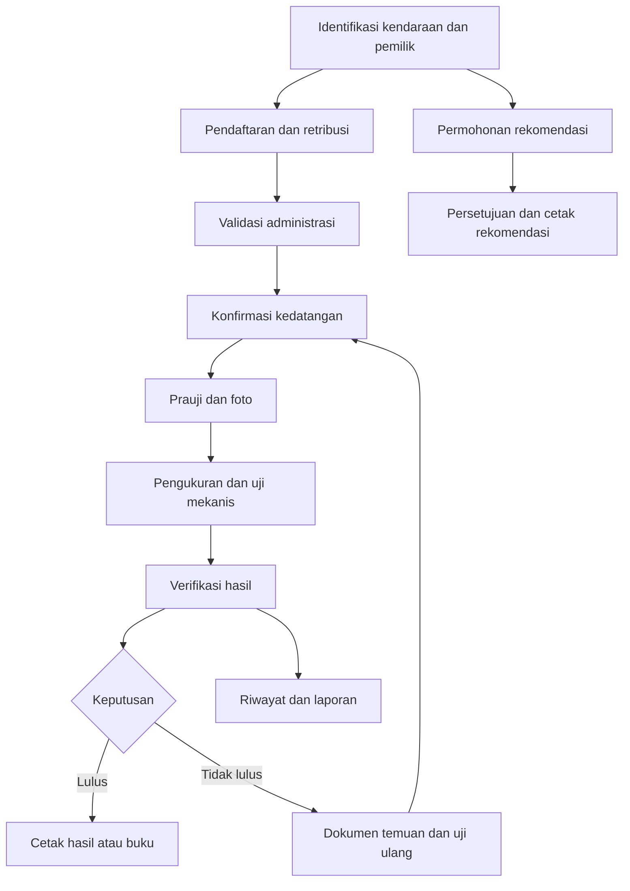

# PRD — Sistem Pengujian Kendaraan Bermotor (PKB SAMPANG)

> Tanggal analisis: 14 Oktober 2026. Metode: pemeriksaan statis repository; bukan hasil pengujian terhadap database/server produksi. **Terbukti** berarti ada implementasi di kode; **inferensi** berarti disimpulkan dari pemakaian; **rekomendasi** berarti perubahan yang belum diimplementasikan. Contoh data bersifat sintetis. Nilai kredensial sengaja tidak disalin.

Dokumen terkait: [PRD](PRD.md) · [Arsitektur](TECH_SPEC.md) · [Database](DATABASE_SCHEMA.md) · [Kontrak endpoint](API_CONTRACT.md) · [UI/UX](UI_UX_GUIDELINES.md).

**Daftar isi**

- [1. Ringkasan eksekutif dan visi](#1-ringkasan-eksekutif-dan-visi)
- [2. Ruang lingkup dan status](#2-ruang-lingkup-dan-status)
- [3. Pengguna dan hak akses](#3-pengguna-dan-hak-akses)
- [4. Katalog kebutuhan fungsional](#4-katalog-kebutuhan-fungsional)
- [5. Alur bisnis](#5-alur-bisnis)
- [6. Data penting dan aturan produk](#6-data-penting-dan-aturan-produk)
- [7. Kriteria penerimaan produksi yang diusulkan](#7-kriteria-penerimaan-produksi-yang-diusulkan)
- [8. Prioritas tindak lanjut](#8-prioritas-tindak-lanjut)

## 1. Ringkasan eksekutif dan visi

Aplikasi mendukung operasional pengujian kendaraan bermotor: identifikasi kendaraan dan pemilik, pendaftaran/retribusi, validasi, kedatangan, prauji, pengukuran dan pemeriksaan mekanis, penetapan hasil, pencetakan dokumen, riwayat, rekomendasi, serta pelaporan. Identitas aktif `PKB SAMPANG` berasal dari `protected/config/main.php`. Beberapa teks lama masih menyebut Surabaya, Wiyung, Tandes, Sampit, atau Jombang; ini adalah inkonsistensi implementasi, bukan bukti sistem multitenant.

Visi yang **diinferensikan**: menyediakan satu sumber data operasional kendaraan dan hasil uji untuk petugas, pimpinan, dan kanal informasi masyarakat. Repository memuat web dan backend Android; tidak ditemukan proyek aplikasi Android/iOS native, Flutter, atau React Native. Pengalaman pengguna mobile native tidak dapat direkonstruksi dari backend saja.

Dokumen ini merupakan baseline produk hasil reverse-engineering. Keberadaan fitur di kode belum membuktikan fitur berjalan di deployment aktual. Tarif, masa berlaku, ambang teknis, dan format dokumen harus disahkan pemilik proses; dokumen ini tidak menetapkan kepatuhan regulasi.

## 2. Ruang lingkup dan status

| Area | Bukti implementasi | Status/batasan |
|---|---|---|
| Operasional web | Modul `retribusi`, `loket`, `pengukuran`, `cis`, `pengujian` | Implementasi tersedia; sangat bergantung fungsi/view PostgreSQL yang DDL-nya tidak disertakan |
| Informasi mobile | Sembilan action `android/default` | JSON dan form POST campuran; autentikasi API tidak eksplisit |
| Dashboard | `site/home`, `ApiController` agregat retribusi | Ada kode agregasi; data aktual belum diverifikasi |
| Rekomendasi dan buku | `recommendation`, `retribusi/bukuuji` | Ada cetak, status persetujuan, nomor seri dan riwayat |
| Master eksternal | Action `api/api*` | Pemanggilan layanan Kemenhub; sebagian mengganti tabel master, sebagian hanya menampilkan data |
| Pembayaran | Alias `posting`, `paymentQr`, `inquiry`, `payment`, `reversal` | Action tujuan tidak ditemukan pada `SiteController`; bukan fitur pembayaran siap pakai |
| Kepuasan masyarakat | `ikm/default` | Pertanyaan bertahap dan penyimpanan tiga jawaban |
| Notifikasi | `site/runcron`, `site/runcronOri`, `recommendation/bukuuji/sendSms` | Ada kode integrasi; scheduler, kredensial valid, dan pengiriman sukses belum terbukti |
| Administrasi akses | Yii Rights dan pengelolaan `TblUser` pada `master/default` | Hak aktual tersimpan di DB; sebagian controller tidak mengaktifkan filter |

Di luar bukti repository: aplikasi mobile native, pembayaran end-to-end, registrasi akun masyarakat aktif, antrean job terkelola, SLA operasional, audit log yang lengkap, deployment otomatis, dan pemulihan bencana teruji.

## 3. Pengguna dan hak akses

### 3.1 Persona operasional

| Persona (pemetaan fungsi, bukan jaminan nama role DB) | Kebutuhan | Modul utama |
|---|---|---|
| Administrator | Kelola akun, penguji, master, assignment permission | `master`, `rights` |
| Petugas pendaftaran/retribusi | Cari kendaraan, daftar uji, tagihan, cetak bukti | `retribusi/default`, `retribusi/bukuuji` |
| Validator | Validasi/batalkan validasi transaksi | `retribusi/validasi` |
| Petugas loket | Cek terdaftar, konfirmasi kedatangan, jadwal ulang, uji ulang | `loket` |
| Penguji | Prauji, dimensi, emisi, pitlift, lampu, rem dan gandengan | `pengukuran`, `cis` |
| Verifikator/pencetak | Tinjau hasil, banding, cetak lulus/tidak lulus | `pengujian` |
| Pejabat persetujuan | Tinjau rekomendasi/buku; indikator Kasubag, Ka UPT, Kadis | `recommendation`; respons `statusRekom` |
| Pimpinan/pelaporan | Monitoring volume, kelulusan, retribusi, laporan tahunan/Kementerian | `report`, dashboard |
| Pengguna informasi mobile/kiosk | Cari kendaraan, hasil, riwayat, persyaratan; survei | `android`, `display`, `ikm` |

### 3.2 Mekanisme RBAC aktual

Login utama menggunakan `TblUser` dan `UserIdentity`, dilanjutkan `RWebUser` serta `RDbAuthManager`. Tabel konfigurasi: `authitem`, `authitemchild`, `authassignment`, `rights`. Nama superuser bawaan Rights adalah `Admin`; nama `Authenticated` juga tersedia di modul, tetapi konfigurasi `defaultRoles` tidak aktif. Daftar role operasional lengkap tidak bisa dipastikan tanpa isi tabel authorization.

`TblUser` menyimpan atribut `otoritas`, flag `prauji`, `emisi`, `pitlift`, `headlight`, `brake`, `gandengan`, dan `posisi_cis`. Ini berbeda dari assignment role. Menu disusun dari `tbl_menu` dan ekspresi `menu_condition`; visibilitas menu tidak menjamin otorisasi endpoint.

Controller yang mengaktifkan `filters() => array('Rights')` meminta pemeriksaan akses. Turunan `Controller`/`RController` tidak otomatis dilindungi. Inventaris per controller ada pada [API_CONTRACT.md](API_CONTRACT.md). `site/pkb` juga melakukan pengalihan khusus berdasarkan ID user 5 dan 11 ke validasi; ini merupakan coupling akun, bukan definisi role yang portabel.

**Target penerimaan akses (rekomendasi):** semua mutasi harus memvalidasi identitas dan izin server-side; identitas petugas diambil dari sesi, bukan field yang dapat diubah pengguna; akses informasi kendaraan disesuaikan kebutuhan dan kebijakan privasi.

## 4. Katalog kebutuhan fungsional

| ID | Kemampuan yang direkonstruksi | Input/hasil utama | Bukti |
|---|---|---|---|
| FR-01 | Login/logout dan perubahan password | `LoginForm`, sesi, form password | `SiteController`, `UserIdentity` |
| FR-02 | Pemeliharaan kendaraan dan buku | Identitas, pemilik, dimensi, jenis, master wilayah | `loket/EditbukuController` |
| FR-03 | Pendaftaran dan retribusi | `FORM[...]`, tanggal uji, jenis uji, scan | `retribusi/DefaultController::actionSaveform` |
| FR-04 | Validasi transaksi | `idRetribusi`, `kondisi`, petugas sesi | `retribusi/ValidasiController` |
| FR-05 | Kedatangan dan antrean | ID pendaftaran/kendaraan; pembuatan hasil awal | `loket/KedatanganController` |
| FR-06 | Penjadwalan/ulang uji | Ganti tanggal, kendaraan tidak lulus, daftar ulang | `TerdaftarController`, `UjiulangController` |
| FR-07 | Prauji dan foto | Daftar pemeriksaan, detail gagal, foto | `cis/PraujiController`, `pengukuran/PraujiController` |
| FR-08 | Pengukuran dan uji mekanis | Dimensi/beban, emisi, lampu, rem, pitlift | `pengukuran/PengukuranController`, modul `cis` |
| FR-09 | Banding/verifikasi | Perubahan status pemeriksaan | `pengujian/VerifikasiController`, `cis/PosisiController` |
| FR-10 | Dokumen hasil | Lulus, sementara, tidak lulus, kartu, BAP | `PrinthasilController`, `BapController`, `BapTlController` |
| FR-11 | Riwayat dan blokir | Pencarian no uji/no kendaraan; unblock | `pengujian/RiwayatController`, `BlokirController` |
| FR-12 | Rekomendasi | Mutasi/numpang keluar/ubah sifat; persetujuan/cetak | `recommendation/RekomController`, `BukuujiController` |
| FR-13 | Dashboard dan display | Status antrean/proses/hasil, total harian/bulanan | `site/home`, `display` |
| FR-14 | Pelaporan dan ekspor | Excel, PDF/HTML cetak; tahunan, retribusi, kelulusan | `report`, PHPExcel, mPDF |
| FR-15 | Informasi Android | Persyaratan, kendaraan, hasil/riwayat, status rekomendasi | `android/DefaultController` |
| FR-16 | Pendaftaran dari Android | `idKendaraan`, `tglUji`, biaya | `android/default/saveRetribusi`; VA respons tetap `0` |
| FR-17 | Master dan akun | CRUD penguji, user, merek, tipe, karoseri, bahan | `master/DefaultController` |
| FR-18 | Survei IKM | Pertanyaan aktif, pilihan A/B/C | `ikm/DefaultController` |

## 5. Alur bisnis

Diagram menggambarkan urutan operasional yang diinferensikan, bukan state machine yang menjamin seluruh transisi. Sebagian perubahan dilakukan melalui SQL langsung atau fungsi database; prasyarat antar tahap harus diverifikasi di database.

### 5.1 Pendaftaran → kedatangan

1. Petugas mencari kendaraan atau memperbarui identitas pada form buku.
2. `actionSaveform` menerima `FORM`, menormalisasi nomor kendaraan/pemilik, mengubah tanggal `d/m/Y` menjadi `m/d/Y`, dan memeriksa kombinasi jenis uji dengan keberadaan kendaraan.
3. Kode memeriksa transaksi berdasarkan `id_kendaraan`, `tgl_uji`, dan `id_uji=1`. Pemeriksaan ini belum membuktikan ada unique constraint atau perlindungan race condition.
4. Controller menyusun argumen string dipisahkan `~` lalu memanggil `insert_retribusi`. Rumus biaya dan seluruh efek fungsi tidak tersedia dalam repository.
5. Validasi mengubah `tbl_retribusi.validasi` dan `petugas_validasi`.
6. Kedatangan memecah `id` berbentuk `id_daftar-id_uji-id_kendaraan-id_retribusi`, memanggil `insert_hasil`, lalu memperbarui petugas di `tbl_proses`.

### 5.2 Pengujian → hasil → ulang

Setiap tahap menyimpan flag proses dan flag lulus. Backend Android `hasilUji` menampilkan `PROSES` sampai lima tahap (`prauji`, `smoke`, `pitlift`, `lampu`, `break`) selesai; sesudah itu hasil akhir memakai `hasil`. Istilah `break` adalah nama field kode untuk pemeriksaan rem dan harus dipertahankan dalam kontrak legacy.

`PengukuranController::actionSaveForm` menggabungkan beberapa tahap, membatasi input kuat lampu di atas 20 menjadi 20, dan mempunyai perlakuan khusus jenis 4/5. Beberapa tahap ditandai lulus otomatis. Action `reloadData` pada controller CIS tertentu membangkitkan angka acak. **Ketersediaan kode ini tidak membuktikan data berasal dari alat ukur**; validasi sumber data dan keputusan teknis menjadi prasyarat produksi.

Hasil dapat dicetak sebagai lulus, lulus sementara, tidak lulus, dan dokumen pemeriksaan. Jalur banding mengubah flag; belum terlihat ledger audit terpusat. Uji ulang ditangani modul loket. Aturan ambang, penghitungan masa berlaku, dan transisi final tidak boleh direka tanpa fungsi DB.

### 5.3 Rekomendasi dan informasi publik

Rekomendasi dibedakan dengan flag `mutke`, `numke`, `ubhsifat`; status persetujuan memakai `approve1/2/3` beserta tanggal. Respons mobile masih menggunakan teks lokasi lama. Riwayat mobile mengambil data terakhir berdasarkan ID/tanggal pada action tertentu; pencarian partial dapat cocok dengan lebih dari satu kendaraan sehingga bukan identifikasi unik.

### 5.4 Integrasi Android

Tidak ada alur login mobile khusus di modul Android. Client mengirim JSON untuk empat pencarian, form POST untuk detail/hasil/riwayat/pembuatan retribusi, serta endpoint total tanpa input. Respons tidak seragam, tanggal memakai nama bulan Inggris, dan nilai biaya dapat berupa string rupiah. Detail kontrak dan contoh ada pada [API_CONTRACT.md](API_CONTRACT.md).

## 6. Data penting dan aturan produk

| Data | Tujuan | Persyaratan target |
|---|---|---|
| Nomor uji dan nomor kendaraan | Identifikasi/pencarian | Normalisasi konsisten; bedakan pencarian dan identifikasi unik |
| Identitas pemilik, alamat, telepon | Administrasi dan notifikasi | Pembatasan akses, minimisasi respons, retensi disepakati |
| Hasil teknis dan foto | Bukti pemeriksaan | Sumber alat/operator, timestamp, jejak perubahan |
| Retribusi dan validasi | Rekonsiliasi administrasi | Perhitungan teruji, transaksi atomik, retry aman |
| Role dan menu | Akses fungsi | Satu sumber policy; jangan menjalankan ekspresi bebas dari tabel menu |
| Dokumen/nomor seri | Penerbitan hasil | Penomoran unik dan audit pencetakan ulang |

## 7. Kriteria penerimaan produksi yang diusulkan

- Satu kendaraan dapat melewati pendaftaran, kedatangan, pemeriksaan, verifikasi, cetak, dan riwayat dengan keterlacakan ID yang sama.
- Percobaan akses tanpa izin ditolak pada semua mutasi; perubahan password tidak dapat menyasar akun lain tanpa izin administratif.
- Data uji produksi berasal dari input terverifikasi; generator nilai acak tidak aktif dalam alur operasional.
- Pendaftaran ulang/retry tidak menciptakan transaksi atau nomor dokumen ganda; kegagalan tahap majemuk tidak meninggalkan status setengah selesai.
- Dokumen lulus/tidak lulus sesuai data tersimpan; hasil Android konsisten dengan web dan timestamp yang sama.
- Backup database mencakup fungsi, view, sequence, role/grant yang relevan, serta data foto/berkas; pemulihan dibuktikan di lingkungan terisolasi.
- Semua identitas instansi, alamat, manifest, dan format dokumen diseragamkan setelah konfirmasi pemilik produk.

Target latency, kapasitas harian, uptime, RPO/RTO, retensi, dan perangkat/browser yang didukung **belum ditetapkan oleh repository**. Tetapkan melalui persetujuan operasional dan pengukuran, bukan dianggap sebagai SLA existing.

## 8. Prioritas tindak lanjut

| Prioritas | Deliverable | Kriteria selesai |
|---|---|---|
| P0 | Snapshot skema PostgreSQL lengkap | Semua model/view/fungsi yang dipakai dapat dipulihkan di staging |
| P0 | Perbaikan autentikasi/otorisasi, SQL, secret, debug/Gii | Tidak ada bypass password, kredensial tertanam, atau mutasi publik yang tidak disetujui |
| P0 | Validasi integritas proses uji | Generator acak dan auto-pass dievaluasi; input/hasil dapat diaudit |
| P1 | Kontrak API konsisten dan validasi | Schema request/response, error, metode HTTP dan pagination teruji |
| P1 | Deployment reproducible dan compatibility | Runtime dipilih melalui uji; backup, rollback, observability tersedia |
| P2 | Responsivitas, aksesibilitas, konsistensi branding | Alur inti lulus pengujian viewport dan keyboard |

Prioritas tersebut adalah rekomendasi hasil analisis; tidak ada perubahan kode aplikasi yang dilakukan dalam pekerjaan dokumentasi ini.
