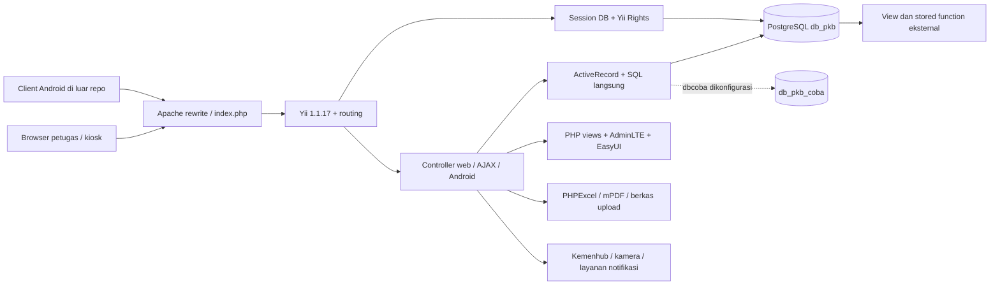

# Technical Specification — Arsitektur dan Operasional

> Tanggal analisis: 14 Oktober 2026. Metode: pemeriksaan statis repository; bukan hasil pengujian terhadap database/server produksi. **Terbukti** berarti ada implementasi di kode; **inferensi** berarti disimpulkan dari pemakaian; **rekomendasi** berarti perubahan yang belum diimplementasikan. Contoh data bersifat sintetis. Nilai kredensial sengaja tidak disalin.

> Implementasi deployment ditambahkan setelah analisis awal: lihat [panduan deployment](deploy/README.md) untuk runtime Composer/PHP 8.4, workflow, perubahan konfigurasi, dan batas pengujian terbaru. Uraian inventaris lama di bawah mencatat kondisi sebelum perubahan ini.

Dokumen terkait: [PRD](PRD.md) · [Arsitektur](TECH_SPEC.md) · [Database](DATABASE_SCHEMA.md) · [Kontrak endpoint](API_CONTRACT.md) · [UI/UX](UI_UX_GUIDELINES.md).

**Daftar isi**

- [1. Arsitektur sistem](#1-arsitektur-sistem)
- [2. Discovery dan entry point](#2-discovery-dan-entry-point)
- [3. Tech stack terverifikasi](#3-tech-stack-terverifikasi)
- [4. Konfigurasi dan secret](#4-konfigurasi-dan-secret)
- [5. Autentikasi dan keamanan](#5-autentikasi-dan-keamanan)
- [6. Integrasi eksternal dan operasi khusus](#6-integrasi-eksternal-dan-operasi-khusus)
- [7. Deployment guide berbasis gap yang ditemukan](#7-deployment-guide-berbasis-gap-yang-ditemukan)
- [8. Batas validasi dokumentasi](#8-batas-validasi-dokumentasi)

## 1. Arsitektur sistem

Sistem merupakan **modular monolith PHP berbasis MVC Yii 1**, dengan server-rendered web, endpoint AJAX, dan backend Android dalam proses aplikasi yang sama. Tidak ada pemisahan layanan web/mobile, broker antrean, atau lapisan repository/service terpusat yang terlihat. Controller menggabungkan parsing request, aturan bisnis, SQL/ActiveRecord, integrasi eksternal, dan rendering.

`db_pkb_coba` adalah komponen koneksi tambahan yang dikonfigurasi; keberadaannya tidak otomatis berarti semua operasi melakukan dual-write. `Outbox` dan `Coba` justru menunjuk `db_sms`, komponen yang tidak ditemukan di konfigurasi aktif.

## 2. Discovery dan entry point

| Lokasi | Peran |
|---|---|
| `index.php` | Bootstrap Yii dan `protected/config/main.php`; debug aktif |
| `.htaccess` | File/direktori existing dilayani langsung; request lainnya diteruskan ke `index.php` |
| `protected/config/` | Web, console, test dan koneksi database PHP |
| `protected/controllers/` | `SiteController`, `OtherController`, `ApiController` |
| `protected/components/` | Base controller, identity, menu, utilitas, multikoneksi, URL rule opsional |
| `protected/models/` | Model tabel operasional, model form |
| `protected/models/view/` | ActiveRecord atas objek `v_*`; definisi view SQL tidak disertakan |
| `protected/models/master/` | Master dari layanan eksternal |
| `protected/modules/` | Modul bisnis serta paket Rights/User |
| `protected/views/` | Tampilan umum, login, dashboard, layout fallback |
| `themes/adminlte/` | Tema aktif, Bootstrap, jQuery, EasyUI dan plugin |
| `themes/classic/` | Tema alternatif; tidak dipilih dalam konfigurasi aktif |
| `css/`, `js/`, `images/` | Aset global termasuk grafik, barcode/QR dan upload |
| `assets/` | Aset yang dipublikasikan Yii; bukan sumber utama untuk patch |
| `protected/runtime/` | Log/cache runtime, artefak Gii; perlu writable terbatas |
| `protected/data/` | Skema contoh dan database bawaan; bukan schema produksi lengkap |
| `protected/extensions/` | PHPExcel dan helper upload |
| `protected/vendors/mpdf/` | Library PDF yang dibundel |
| `protected/yiic`, `protected/yiic.php` | Entry point console Yii |
| `yii/framework/` | Framework vendored, versi 1.1.17 |
| `yii/demos/`, `yii/requirements/` | Contoh dan pemeriksa persyaratan Yii; bukan modul produk |

Tidak ditemukan manifest Composer di root, `.env.example`, konfigurasi Docker Compose, pipeline CI root, atau migrasi lengkap domain PKB. `themes/adminlte/package.json` adalah metadata/build tooling tema, bukan backend Node atau SPA aplikasi. Test di `yii/demos` menguji contoh framework, bukan workflow PKB.

### 2.1 Modul aktif dan inkonsistensi

`main.php` mendaftarkan `android`, `capture`, `recommendation`, `report`, `loket`, `retribusi`, `ikm`, `pengujian`, `pengukuran`, `display`, `cis`, `va`, `master`, `gii`, dan `rights`. Direktori modul `va` tidak tersedia. Direktori `user` dan `employee` tersedia tetapi tidak didaftarkan. Fitur login aktif menggunakan controller utama, bukan otomatis Yii User.

Dua entri key kosong pada `urlManager.rules` membuat mapping terakhir (`site/home/`) menggantikan `site/index`. Alias pembayaran menunjuk action yang tidak ditemukan. `errorHandler` menunjuk `site/error` ketika debug dimatikan, tetapi `actionError` tidak ditemukan; perbaiki penanganan error sebelum sekadar menonaktifkan debug. Detail alias dan semua action terdapat pada [API_CONTRACT.md](API_CONTRACT.md).

## 3. Tech stack terverifikasi

| Lapisan | Komponen/bukti | Catatan |
|---|---|---|
| Bahasa/server aplikasi | PHP; kode aplikasi memakai fitur lintas generasi | Versi produksi tidak dideklarasikan |
| Framework | Yii **1.1.17**, `yii/framework/YiiBase.php::getVersion` | Framework disimpan dalam repo |
| ORM | `CActiveRecord`, `CDbCriteria`, `CDbCommand` | Banyak query raw dan pemanggilan stored function |
| Database aktif | PostgreSQL, DSN `pgsql`, port 5432, charset utf8 | MySQL config tersedia tetapi tidak diaktifkan |
| Session | `CDbHttpSession`, `connectionID=db`, timeout 7200 detik | Tabel default `YiiSession`; auto-create aktif |
| Authorization | Yii Rights **1.3.0** | Filter harus diaktifkan per controller |
| UI | AdminLTE **2.3.0**, Bootstrap **3.3.5** | Bukti package.json tema dan header CSS |
| Interaksi | jQuery **1.9.1** dimuat layout utama; EasyUI datagrid | Versi jQuery lain juga dibundel/dimuat pada layout tertentu |
| Grafik | Highcharts, exporting script | Bukan bukti semua plugin tema dipakai |
| Ekspor | PHPExcel; mPDF **6.0** | Dependensi vendored; kompatibilitas runtime perlu diuji |
| Upload/gambar | FileUploader, GD (`imagejpeg`, resize), base64 | Beberapa foto/scan disimpan pada field DB |
| HTTP eksternal | cURL dan `file_get_contents` | Parameter koneksi tersebar pada controller |
| Cache/log | CFileLogRoute error/warning; aset/runtime Yii | Tidak ada Redis/Memcached atau cache aplikasi yang dikonfigurasi |
| Web server | Rewrite Apache dari `.htaccess` | Server aktual belum diverifikasi |

Ekstensi yang harus diperiksa sesuai jalur fitur: PDO dan `pdo_pgsql`, cURL, GD, mbstring, XML/DOM/SimpleXML, ZIP/zlib, calendar (`cal_days_in_month`), dan dukungan session. Jangan menganggap PHP CLI yang tersedia sama dengan PHP-FPM/Apache produksi.

## 4. Konfigurasi dan secret

| Parameter | Lokasi | Makna/status |
|---|---|---|
| `YII_DEBUG`, `YII_TRACE_LEVEL` | `index.php` | Saat ini true dan 3 |
| `timeZone` | `main.php` | `Asia/Jakarta` |
| `name`, `namaAplikasi` | `main.php` | Identitas PKB SAMPANG |
| `tahunGrafik` | `main.php` | Tahun saat runtime dikurangi dua |
| `db` | `database.php` | PostgreSQL utama `db_pkb` |
| `dbcoba` | `database_coba.php` | PostgreSQL tambahan `db_pkb_coba` |
| `db_mysql` | Baris nonaktif pada `main.php` | Bukan koneksi default |
| `session.timeout` | `main.php` | 7200 detik; remember-me berbeda |
| `allowAutoLogin` | `main.php` | Cookie-based login diaktifkan |
| `authManager` | `main.php` | Nama tabel RBAC lowercase |
| `tokenApi`, `urlApi` | `main.php` | Token dan URL layanan Kemenhub; secret tertanam |
| `passwordBayangan` | `main.php` dan `UserIdentity` | Password alternatif universal untuk akun yang ada |
| Gii | `main.php` | Aktif, password tertanam, filter IP memuat wildcard `*` |

Tidak ada pemuatan `.env` otomatis yang ditemukan. Menambahkan file `.env` saja tidak mengubah konfigurasi aplikasi. **Rekomendasi implementasi terpisah:** gunakan `getenv` atau secret injection pada konfigurasi, misalnya `PKB_DB_HOST`, `PKB_DB_PORT`, `PKB_DB_NAME`, `PKB_DB_USER`, `PKB_DB_PASSWORD`, `PKB_KEMENHUB_URL`, `PKB_KEMENHUB_TOKEN`; nama ini adalah rancangan, belum dibaca kode sekarang. Password bayangan harus dihapus dari mekanisme autentikasi, bukan sekadar dipindah ke environment.

## 5. Autentikasi dan keamanan

### 5.1 Jalur sesi aktual

1. `site/login` menerima `LoginForm[username]`, `LoginForm[password]`, optional `rememberMe`; AJAX validation memakai `ajax=login-form`.
2. `LoginForm` memeriksa required, boolean remember-me, dan identity.
3. `UserIdentity` mencari username case-insensitive. Password diperiksa sebagai MD5 **atau** sama dengan password bayangan dari config.
4. Login menyimpan ID `id_user`, session `employee_name` (berisi `otoritas`) dan `username`.
5. Remember-me memberi durasi 30 hari; tanpa remember-me durasi login 0. Ini berbeda dari timeout session DB dua jam.
6. `site/pkb` melakukan redirect berdasarkan identitas; logout mengakhiri login lalu kembali ke `/pkb`.

Tidak ditemukan JWT, Sanctum, OAuth server, refresh-token, atau token middleware pada backend Android. Token Kemenhub adalah kredensial **outbound**, bukan mekanisme autentikasi request masuk.

### 5.2 Temuan yang memengaruhi kesiapan produksi

| Prioritas | Bukti | Dampak dan tindakan yang direkomendasikan |
|---|---|---|
| P0 | Password bayangan dan MD5 di `UserIdentity` | Hapus bypass; migrasikan hash password dengan mekanisme verifikasi/rehash yang diuji |
| P0 | `site/changePassword` memakai ID dari POST; tanpa filter controller | Terapkan izin terhadap akun target, validasi password lama/administratif, dan logging; sekarang password baru juga di-lowercase sebelum MD5 |
| P0 | `ApiController`/Android dan beberapa mutasi tanpa filter | Inventarisasi eksposur; tutup mutasi/sinkronisasi dari pengguna tanpa izin |
| P0 | `AuthItemController` mempunyai `accessRules` tetapi `filters` dikomentari | Definisi rules saja tidak menjalankannya; verifikasi dan perbaiki akses manajemen role |
| P0 | Query interpolasi di pencarian, sort/order, update dan stored-function arguments | Gunakan binding nilai, whitelist kolom sorting, validasi tipe/range |
| P0 | Secret DB, kamera, token integrasi di source | Rotasi secret terkait dan keluarkan dari source; jangan salin ke log/dokumentasi |
| P0 | Debug aktif, Gii terbuka wildcard | Batasi developer tooling, matikan debug setelah error handler valid |
| P0 | `reloadData` CIS menghasilkan `rand`/`random`; beberapa auto-pass | Pisahkan simulasi dari operasional dan audit integritas hasil |
| P1 | CSRF/cookie validation tidak diset di main; default framework false | Rancang proteksi form/session dan token AJAX; tetapkan Secure/HttpOnly/SameSite sesuai arsitektur |
| P1 | `eval(menu_condition)` dan business rules | Ganti policy ekspresi bebas dengan permission terstruktur; batasi akses tabel policy |
| P1 | Sinkronisasi master TRUNCATE kemudian INSERT | Staging import, validasi payload, transaksi/rollback, concurrency lock |
| P1 | Upload dan ekspor | Batas ukuran/MIME, nama aman, non-executable storage, izin ekspor dan sanitasi sel spreadsheet |
| P1 | Data kendaraan/foto di respons tanpa access gate eksplisit | Sesuaikan field publik, kontrol akses objek, rate limit dan audit akses |

Ini temuan statis, bukan hasil penetration test atau bukti eksploitasi. Jangan menafsirkan pembatasan menu sebagai pembatasan akses jaringan.

## 6. Integrasi eksternal dan operasi khusus

- **Kemenhub:** URL yang dikonfigurasi `https://ujiberkala-middle.kemenhub.go.id/api/v1/global`; body outbound `{token, prefix}`. Sebagian action mengganti tabel master; sebagian menampilkan `var_export`. Keaktifan/versi layanan eksternal tidak diuji.
- **Kamera:** modul `capture` dan prauji menggunakan HTTP kamera lokal serta base64. `capture/default/index` memiliki kode sesudah `exit()` yang tidak terjangkau. Jangan menganggap snapshot path/network/kredensial masih benar.
- **Notifikasi WhatsApp:** `site/runcron` memuat cURL ke Qontak, sedangkan `site/runcronOri` mempunyai pengiriman aktif ke Fonnte dengan penerima dan pesan contoh yang tertanam. Pada `runcron`, `$no_hp` diinisialisasi kosong dan kondisi memakai variabel itu sebelum diisi, sehingga alur kirim tampak tidak tercapai. Ada parameter penerima/template yang tertanam. Jadwal sistem tidak disertakan.
- **SMS:** `Outbox` membutuhkan `db_sms`, yang tidak dikonfigurasi. Status fitur belum operasional hanya dengan checkout ini.
- **Pembayaran:** alias route ada tetapi action tidak ada; blok QRIS pada Android berupa komentar. Jangan mengonfigurasi callback bank sebelum implementasi dan kontrak diverifikasi.
- **Upload:** `/downloadsfile/` dipakai controller dan belum ada pada checkout; direktori harus disediakan sesuai kebijakan penyimpanan. Nilai gambar dapat masuk DB, sehingga backup file saja tidak cukup.

## 7. Deployment guide berbasis gap yang ditemukan

### 7.1 Prasyarat dan gate

Checkout ini **belum dapat direkonstruksi sebagai layanan produksi hanya dengan import `schema.mysql.sql`**. Dapatkan dump PostgreSQL yang mencakup tabel, view, function/procedure, sequence, index, constraint, extension dan grants yang relevan; isi master, menu dan role juga diperlukan. Gunakan data staging yang disanitasi.

Pilih versi PHP/database melalui pengujian kompatibilitas. Tidak ada matriks versi yang dijamin repo. `MultiActiveRecord` masih memakai `create_function` dan `CustomUrlRule` memakai mcrypt; konfigurasi aktif tidak memasang CustomUrlRule. Library lama serta kode lebih baru dalam aplikasi membuat pemasangan runtime berdasarkan umur framework saja tidak memadai. Jangan menurunkan standar keamanan runtime untuk membuat aplikasi tampak berjalan.

### 7.2 Urutan pemasangan staging

1. Siapkan direktori release dan cadangan konfigurasi di luar webroot. Jangan mengubah database produksi untuk uji instalasi.
2. Siapkan PHP runtime beserta ekstensi, PostgreSQL dan server web. Verifikasi `php -v` dan `php -m` pada runtime yang benar.
3. Pulihkan snapshot DB lengkap ke instance staging. Cocokkan objek terhadap [DATABASE_SCHEMA.md](DATABASE_SCHEMA.md); periksa fungsi bisnis sebelum endpoint mutasi diuji.
4. Atur konfigurasi `db`, koneksi tambahan yang benar-benar digunakan, URL/token integrasi sandbox, timezone dan nama instansi. Nonaktifkan pengiriman eksternal selama uji.
5. Konfigurasikan rewrite; document root saat ini adalah root proyek. Batasi akses `.git`, `protected`, paket demo/requirements dan berkas internal. Pada Apache pastikan aturan deny `protected/.htaccess` benar-benar diberlakukan; pada Nginx aturan tersebut harus diterjemahkan eksplisit.
6. Berikan izin tulis hanya pada `assets/`, `protected/runtime/`, dan direktori upload/temp yang diperlukan. Hindari writable untuk semua source. Untuk produksi, pre-create session table dan evaluasi mematikan auto-create agar user runtime tidak memerlukan DDL.
7. Perbaiki error handler, debug/Gii, autentikasi/otorisasi dan temuan P0. Dokumen ini tidak mengimplementasikan perbaikannya.
8. Jalankan smoke test pada daftar di bawah; gunakan browser untuk verifikasi aset/cetak. Aktifkan integrasi satu per satu dengan data uji dan persetujuan pemilik layanan.
9. Setelah lulus, lakukan deployment terkontrol dengan backup, rencana rollback aplikasi serta rollback data yang memperhitungkan transaksi baru.

Contoh konfigurasi reverse proxy/web server harus menyesuaikan deployment aktual. Jangan menyalin endpoint callback yang tidak memiliki implementasi. Repo tidak menyediakan image container, health endpoint, atau migrasi otomatis yang dapat diasumsikan aman untuk dijalankan.

### 7.3 Smoke test penerimaan

| Area | Pemeriksaan wajib |
|---|---|
| Boot | `/pkb` menampilkan login; aset 200; root/dashboard sesuai otorisasi yang disepakati |
| Session | Login, logout, expiry, remember-me, role berbeda dan akses langsung route |
| Data | Cari kendaraan, input invalid, entitas tidak ditemukan, parameter tanggal/sort |
| Workflow | Satu siklus daftar → validasi → datang → uji → cetak → riwayat; satu skenario tidak lulus/ulang |
| Atomicity | Gagal pada langkah tengah, retry request, double submit, pembaruan bersamaan |
| Ekspor | Excel/PDF dapat dibuka, identitas dan perhitungan sesuai, format cetak A4/printer aktual |
| Android | Sembilan endpoint, JSON vs form, empty result, tipe boolean/angka, gambar |
| Security | Tanpa sesi, izin salah, CSRF, update akun lain, input SQL, Gii, akses source |
| Restore | Pulihkan DB + storage lalu ulangi workflow inti |

### 7.4 Observability, backup dan rollback

CFileLogRoute menulis error/warning ke runtime; belum ada request ID, metrik, tracing, atau alarm yang dikonfigurasi. Rekomendasi: ukur error rate, latency per route, query lambat, DB connection/session growth, disk runtime/upload, kegagalan export dan integrasi; jangan log secret, password atau seluruh data pribadi.

Backup harus konsisten antara data transaksi, foto base64 di DB, dan file pendukung. Tetapkan jadwal, retensi, enkripsi, RPO/RTO dan uji restore bersama operasional. Rollback release tidak otomatis membatalkan mutasi data; gunakan strategi pemulihan yang menjaga transaksi sah setelah deployment. Sinkronisasi master yang memakai TRUNCATE memerlukan perlindungan tambahan sebelum diotomasi.

## 8. Batas validasi dokumentasi

Analisis dilakukan tanpa menyambung ke database, kamera, bank, Kemenhub atau layanan pesan. Tidak ada endpoint mutasi yang dipanggil. Inventaris kode mengabaikan komentar PHP agar action yang dikomentari tidak dianggap aktif. Lihat lampiran endpoint untuk 74 controller dan model untuk seluruh 130 file model yang diperiksa. Angka inventaris mencakup paket `user` yang tidak aktif; bukan jumlah route produksi yang pasti dapat diakses.
